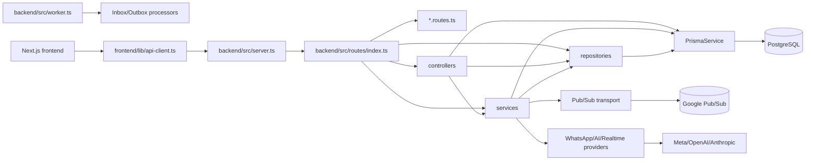
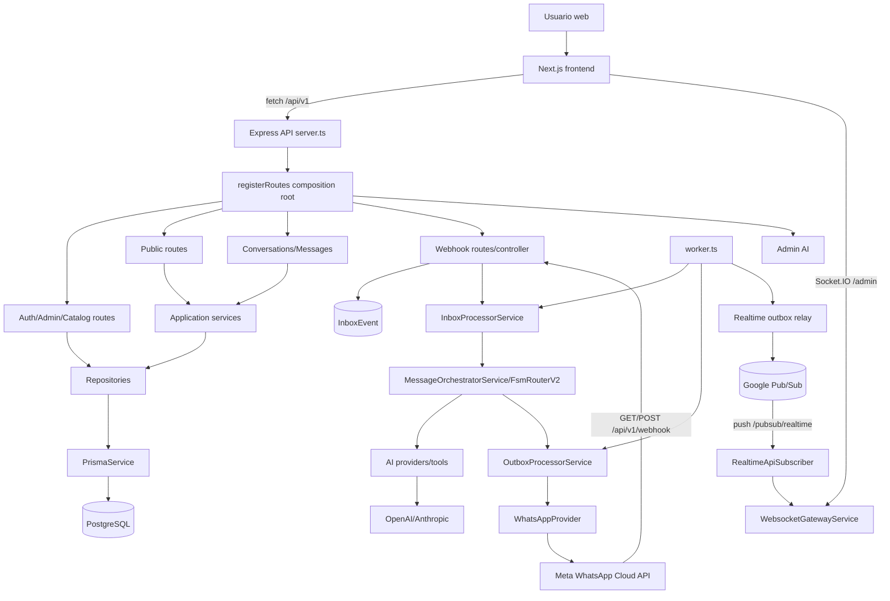
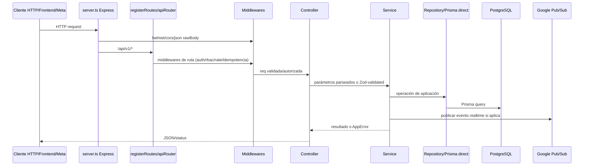
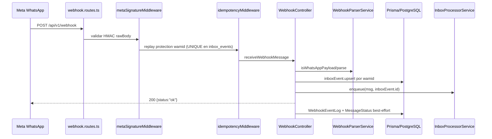
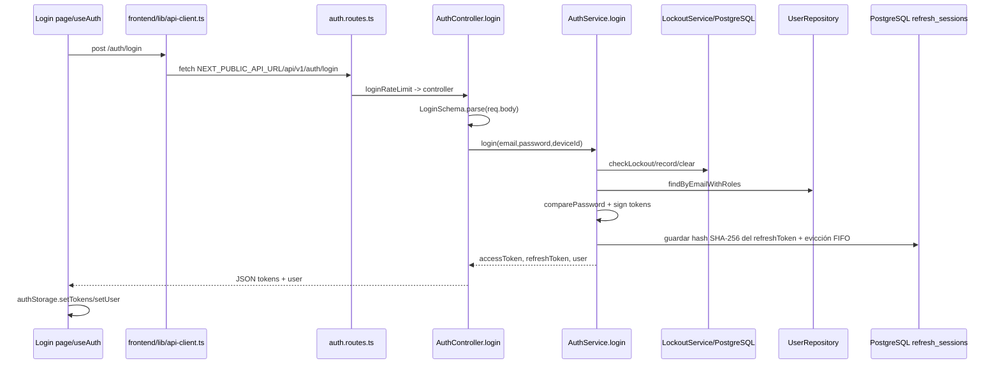
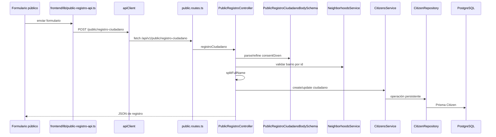

# Arquitectura del Proyecto Nexo Comercial

## 1. Propósito del documento

Este documento describe la arquitectura **real observada en el código** de Nexo Comercial para que una persona desarrolladora nueva pueda seguir peticiones, datos, dependencias, persistencia e integraciones sin asumir patrones por nombres de carpetas.

- **Alcance:** repositorio completo: backend Express/TypeScript, worker, frontend Next.js, Prisma/PostgreSQL, Google Pub/Sub, Docker/CI y documentación existente.
- **Metodología:** inventario de estructura, lectura de `package.json`, entrypoints, rutas, controladores, servicios, repositorios, middlewares, Prisma schema, clientes frontend, Docker y workflows. Las conclusiones se clasifican como **Confirmado**, **Inferido** o **No determinado**.
- **Limitación:** no se ejecutó la aplicación completa ni se validaron integraciones externas con credenciales reales; el análisis se basa en código y configuración versionada.
- **Fecha del análisis:** 2026-07-09.
- **Rama Git analizada:** `work`.
- **Commit analizado:** `8492459787e9b95695f71e9f4022713179eda823`.

## 2. Resumen ejecutivo

**Confirmado.** Nexo Comercial es un sistema web con:

1. **Backend API HTTP REST** en Express/TypeScript, iniciado desde `backend/src/server.ts`, que monta middlewares globales, Swagger, rutas bajo `/api/v1`, healthchecks y WebSocket opcional. Evidencia: `server.ts` crea `express()`, instancia `PrismaService`, registra `registerRoutes(app, { prisma, realtimeTransport })`, agrega `errorHandler` y escucha en `env.PORT` (`backend/src/server.ts`).
2. **Worker background** en `backend/src/worker.ts` que procesa inbox/outbox sobre PostgreSQL (polling de `inbox_events`/`outbox_events` o invocado por Cloud Tasks en producción), healthcheck `/healthz` y relay realtime durable. Evidencia: instancia `InboxProcessorService`, `OutboxProcessorService`, arranca `.start()` si `WORKERS_ENABLED` y expone `healthServer` (`backend/src/worker.ts`).
3. **Frontend Next.js/React** en `frontend/app`, `frontend/hooks` y `frontend/lib`, con App Router, llamadas HTTP mediante `frontend/lib/api-client.ts`, estado de auth en `frontend/hooks/useAuth.ts` y WebSocket admin mediante Socket.IO client (`frontend/package.json`, `frontend/app/layout.tsx`, `frontend/lib/api-client.ts:12`, `frontend/lib/api-client.ts:73`, `frontend/hooks/useAuth.ts:212`, `frontend/lib/realtime/realtime-manager.ts:83`).
4. **Persistencia principal PostgreSQL vía Prisma**. Evidencia: `backend/prisma/schema.prisma` declara `datasource db` PostgreSQL con `DATABASE_URL`; `PrismaService` extiende `PrismaClient`; repositorios reciben `PrismaService` y llaman modelos Prisma (`backend/prisma/schema.prisma:5`, `backend/prisma/schema.prisma:7`, `backend/src/services/prisma.service.ts:7`, `backend/src/routes/index.ts:86-97`).
5. **PostgreSQL + Google Pub/Sub** para sesiones, lockout, rate limit, idempotencia, background y realtime. Evidencia: `AuthService` persiste refresh sessions en `refresh_sessions`; `PostgresRateLimiter`/`LockoutService` usan `rate_limit_counters`/`identity_lockouts`; el bus realtime publica en los topics `realtime-events`/`ai-stream` (`backend/src/services/auth.service.ts`, `backend/src/services/postgres-rate-limiter.service.ts`, `backend/src/services/realtime/pubsub-realtime-transport.service.ts`, `backend/src/services/realtime/ai-stream-pubsub.service.ts`).
6. **Integraciones externas confirmadas:** Meta WhatsApp Cloud API/Graph API, OpenAI SDK/proveedor LLM opcional, Anthropic provider opcional por import/implementación, WebSocket Socket.IO, Swagger UI. Evidencia: `WhatsAppProvider` usa `fetch` contra URLs de Meta (`backend/src/config/meta.config.ts:5`, `backend/src/services/whatsapp/whatsapp.provider.ts:104`); dependencias incluyen `openai` y proveedores AI (`backend/package.json`, `backend/src/ai/providers/openai.provider.ts`, `backend/src/ai/providers/anthropic.provider.ts`).

**Arquitectura predominante inferida:** monorepo con dos aplicaciones principales (`backend`, `frontend`) y un proceso worker. Dentro del backend predomina una estructura procedural/manual: `server.ts` como bootstrap, `routes/index.ts` como composition root manual, rutas Express que invocan controladores, controladores que delegan en servicios y servicios que usan repositorios o infraestructura. Esta etiqueta es **inferida**, no declarada por un framework de arquitectura; se sostiene por el wiring manual y los imports reales en `backend/src/routes/index.ts`.

## 3. Stack tecnológico verificado

| Categoría | Tecnología | Uso | Evidencia |
| --------- | ---------- | --- | --------- |
| Monorepo JS | pnpm workspace | Scripts raíz delegan a backend/frontend | `package.json`, `pnpm-workspace.yaml` |
| Backend HTTP | Node.js + Express 4 | API REST, middlewares, rutas | `backend/package.json`, `backend/src/server.ts:17-18`, `backend/src/routes/index.ts:79` |
| Backend lenguaje | TypeScript | Código fuente backend | `backend/tsconfig.json`, `backend/package.json` |
| ORM | Prisma Client 5.22 | Acceso a PostgreSQL | `backend/package.json`, `backend/prisma/schema.prisma:1-8`, `backend/src/services/prisma.service.ts:7` |
| Base de datos | PostgreSQL | Persistencia relacional | `backend/prisma/schema.prisma:5-8`, `docker-compose.dev.yml` |
| Background | PostgreSQL (Prisma) + polling/Cloud Tasks | Procesamiento de inbox/outbox desde `inbox_events`/`outbox_events` | `backend/src/services/events/inbox-processor.service.ts`, `backend/src/services/events/outbox-processor.service.ts`, `backend/src/config/env.config.ts` |
| Auth | JWT + bcryptjs | Access/refresh tokens, hash passwords | `backend/package.json`, `backend/src/services/auth.service.ts:20-28`, `backend/src/utils/password.util.ts` |
| Validación backend | Zod | Schemas de entrada | `backend/package.json`, `backend/src/controllers/public-registro.controller.ts:3`, `backend/src/services/auth.schemas.ts` |
| Seguridad HTTP | helmet, cors | Headers y CORS global | `backend/package.json`, `backend/src/server.ts:57-75` |
| Realtime | Socket.IO + Google Pub/Sub | WebSocket admin; eventos durables relayados por Pub/Sub vía push subscriptions | `backend/src/services/realtime/pubsub-realtime-transport.service.ts`, `backend/src/services/realtime/websocket-gateway.service.ts`, `frontend/lib/realtime/realtime-manager.ts` |
| AI/LLM | OpenAI SDK, proveedor Anthropic | Orquestación AI y herramientas | `backend/package.json`, `backend/src/ai/providers/openai.provider.ts`, `backend/src/ai/providers/anthropic.provider.ts` |
| Frontend | Next.js 16 + React 19 | App Router y UI | `frontend/package.json`, `frontend/app/layout.tsx` |
| Frontend estado | React hooks + Zustand | Auth/hooks y stores de conexión/notificaciones | `frontend/hooks/useAuth.ts`, `frontend/stores/use-connection-store.ts` |
| Testing backend | Jest + Supertest | Pruebas unit/integration | `backend/package.json`, `backend/src/__tests__` |
| Testing frontend | Vitest + Testing Library | Pruebas frontend | `frontend/package.json`, `frontend/test/setup.ts` |
| Contenedores | Docker Compose | postgres, api, worker, realtime-relay, frontend (+ Pub/Sub emulator en dev) | `docker-compose.dev.yml`, `docker-compose.prod.yml` |
| CI | GitHub Actions | quality/backend-ci | `.github/workflows/backend-ci.yml`, `.github/workflows/quality.yml` |

## 4. Vista general del repositorio

```text
nexo-comercial/
├── backend/
│   ├── prisma/                 # schema, migraciones y seeds
│   ├── src/
│   │   ├── server.ts           # entrypoint API
│   │   ├── worker.ts           # entrypoint worker
│   │   ├── routes/             # registro de rutas y composition root manual
│   │   ├── controllers/        # adaptadores HTTP Express
│   │   ├── services/           # lógica de aplicación, colas, realtime, WhatsApp
│   │   ├── repositories/       # acceso Prisma por agregado/feature
│   │   ├── middlewares/        # auth, RBAC, rate limit, validation, errores
│   │   ├── ai/                 # orquestación LLM, tools, FSM AI
│   │   ├── config/             # env, swagger, WhatsApp/Meta config
│   │   └── utils/              # errores, tokens, logging, parsers
│   └── Dockerfile
├── frontend/
│   ├── app/                    # Next.js App Router
│   ├── hooks/                  # hooks de datos/autenticación
│   ├── lib/                    # clientes API, auth storage, realtime
│   ├── stores/                 # stores Zustand
│   └── Dockerfile
├── docs/                       # documentación técnica existente y este documento
├── deploy/                     # Caddyfile
├── postman/                    # colección Postman
├── docker-compose*.yml         # desarrollo/producción
├── .github/workflows/          # CI
└── package.json                # scripts raíz
```

## 5. Arquitectura identificada

### Patrón predominante

**Inferido:** backend organizado como API monolítica con worker separado y wiring manual. La secuencia observable es:

`server.ts` → `registerRoutes` → routers Express → controllers → services → repositories/infraestructura → Prisma/Google Pub/Sub/Meta.

Evidencia: `server.ts` instancia `PrismaService` y llama `registerRoutes` (`backend/src/server.ts`). `registerRoutes` construye repositorios, servicios y controladores con `new` y monta routers (`backend/src/routes/index.ts`).

### Patrones secundarios confirmados/inferidos

- **Repository pattern parcial (Confirmado por estructura e imports):** repositorios como `CitizenRepository`, `MessageRepository`, `ConversationRepository` encapsulan muchas llamadas Prisma, y servicios los consumen (`backend/src/routes/index.ts:86-97`, `backend/src/routes/index.ts:167-193`). No es universal porque algunos controladores/servicios también reciben `PrismaService` y hacen consultas directas, por ejemplo `WebhookController.persistInboundMessages` usa `this.prisma.inboxEvent.upsert` (`backend/src/controllers/webhook.controller.ts:103-120`).
- **Composition root manual (Confirmado):** `backend/src/routes/index.ts` selecciona implementaciones y resuelve dependencias con constructores (`backend/src/routes/index.ts:79-229`). No hay contenedor DI declarado.
- **Worker + procesamiento de inbox/outbox sobre PostgreSQL (Confirmado):** `InboxProcessorService` y `OutboxProcessorService` reclaman lotes directo de `inbox_events`/`outbox_events`; en producción Cloud Tasks los invoca por HTTP (`BACKGROUND_EXECUTION_BACKEND=cloud_tasks`) y en local el polling los arranca desde API o worker según `WORKERS_ENABLED` (`backend/src/services/events/inbox-processor.service.ts`, `backend/src/services/events/outbox-processor.service.ts`, `backend/src/routes/index.ts`, `backend/src/worker.ts`).
- **Frontend separado que consume API REST (Confirmado):** `apiClient` arma URLs con `NEXT_PUBLIC_API_URL` + `/api/v1` y hace `fetch` (`frontend/lib/api-client.ts:12`, `frontend/lib/api-client.ts:73`).

### Desviaciones

- La capa de servicios no está aislada de infraestructura: servicios reciben `PrismaService`, providers de WhatsApp/Pub/Sub y algunos usan Prisma directamente (`backend/src/routes/index.ts`, `backend/src/services/auth.service.ts`).
- Hay lógica operacional en `routes/index.ts`: además de registrar rutas, crea colas y puede iniciar workers en el proceso API (`backend/src/routes/index.ts:148-160`).

## 6. Módulos principales

| Módulo | Responsabilidad | Dependencias | Consumidores | Evidencia |
| ------ | --------------- | ------------ | ------------ | --------- |
| Bootstrap API | Crear Express, middlewares, Swagger, realtime, rutas | env, PrismaService, Pub/Sub transport, routes, WebSocket | proceso Node `start` | `backend/src/server.ts` |
| Composition/routing | Instanciar dependencias y montar `/api/v1` | repositorios, servicios, controllers, routers | `server.ts` | `backend/src/routes/index.ts:79-229`, `backend/src/routes/index.ts:271` |
| Auth/admin | Login, refresh, logout, roles, refresh sessions en PostgreSQL | UserRepository, PrismaService, LockoutService, JWT | rutas `/auth`, frontend `useAuth` | `backend/src/routes/auth.routes.ts`, `backend/src/services/auth.service.ts`, `frontend/hooks/useAuth.ts` |
| Ciudadanos/catálogos | CRUD ciudadanos, barrios, tags | repositorios Prisma | admin routes, public registro, AI tools | `backend/src/routes/index.ts:91-105`, `backend/src/routes/citizens.routes.ts:22-33` |
| Conversaciones/mensajes | Conversaciones, handover, mensajes outbound/inbound | ConversationRepository, MessageRepository, state machine, WhatsApp/outbox | admin UI, webhook/worker | `backend/src/routes/conversations.routes.ts:13-40`, `backend/src/services/message.service.ts`, `backend/src/services/orchestrator/message-orchestrator.service.ts:75-220` |
| Webhook WhatsApp | Verificar y recibir payloads Meta | WebhookParser, Prisma, InboxProcessor, MessageRepository | Meta Graph webhook | `backend/src/routes/webhook.routes.ts:24-43`, `backend/src/controllers/webhook.controller.ts:61-120` |
| Colas/worker | Procesar inbox/outbox desde `inbox_events`/`outbox_events` y reintentos | InboxProcessorService/OutboxProcessorService, PostgreSQL, WhatsAppProvider, orchestrator | API process o worker process | `backend/src/worker.ts`, `backend/src/services/events/inbox-processor.service.ts`, `backend/src/services/events/outbox-processor.service.ts` |
| AI orchestration | FSM v2, agentes, tools, proveedores LLM | Prisma, OpenAI/Anthropic providers, tools | MessageOrchestrator/FsmRouter/Admin AI | `backend/src/ai/fsm/fsm-router-v2.ts`, `backend/src/ai/providers/openai.provider.ts`, `backend/src/routes/admin-ai.routes.ts` |
| Realtime | Gateway Socket.IO, Pub/Sub durable, outbox relay | Google Pub/Sub (topics `realtime-events`/`ai-stream`), Socket.IO, RealtimeOutboxEvent | API, worker, frontend admin | `backend/src/services/realtime`, `frontend/lib/realtime/realtime-manager.ts` |
| Frontend admin/public | UI, auth, dashboards, formularios públicos | Next App Router, apiClient, hooks, stores | usuarios web | `frontend/app`, `frontend/hooks`, `frontend/lib/api-client.ts:73` |

## 7. Capas y responsabilidades

| Capa real | Responsabilidad | Puede depender de | Es consumida por | Evidencia |
| --------- | --------------- | ----------------- | ---------------- | --------- |
| Entrypoints de proceso | Arranque API/worker, conexión a infra, shutdown | config, services, routes | Node runtime/Docker | `backend/src/server.ts`, `backend/src/worker.ts` |
| Rutas Express | Definir paths y middlewares por endpoint | controllers, auth/rbac/rate-limit middlewares | Express app | `backend/src/routes/*.routes.ts`, `backend/src/routes/index.ts` |
| Controllers | Adaptar HTTP a servicios, parsear req/res, manejar next | services, schemas, utils, a veces repositories/Prisma | routers | `backend/src/controllers/auth.controller.ts:33-57`, `backend/src/controllers/webhook.controller.ts:61-101` |
| Services | Lógica de aplicación/orquestación | repositories, PrismaService, providers | controllers, workers, AI tools | `backend/src/services/auth.service.ts`, `backend/src/services/orchestrator/message-orchestrator.service.ts` |
| Repositories | Consultas Prisma por modelo/feature | PrismaService | services/controllers | `backend/src/routes/index.ts:86-97`, `backend/src/repositories/citizen.repository.ts` |
| Infra/providers | Prisma, WhatsApp, realtime (Pub/Sub), LLM | env, SDKs remotos | services/workers | `backend/src/services/prisma.service.ts`, `backend/src/services/whatsapp/whatsapp.provider.ts`, `backend/src/services/realtime/pubsub-realtime-transport.service.ts` |
| Frontend UI/hooks/lib | Renderizar UI, gestionar auth/estado, llamar API | apiClient, localStorage, env NEXT_PUBLIC | usuarios web | `frontend/app`, `frontend/hooks/useAuth.ts`, `frontend/lib/api-client.ts` |

## 8. Dirección de dependencias

**Confirmado:** la dirección más frecuente es de entrypoints hacia infraestructura concreta mediante wiring manual:



**Abstracciones:** existen interfaces/tipos en AI providers y contratos realtime, pero la mayoría de dependencias se resuelven con clases concretas (`new WhatsAppProvider`, `new CitizenRepository`, `new AuthService`) en `routes/index.ts` y `worker.ts`.

**Inversión de dependencias:** parcial. Los servicios reciben dependencias por constructor, lo que permite tests/mocks, pero el composition root pasa implementaciones concretas. Ejemplo: `AuthService` recibe `UserRepository`, `PrismaService`, `LockoutService` (`backend/src/services/auth.service.ts`) y `registerRoutes` crea esas clases (`backend/src/routes/index.ts`).

**Accesos directos:** `WebhookController` accede directamente a `PrismaService` para `inboxEvent` y `webhookEventLog`, además de usar `MessageRepository` (`backend/src/controllers/webhook.controller.ts:31-36`, `backend/src/controllers/webhook.controller.ts:107-120`, `backend/src/controllers/webhook.controller.ts:130-137`).

## 9. Diagrama general de arquitectura



## 10. Entrypoints del sistema

| Tipo | Archivo | Símbolo | Responsabilidad |
| ---- | ------- | ------- | --------------- |
| HTTP API | `backend/src/server.ts` | `start()` | Conecta Prisma, crea HTTP server, monta realtime, escucha `PORT` |
| HTTP routes | `backend/src/routes/index.ts` | `registerRoutes()` | Composition root y montaje de `/api/v1` |
| Worker | `backend/src/worker.ts` | `startWorker()` | Procesar inbox/outbox, healthcheck `/healthz`, relay realtime |
| WhatsApp webhook | `backend/src/routes/webhook.routes.ts` | `createWebhookRouter()` | `GET /webhook`, `POST /webhook` con firma/idempotencia |
| Auth HTTP | `backend/src/routes/auth.routes.ts` | `createAuthRouter()` | Login, refresh, me, logout, register admin |
| Public HTTP | `backend/src/routes/public.routes.ts` | `createPublicRouter()` | Registro ciudadano, barrios, eventos públicos, newsletter |
| Frontend app | `frontend/app/layout.tsx` | `RootLayout` | Layout raíz Next.js |
| Frontend proxy | `frontend/proxy.ts` | `proxy()` | Normaliza rutas `/admin` en Edge Runtime |
| Frontend API client | `frontend/lib/api-client.ts` | `apiClient` | Cliente fetch central con auth/refresh |
| WebSocket frontend | `frontend/lib/realtime/realtime-manager.ts` | `io(.../admin)` | Conexión Socket.IO admin |

## 11. Flujo general de una petición



## 12. Flujos funcionales representativos

### 12.1 Flujo funcional 1: webhook inbound de WhatsApp hasta persistencia/procesamiento

**Propósito:** recibir mensajes de Meta WhatsApp, validar firma/idempotencia, persistir `InboxEvent`, marcar procesamiento y responder rápido a Meta.

**Punto de entrada:** `POST /api/v1/webhook`, registrado en `createWebhookRouter` y montado por `registerRoutes` (`backend/src/routes/webhook.routes.ts:35-43`, `backend/src/routes/index.ts:202`).



**Transformaciones reales:**

```text
HTTP JSON raw body
→ WaWebhookPayload en req.body
→ WebhookParserService.parse(payload)
→ mensajes parseados con wamid/phone/payload
→ InboxEvent Prisma create/upsert (wamid UNIQUE, idempotencyKey)
→ InboxEvent marcado como enqueued para InboxProcessorService
→ respuesta JSON {status:"ok"}
```

**Validaciones y errores:**
- `server.ts` conserva `rawBody` para firma Meta (`backend/src/server.ts:84-89`).
- `createWebhookRouter` aplica `correlationIdMiddleware`, `metaSignatureMiddleware` e `idempotencyMiddleware` antes del controller (`backend/src/routes/webhook.routes.ts:35-42`).
- Payload no objeto retorna 400; payload no WhatsApp retorna 200 `ignored`; parse inválido retorna 200 para no forzar retries; error persistiendo inbound retorna 500 para que Meta reintente (`backend/src/controllers/webhook.controller.ts:61-96`).
- Auditoría y statuses se persisten best-effort después de responder (`backend/src/controllers/webhook.controller.ts:98-100`, `backend/src/controllers/webhook.controller.ts:124-159`).

### 12.2 Flujo funcional 2: login admin desde frontend hasta sesión de refresh en PostgreSQL

**Propósito:** autenticar un usuario del panel, emitir JWT access/refresh y guardar sesión refresh en PostgreSQL.

**Punto de entrada frontend:** `useAuth.login()` llama `apiClient.post('/auth/login', { email, password }, { skipAuth: true })` (`frontend/hooks/useAuth.ts:208-216`).

**Punto de entrada backend:** `POST /api/v1/auth/login`, registrado por `auth.routes.ts` con rate limit de login (`backend/src/routes/auth.routes.ts:33`).



**Transformaciones reales:**

```text
Formulario email/password
→ payload JSON {email,password}
→ LoginSchema Zod
→ normalizedEmail
→ User Prisma con roles
→ AuthenticatedUser
→ JWT access + refresh
→ hash SHA-256(refreshToken) en refresh_sessions (PostgreSQL)
→ localStorage frontend vía authStorage
```

**Validaciones y errores:**
- `AuthController.login` usa `LoginSchema.parse`, resuelve `deviceId` y delega en `AuthService.login`; errores pasan a `next(err)` (`backend/src/controllers/auth.controller.ts:33-57`).
- `AuthService.login` normaliza email, consulta lockout, busca usuario, valida activo y compara password; errores de credenciales usan `AppError.unauthorized` (`backend/src/services/auth.service.ts:88-125`).
- Frontend traduce 401 a mensaje de credenciales inválidas y guarda tokens/usuario si `ok` (`frontend/hooks/useAuth.ts:218-239`).

### 12.3 Flujo funcional 3: registro ciudadano público desde frontend hasta Citizen

**Propósito:** permitir a una persona registrarse desde UI pública sin JWT.

**Punto de entrada backend:** `POST /api/v1/public/registro-ciudadano` con rate limit público (`backend/src/routes/public.routes.ts:37-46`).



**Transformaciones reales:**

```text
Formulario web
→ DTO frontend PublicRegistro payload
→ JSON HTTP
→ PublicRegistroCiudadanoBodySchema
→ fullName dividido en name/lastName
→ Citizen create/update con sourceChannel web y consent
→ respuesta JSON al frontend
```

**Validaciones y errores:**
- Schema Zod exige `fullName`, `phone`, `neighborhoodId` UUID, `consentGiven === true` y valida email/interests (`backend/src/controllers/public-registro.controller.ts:8-24`).
- El router público aplica rate limit por PostgreSQL/IP (`PostgresRateLimiter` sobre `rate_limit_counters`) antes del controller (`backend/src/routes/public.routes.ts`).
- El controller importa `splitFullName`, `SourceChannel` y servicios de ciudadanos/barrios, confirmando transformación y dependencia (`backend/src/controllers/public-registro.controller.ts:1-6`).

### 12.4 Flujo funcional adicional: respuesta de agente/admin por conversación hasta WhatsApp

**Propósito:** enviar un mensaje outbound desde panel/admin dentro de una conversación.

**Punto de entrada:** `POST /api/v1/conversations/:id/messages` (`backend/src/routes/conversations.routes.ts:27`).

**Recorrido confirmado:** router protegido por auth en `registerRoutes` para `/conversations` (`backend/src/routes/index.ts`); `ConversationsController` recibe `messageService`; `MessageService` fue construido con `MessageRepository`, `OutboxProcessorService`, RealtimeNotifier y Prisma (`backend/src/routes/index.ts`). El outbound se persiste como mensaje y se procesa por `OutboxProcessorService`, que reclama lotes de `outbox_events` en PostgreSQL y usa `WhatsAppProvider` para enviar a Meta (`backend/src/services/events/outbox-processor.service.ts`, `backend/src/services/whatsapp/whatsapp.provider.ts`).

## 13. Persistencia

- **Base principal:** PostgreSQL por Prisma (`backend/prisma/schema.prisma:5-8`).
- **Modelos centrales confirmados:** `User`, `Role`, `Citizen`, `Conversation`, `Message`, `InboxEvent`, `OutboxEvent`, `RealtimeOutboxEvent`, `WebhookEventLog`, `Department`, `Event`, `CommunicationLine`, `AiAgent/AiTool/AiRun`, `NewsletterSubscriber`, `Ticket` (`backend/prisma/schema.prisma:70`, `backend/prisma/schema.prisma:140`, `backend/prisma/schema.prisma:170`, `backend/prisma/schema.prisma:195`, `backend/prisma/schema.prisma:450`, `backend/prisma/schema.prisma:470`, `backend/prisma/schema.prisma:493`, `backend/prisma/schema.prisma:714`, `backend/prisma/schema.prisma:955`).
- **Conexión:** `PrismaService` extiende `PrismaClient`; `server.ts` y `worker.ts` instancian y llaman `connect()`/`disconnect()` (`backend/src/services/prisma.service.ts:7`, `backend/src/server.ts:41`, `backend/src/server.ts:132`, `backend/src/worker.ts:18`, `backend/src/worker.ts:22`).
- **Repositorios:** creados en `registerRoutes` con `deps.prisma` (`backend/src/routes/index.ts:86-97`).
- **Acceso directo:** algunos componentes reciben Prisma además de repositorios; `WebhookController` persiste `InboxEvent` y `WebhookEventLog` directamente (`backend/src/controllers/webhook.controller.ts:107-137`).
- **Migraciones:** múltiples migraciones en `backend/prisma/migrations`, y scripts `prisma:migrate`, `migrate:deploy`, `prisma:seed` en `backend/package.json`.
- **Transacciones:** confirmadas donde se use `$transaction` en servicios/repositorios; no hay garantía global por request. Para realtime durable, `MessageOrchestratorService` tiene path `persistInboundMessageWithOutbox` (referenciado en `backend/src/services/orchestrator/message-orchestrator.service.ts:147-160`), lo que sugiere persistencia de mensaje + outbox en una operación coordinada; verificar implementación antes de modificar.
- **Background:** no hay colas externas; `InboxProcessorService`/`OutboxProcessorService` reclaman lotes de `inbox_events`/`outbox_events` con `UPDATE ... SET status='processing'` y los reintentos se orquestan con `QUEUE_RETRY_PROMOTION_INTERVAL_MS`, `INBOX_POLL_INTERVAL_MS`, `OUTBOX_POLL_INTERVAL_MS` (`backend/src/services/events/inbox-processor.service.ts`, `backend/src/services/events/outbox-processor.service.ts`).

## 14. Integraciones externas

| Integración | Propósito | Cliente | Configuración | Consumidor | Evidencia |
| ----------- | --------- | ------- | ------------- | ---------- | --------- |
| Meta WhatsApp Cloud/Graph API | Webhook inbound, envío mensajes/media/status | `fetch` en `WhatsAppProvider` | `WHATSAPP_*`, `META_GRAPH_BASE_URL` | Webhook, OutboxProcessor, MessageService | `backend/src/config/meta.config.ts:5-19`, `backend/src/services/whatsapp/whatsapp.provider.ts:104`, `backend/src/config/env.config.ts:165-171` |
| OpenAI | LLM provider para orquestación AI | `openai` SDK/provider | `OPENAI_API_KEY`, `OPENAI_BASE_URL` | AI service/FSM/tools | `backend/package.json`, `backend/src/config/env.config.ts:78-79`, `backend/src/ai/providers/openai.provider.ts` |
| Anthropic | LLM provider alternativo | provider propio/import opcional | variable inferida por provider; revisar archivo antes de operar | AI provider factory | `backend/src/ai/providers/anthropic.provider.ts`, `backend/src/ai/providers/provider.factory.ts` |
| Socket.IO | Realtime admin | `socket.io` backend, `socket.io-client` frontend | `WS_ENABLED`, `WS_PATH`, `REALTIME_DURABLE_ENABLED`, `NEXT_PUBLIC_WS_*` | Frontend admin, API, worker | `backend/src/services/realtime`, `frontend/lib/realtime/realtime-manager.ts` |
| Swagger UI | Documentación OpenAPI | `swagger-ui-express` | `BASE_URL`, `PORT` | API server | `backend/src/server.ts:92-117` |
| Vercel Analytics | Analítica frontend | `@vercel/analytics` | Next/Vercel | frontend | `frontend/package.json` |

**Retries/timeouts:** Meta HTTP timeout por defecto está configurado en `DEFAULT_META_HTTP_TIMEOUT_MS = 10_000` (`backend/src/config/meta.config.ts:9`). Los reintentos de colas se controlan con `QUEUE_RETRY_PROMOTION_INTERVAL_MS`, `INBOX_POLL_INTERVAL_MS`, `OUTBOX_POLL_INTERVAL_MS` (`backend/src/routes/index.ts:129-144`, `backend/src/worker.ts:28-31`).

## 15. Inyección y resolución de dependencias

**Confirmado:** no se observó contenedor DI externo. La resolución es manual:

- `server.ts` crea `PrismaService` y, si `REALTIME_DURABLE_ENABLED`, un `PubSubRealtimeTransport` sobre el cliente de Google Pub/Sub (`backend/src/server.ts`).
- `registerRoutes` crea repositorios, servicios, controllers, processors y routers (`backend/src/routes/index.ts`).
- `worker.ts` repite wiring para processors, WhatsAppProvider, realtime relay y health server (`backend/src/worker.ts`).
- Los objetos son singletons por proceso en la práctica porque se crean una vez durante bootstrap. No se observó scope por request excepto valores en `req/res.locals` como correlation id.
- La selección runtime se hace por variables de entorno: `WORKERS_ENABLED`, `BACKGROUND_EXECUTION_BACKEND`, `REALTIME_DURABLE_ENABLED`, `WS_ENABLED` (`backend/src/routes/index.ts`, `backend/src/server.ts`, `backend/src/worker.ts`).

## 16. Transformación de datos

### Webhook inbound

```text
req.rawBody Buffer
→ req.body WaWebhookPayload
→ WebhookParserService.parse
→ msg {wamid, phone, payload...}
→ Prisma InboxEvent {wamid, phone, payload, idempotencyKey}
→ queue item
→ MessageOrchestratorService.handleInboundMessage
→ Citizen/Conversation/Message/Ticket records
→ optional FSM/AI result
→ OutboxEvent para respuesta WhatsApp
```

Evidencia: raw body (`backend/src/server.ts:84-89`), parse/persist/enqueue (`backend/src/controllers/webhook.controller.ts:75-120`), orchestrator crea ciudadano/conversación y persiste mensaje (`backend/src/services/orchestrator/message-orchestrator.service.ts:75-176`).

### Auth

```text
Login form
→ {email,password}
→ LoginSchema
→ normalizedEmail
→ User + roles desde Prisma
→ AuthenticatedUser
→ JWT access/refresh
→ hash SHA-256 del refresh token en refresh_sessions (PostgreSQL)
→ localStorage frontend
```

Evidencia: controller/service/frontend (`backend/src/controllers/auth.controller.ts:33-54`, `backend/src/services/auth.service.ts:88-125`, `frontend/hooks/useAuth.ts:212-239`).

### Registro ciudadano público

```text
Formulario público
→ JSON API
→ Zod schema con consentimiento
→ splitFullName(fullName)
→ CitizensService/CitizenRepository
→ Citizen PostgreSQL
→ respuesta JSON
```

Evidencia: schema/imports (`backend/src/controllers/public-registro.controller.ts:1-24`) y router (`backend/src/routes/public.routes.ts:37-38`).

## 17. Autenticación y autorización

- **Login:** `POST /auth/login` valida con Zod, device id, lockout y credenciales (`backend/src/controllers/auth.controller.ts:33-40`, `backend/src/services/auth.service.ts:88-125`).
- **Tokens:** access/refresh JWT; refresh token se guarda hasheado (SHA-256) en la tabla `refresh_sessions` (modelo `RefreshSession`: tokenHash, jti, deviceId, expiresAt, revokedAt; `@@unique([userId, deviceId, jti])`) con rotación single-use y evicción FIFO (`backend/src/services/auth.service.ts`).
- **Refresh:** verifica firma, hash en `refresh_sessions`, replay y usuario activo; rota token (`backend/src/services/auth.service.ts`).
- **Middleware:** `auth.middleware.ts` valida `Authorization: Bearer`; `rbac.ts`/`role.middleware.ts` aplican roles. Rutas admin usan `authMiddleware` y `requireRole` en routers como users/departments/events/tags (`backend/src/routes/users.routes.ts:22-31`, `backend/src/routes/departments.routes.ts:22-26`).
- **Frontend:** sesión vive en `localStorage` mediante `authStorage`; `useAuth` restaura sesión, refresca proactivamente y sincroniza pestañas (`frontend/hooks/useAuth.ts:112-204`).
- **Proxy Next:** no decide auth real por usar localStorage; solo redirige `/admin` a una ruta de panel (`frontend/proxy.ts:1-35`).

## 18. Manejo de errores

- **Global backend:** `server.ts` registra `errorHandler` después de rutas (`backend/src/server.ts:125-128`).
- **Formato:** comentarios indican normalización de `AppError`, `ValidationError` y genéricos al formato `{ success:false, error, code? }` (`backend/src/server.ts:125-127`, `backend/src/middlewares/errorHandler.ts`).
- **Controllers:** capturan y llaman `next(err)` en auth; webhook responde manualmente según tipo de error para controlar retries de Meta (`backend/src/controllers/auth.controller.ts:55-57`, `backend/src/controllers/webhook.controller.ts:65-96`).
- **Proceso:** `server.ts` y `worker.ts` manejan `unhandledRejection`/`uncaughtException` con logs JSON y `process.exit(1)` (`backend/src/server.ts:209-220`, `backend/src/worker.ts:149-170`).
- **Frontend:** `apiClient` encapsula respuesta `ok/status/message` y refresh automático en 401; `useAuth` muestra mensajes específicos de login (`frontend/lib/api-client.ts:73`, `frontend/lib/api-client.ts:138`, `frontend/hooks/useAuth.ts:218-223`).

## 19. Configuración y variables de entorno

- **Backend:** `env.config.ts` carga/valida variables con Zod y `dotenv`; variables críticas incluyen `DATABASE_URL`, `JWT_SECRET`, `JWT_REFRESH_SECRET`, `WHATSAPP_*`, `OPENAI_*`, `BACKGROUND_EXECUTION_BACKEND` (`polling`|`cloud_tasks`), `GCP_PROJECT_ID`/`GCP_LOCATION`/`TASKS_QUEUE_NAME`/`WORKER_SERVICE_URL`/`TASKS_SERVICE_ACCOUNT_EMAIL` (requeridas en modo `cloud_tasks`), `WORKERS_ENABLED`, `WS_ENABLED`, `REALTIME_DURABLE_ENABLED` (`backend/src/config/env.config.ts`).
- **Frontend:** `NEXT_PUBLIC_API_URL`, `NEXT_PUBLIC_WS_URL`, `NEXT_PUBLIC_WS_PATH`, `NEXT_PUBLIC_WS_ENABLED`, `NEXT_PUBLIC_BASE_URL` se consumen en `api-client`, realtime y SEO (`frontend/lib/api-client.ts:12`, `frontend/lib/realtime/realtime-manager.ts:11-14`, `frontend/lib/seo.ts:12`).
- **Docker:** compose pasa `DATABASE_URL` a API/worker (`docker-compose.dev.yml`).
- **No exponer secretos:** este documento solo nombra variables, no valores reales.

## 20. Logging y observabilidad

- Logs con `console.log/warn/error` en bootstrap, shutdown, webhook y worker (`backend/src/server.ts:174-180`, `backend/src/worker.ts:111-118`, `backend/src/controllers/webhook.controller.ts:49-55`).
- Logger estructurado para orquestador (`createStructuredLogger('Orchestrator')`) (`backend/src/services/orchestrator/message-orchestrator.service.ts:20`, `backend/src/services/orchestrator/message-orchestrator.service.ts:36`).
- Seguridad: `logSecurityEvent` en refresh/replay/device mismatch (`backend/src/services/auth.service.ts:21`, `backend/src/services/auth.service.ts:163-187`).
- Realtime metrics: `createRealtimeMetrics('api'|'worker')` en API/worker (`backend/src/server.ts:159-166`, `backend/src/worker.ts:34-40`).
- Auditoría persistente: `AuditService` se inyecta en controllers admin/auth y modelo `AuditLog` existe en Prisma (`backend/src/routes/index.ts:86-87`, `backend/prisma/schema.prisma:255-279`).

## 21. Ejecución y despliegue

- **Desarrollo backend:** `pnpm --dir backend run dev` ejecuta `ts-node-dev src/server.ts`; worker `dev:worker` ejecuta `src/worker.ts` (`backend/package.json`).
- **Build backend:** `tsc`; producción `node dist/server.js` y `node dist/worker.js` (`backend/package.json`).
- **Frontend:** `next dev`, `next build`, `next start` (`frontend/package.json`).
- **Compose:** levanta PostgreSQL, API, worker, realtime-relay y frontend (más el emulador de Pub/Sub en dev); producción usa `docker-compose.prod.yml` con mismas dependencias externas (`docker-compose.dev.yml`, `docker-compose.prod.yml`).
- **CI:** workflows `backend-ci.yml` y `quality.yml` en `.github/workflows`.
- **Railway/VPS:** `railway.json`, `deploy/Caddyfile` y docs runtime sugieren despliegue Railway/VPS, pero el flujo exacto productivo depende del ambiente.

## 22. Decisiones arquitectónicas observadas

### Decisión: wiring manual centralizado

- **Evidencia:** `registerRoutes` crea repositorios, servicios, processors y controllers con `new` (`backend/src/routes/index.ts:82-198`).
- **Razón probable:** mantener explícita la composición sin framework DI.
- **Nivel:** Confirmado el wiring; razón Inferida.

### Decisión: webhook durable antes de responder a Meta

- **Evidencia:** `WebhookController` persiste `InboxEvent` antes del 200 y devuelve 500 si falla DB (`backend/src/controllers/webhook.controller.ts:85-96`, `backend/src/controllers/webhook.controller.ts:103-120`).
- **Razón probable:** aprovechar reintentos de Meta y evitar pérdida de mensajes.
- **Nivel:** Confirmado; la razón está comentada en código.

### Decisión: refresh tokens single-use en PostgreSQL

- **Evidencia:** `AuthService` guarda el hash SHA-256 del refresh token en `refresh_sessions` y rota eliminando el anterior (delete + create), con detección de replay y evicción FIFO por usuario (`backend/src/services/auth.service.ts`).
- **Razón probable:** mitigar replay y soportar multi-sesión por dispositivo.
- **Nivel:** Confirmado.
- **Nota histórica:** antes de la migración Redis-free esta decisión se implementaba con un almacén Redis (claves `auth:session:*`); desde entonces la fuente de verdad es PostgreSQL vía la tabla `refresh_sessions`.

### Decisión: API y worker pueden procesar colas

- **Evidencia:** `registerRoutes` arranca processors si `WORKERS_ENABLED`; `worker.ts` también los arranca (`backend/src/routes/index.ts:156-160`, `backend/src/worker.ts:65-73`).
- **Razón probable:** soportar despliegue simple en un solo proceso o despliegue separado API/worker.
- **Nivel:** Confirmado el comportamiento; razón Inferida.

## 23. Dependencias críticas

| Dependencia | Por qué es crítica | Quién depende | Evidencia |
| ----------- | ------------------ | ------------- | --------- |
| `PrismaService`/PostgreSQL | Persistencia de casi todos los módulos | repositorios, webhook, services, worker | `backend/src/routes/index.ts`, `backend/src/controllers/webhook.controller.ts` |
| `PubSubRealtimeTransport` (Google Pub/Sub) | Bus realtime durable entre worker y API; crítico para streaming AI y eventos | RealtimeOutboxRelay, AIStreamPubSubPublisher, WebsocketGatewayService | `backend/src/services/realtime/pubsub-realtime-transport.service.ts`, `backend/src/services/realtime/ai-stream-pubsub.service.ts` |
| `routes/index.ts` | Composition root: cambiarlo impacta toda la API | server, todas las rutas | `backend/src/server.ts`, `backend/src/routes/index.ts` |
| `env.config.ts` | Valida configuración requerida | server, worker, providers | `backend/src/config/env.config.ts` |
| `WhatsAppProvider` | Canal externo principal de mensajería | outbox, message service, worker | `backend/src/routes/index.ts`, `backend/src/worker.ts` |
| `api-client.ts` | Todas o la mayoría de llamadas frontend REST | hooks/libs frontend | `frontend/lib/api-client.ts`, `frontend/hooks/useAuth.ts` |

## 24. Inconsistencias o deuda arquitectónica observada

1. **Composition root con responsabilidades operativas.**
   - **Evidencia:** `registerRoutes` no solo monta rutas; también crea `InboxProcessorService`/`OutboxProcessorService` y los inicia si `WORKERS_ENABLED` (`backend/src/routes/index.ts:128-160`).
   - **Impacto observable:** riesgo de procesar colas desde proceso API si configuración no está clara; duplica wiring con `worker.ts`.
   - **Nivel:** Confirmado.

2. **Acceso directo a Prisma fuera de repositorios.**
   - **Evidencia:** `WebhookController` usa `this.prisma.inboxEvent.upsert` y `this.prisma.webhookEventLog.create` (`backend/src/controllers/webhook.controller.ts:107-137`).
   - **Impacto observable:** la abstracción de repositorios no es uniforme; cambios de persistencia requieren revisar controllers/services.
   - **Nivel:** Confirmado.

3. **Dependencias concretas en servicios.**
   - **Evidencia:** `MessageOrchestratorService` recibe `WhatsAppProvider`, `PrismaService`, `RealtimeNotifier` concretos (`backend/src/services/orchestrator/message-orchestrator.service.ts`).
   - **Impacto observable:** tests y sustituciones runtime dependen de mocks/clases compatibles, no de interfaces explícitas.
   - **Nivel:** Confirmado.

4. **Frontend proxy no protege realmente `/admin`.**
   - **Evidencia:** comentario indica que la sesión recuperable vive en localStorage y el proxy no decide login; solo redirige `/admin` (`frontend/proxy.ts:1-35`).
   - **Impacto observable:** la protección real depende de componentes/hook de cliente y de backend auth, no del Edge proxy.
   - **Nivel:** Confirmado.

5. **Posible duplicidad de documentación/patrón vs comportamiento.**
   - **Evidencia:** hay docs de arquitectura FSM/IA, pero el comportamiento real debe seguirse en `MessageOrchestratorService`, `FsmRouterV2`, processors y routes. Este documento prioriza código (`docs/fsm-v2-simplified-architecture.md`, `backend/src/services/orchestrator/message-orchestrator.service.ts`).
   - **Impacto observable:** un cambio basado solo en docs puede omitir rutas o processors reales.
   - **Nivel:** Inferido.

## 25. Aspectos no determinados

- No se determinó el comportamiento real de Meta/OpenAI/Anthropic en producción sin credenciales ni llamadas externas.
- No se verificó rendimiento, límites reales de rate limiting ni throughput de colas ejecutando carga.
- No se determinó si todos los endpoints frontend usados tienen contrato 100% alineado con backend; se verificó el patrón general `apiClient` + rutas.
- No se confirmó una política transaccional global para todas las operaciones; solo existen usos/localizaciones puntuales a revisar por flujo.
- No se determinó si existen dependencias circulares TypeScript en runtime; requeriría análisis estático adicional.
- No se confirmó despliegue productivo exacto (Railway/VPS/Vercel) más allá de archivos presentes.
- No se validó visualmente la UI ni se tomaron screenshots porque esta tarea solo modifica documentación.

## 26. Guía para nuevos desarrolladores

1. **Para entender el arranque API:** empezar por `backend/src/server.ts`, luego `backend/src/routes/index.ts`.
2. **Para seguir una petición HTTP:** buscar la ruta en `backend/src/routes/*.routes.ts`, luego el controller correspondiente y después el service/repository inyectado en `registerRoutes`.
3. **Para modificar lógica de negocio/admin:** revisar `backend/src/services/*` y su repositorio en `backend/src/repositories/*`; confirmar si el flujo usa Prisma directo.
4. **Para persistencia:** revisar primero `backend/prisma/schema.prisma`, después repositorios y migraciones.
5. **Para webhook WhatsApp:** ruta `backend/src/routes/webhook.routes.ts`, controller `backend/src/controllers/webhook.controller.ts`, parser `backend/src/services/whatsapp/webhook-parser.service.ts`, processors `backend/src/services/events/*`, orchestrator `backend/src/services/orchestrator/message-orchestrator.service.ts`.
6. **Para mensajes outbound:** revisar `MessageService`, `OutboxProcessorService` y `WhatsAppProvider`.
7. **Para auth:** revisar `backend/src/routes/auth.routes.ts`, `AuthController`, `AuthService`, `auth.middleware.ts`, `rbac.ts`, `token.util.ts`; en frontend revisar `frontend/hooks/useAuth.ts`, `frontend/lib/auth-storage.ts` y `frontend/lib/api-client.ts`.
8. **Para frontend:** seguir `frontend/app/*/page.tsx` → hook en `frontend/hooks` → cliente en `frontend/lib/*-api.ts` o `api-client.ts` → endpoint backend.
9. **Para agregar dependencias:** el patrón existente registra clases en `backend/src/routes/index.ts` para API y en `backend/src/worker.ts` para workers.
10. **Para variables:** revisar `backend/src/config/env.config.ts`, `.env.example`, `docker-compose*.yml` y `frontend/.env.example`.

## 27. Índice de archivos arquitectónicamente relevantes

| Archivo | Símbolo | Responsabilidad | Relevancia |
| ------- | ------- | --------------- | ---------- |
| `backend/src/server.ts` | `start`, Express app | Bootstrap API, middlewares, Swagger, realtime, shutdown | Crítico |
| `backend/src/worker.ts` | `startWorker` | Bootstrap worker, processors, healthcheck | Crítico |
| `backend/src/routes/index.ts` | `registerRoutes` | Composition root y rutas `/api/v1` | Crítico |
| `backend/src/routes/webhook.routes.ts` | `createWebhookRouter` | GET/POST webhook Meta + middlewares | Alto |
| `backend/src/controllers/webhook.controller.ts` | `WebhookController` | Persistir inbox, encolar, auditar webhook | Alto |
| `backend/src/services/events/inbox-processor.service.ts` | `InboxProcessorService` | Procesamiento cola inbound | Alto |
| `backend/src/services/events/outbox-processor.service.ts` | `OutboxProcessorService` | Procesamiento cola outbound | Alto |
| `backend/src/services/orchestrator/message-orchestrator.service.ts` | `MessageOrchestratorService` | Orquestación inbound ciudadano/conversación/FSM | Alto |
| `backend/src/ai/fsm/fsm-router-v2.ts` | `FsmRouterV2` | Router FSM/AI para mensajes | Alto |
| `backend/src/services/whatsapp/whatsapp.provider.ts` | `WhatsAppProvider` | Cliente Meta Graph API | Alto |
| `backend/src/controllers/auth.controller.ts` | `AuthController` | Endpoints auth | Alto |
| `backend/src/services/auth.service.ts` | `AuthService` | Credenciales, JWT, refresh sessions en PostgreSQL | Alto |
| `backend/src/middlewares/auth.middleware.ts` | `authMiddleware` | Autenticación JWT | Alto |
| `backend/src/middlewares/rbac.ts` | `requireRole` | Autorización por rol | Alto |
| `backend/src/config/env.config.ts` | `env` | Validación de configuración | Crítico |
| `backend/src/services/prisma.service.ts` | `PrismaService` | Cliente PostgreSQL | Crítico |
| `backend/src/services/realtime/pubsub-realtime-transport.service.ts` | `PubSubRealtimeTransport` | Bus realtime durable sobre Google Pub/Sub | Alto |
| `backend/prisma/schema.prisma` | modelos Prisma | Modelo de datos | Crítico |
| `frontend/lib/api-client.ts` | `apiClient` | Cliente HTTP central | Crítico frontend |
| `frontend/hooks/useAuth.ts` | `useAuth`, `AuthProvider` | Estado auth frontend | Alto frontend |
| `frontend/lib/realtime/realtime-manager.ts` | `io(.../admin)` | Cliente WebSocket admin | Alto frontend |
| `frontend/proxy.ts` | `proxy` | Normalización `/admin` | Medio |
| `docker-compose.dev.yml` / `.prod.yml` | services | Infra local / prod | Alto ops |
| `.github/workflows/backend-ci.yml` | workflow | CI backend | Medio ops |
| `.github/workflows/quality.yml` | workflow | CI calidad | Medio ops |

---

## Checklist de criterios de finalización

- [x] Se inspeccionó la estructura completa del repositorio.
- [x] Se identificó el stack real.
- [x] Se localizaron los entrypoints.
- [x] Se identificaron módulos reales.
- [x] Se identificaron capas reales, si existen.
- [x] Se verificó la dirección de dependencias.
- [x] Se localizó el bootstrap.
- [x] Se identificó el mecanismo de resolución de dependencias.
- [x] Se trazaron al menos 3 flujos completos.
- [x] Se documentaron transformaciones de datos.
- [x] Se analizó persistencia.
- [x] Se analizaron integraciones externas.
- [x] Se analizó frontend, si existe.
- [x] Se analizó backend, si existe.
- [x] Se analizó comunicación frontend/backend, si existe.
- [x] Se analizaron preocupaciones transversales.
- [x] Se generaron diagramas Mermaid.
- [x] Cada afirmación importante tiene evidencia.
- [x] Se diferenciaron confirmaciones e inferencias.
- [x] Se documentaron aspectos no determinados.
- [x] No se modificó código productivo.
- [x] Se creó `docs/ARQUITECTURA.md`.
