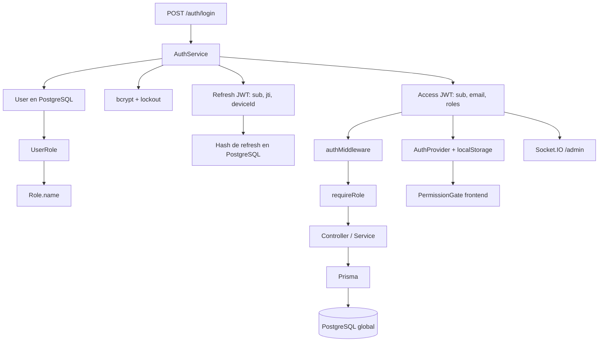
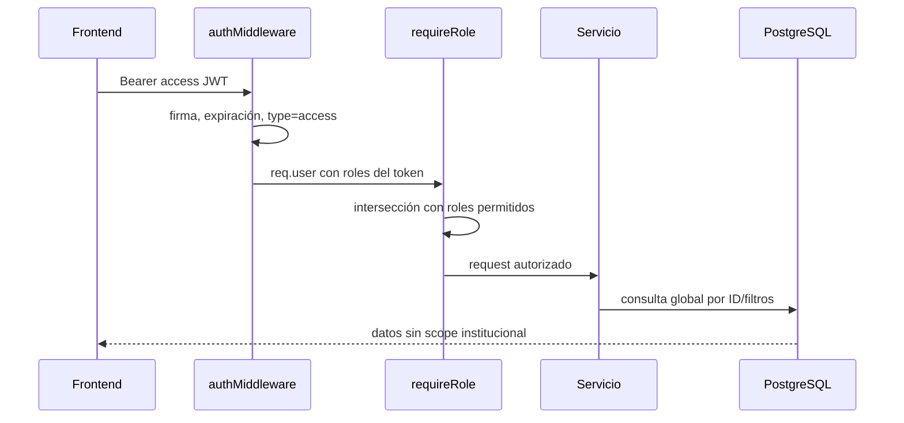

# Modelo actual de acceso — Voz Ciudadana

> Auditoría de código al 2026-07-09. Estado observado en la rama y árbol de trabajo actuales.
> Este documento describe lo comprobado; no representa una arquitectura objetivo.

## 1. Propósito y alcance

Fuente principal para entender usuarios, autenticación, sesiones, roles, autorización, administración, alcance de datos y controles frontend/backend/DB.

Leyenda:

- ✅ Implementado y comprobado
- ⚠️ Parcial o control incompleto
- ❌ No implementado
- ❓ No demostrado
- 🧟 Legado o código muerto

Documentos de detalle:

- [Usuarios, roles y relaciones](architecture/users-roles-permissions.md)
- [Flujo de autenticación](architecture/authentication-flow.md)
- [Flujo de autorización](architecture/authorization-flow.md)
- [Multi-tenancy](architecture/multi-tenancy.md)
- [Matriz de roles y permisos](reference/roles-permissions-matrix.md)
- [Rutas frontend](reference/protected-routes.md)
- [Endpoints](reference/protected-endpoints.md)
- [Auditoría y pruebas](security/access-control-audit.md)
- [Hallazgos de seguridad](security/security-findings.md)

## 2. Resumen ejecutivo

Voxzz Ciudadana implementa hoy un **RBAC de panel de cuatro roles**, con usuarios locales en PostgreSQL, contraseñas bcrypt, access/refresh JWT y sesiones de refresh token en PostgreSQL (tabla `refresh_sessions`). Los roles se incluyen en el access token y `requireRole` protege las APIs administrativas y operativas.

El modelo es **single-tenant global**. No existen `Organization`, `Tenant`, `Municipality`, `Membership`, perfiles institucionales ni claves de tenant en el schema. `Department` es un catálogo de routing, no un tenant ni una relación de pertenencia de usuarios. Las consultas operativas no aplican scope por departamento, asignación o propietario.

La seguridad del panel tiene bases correctas, pero no es coherente de extremo a extremo:

1. ✅ La autenticación, rotación de refresh tokens, lockout, rate limit y RBAC de endpoints están conectados.
2. ⚠️ Los permisos granulares (`view:*`, `manage:*`) existen solo en frontend y divergen de los roles aceptados por backend.
3. ⚠️ Socket.IO autentica el JWT, pero no exige rol ni valida acceso al `conversationId` solicitado.
4. ❌ No existe aislamiento multi-tenant ni RLS; cualquier aislamiento institucional esperado no está implementado.
5. ⚠️ `POST /messages/text` permite a un rol operativo enviar a un número arbitrario sin vincularlo a una conversación/ciudadano.
6. ⚠️ La revocación de rol o desactivación no invalida inmediatamente access tokens ya emitidos.
7. ⚠️ Los access y refresh tokens están en `localStorage`; el access token también se copia a una cookie no `HttpOnly`.

Conclusión: **coherente para un panel interno single-tenant solo a nivel RBAC grueso, pero no suficientemente seguro para multi-tenancy ni para datos segmentados por dependencia/municipio**. Requiere atención inmediata en WebSocket, scopes de recursos, revocación y almacenamiento de tokens.

## 3. Arquitectura actual

No hay una etapa real de perfil institucional, permiso persistido, organización o tenant entre usuario y acceso a datos.

## 4. Modelo de usuarios

### 4.1 Identidades reales

| Tipo real                           | Autentica                           | Persistencia               | Uso                                |
| ----------------------------------- | ----------------------------------- | -------------------------- | ---------------------------------- |
| Usuario de panel (`User`)           | ✅ Email + contraseña               | `users`                    | Administración y operación interna |
| Ciudadano (`Citizen`)               | ❌ No tiene credenciales/sesión     | `citizens`                 | CRM, WhatsApp, registros y eventos |
| Suscriptor (`NewsletterSubscriber`) | ❌ Token de confirmación, no sesión | `newsletter_subscribers`   | Newsletter público                 |
| Actor de webhook Meta               | Firma HMAC, no usuario              | `webhook_event_logs`/colas | Integración WhatsApp               |

`Citizen` no es un perfil de `User`: no existe FK entre ambas tablas. Tampoco existe un proveedor externo de identidad.

### 4.2 Cuenta de panel

`User` almacena `email`, `hashedPassword`, `fullName`, `isActive`, `isSuperuser`, timestamps y relaciones operativas (`backend/prisma/schema.prisma:70-94`).

- ✅ `email` es único.
- ✅ La contraseña se almacena hasheada.
- ✅ `isActive` se verifica en login, refresh y `/auth/me`.
- 🧟 `isSuperuser` permanece en DB, pero el código declara que está deprecado y no lo consulta para autorizar (`backend/src/types/auth.types.ts:1-14`).
- ❌ No existe `Profile`.
- ❌ No existen estados de invitación, verificación de email o recuperación de contraseña.

## 5. Tipos de usuario y roles

Los cuatro roles sembrados y aceptados por TypeScript son:

- `SUPERADMIN`
- `COORDINADOR`
- `OPERADOR_CHAT`
- `ANALISTA`

Evidencia: `backend/src/types/auth.types.ts:9-14`, migración `00000000000023_seed_panel_roles/migration.sql` y `backend/prisma/seed/core/roles.seed.ts`.

Un usuario puede tener cero, uno o varios roles mediante `UserRole`. La autorización aplica semántica **OR**: basta uno de los roles permitidos (`backend/src/middlewares/rbac.ts:28-47`).

No hay permisos persistidos. Los strings frontend `view:dashboard`, `view:inbox`, `view:citizens`, `view:events`, `manage:users`, `manage:settings`, `assign:roles` son una tabla local de presentación (`frontend/lib/auth-guards.ts:16-45`), no claims ni reglas backend.

## 6. Creación y ciclo de vida

Flujos comprobados:

1. ✅ Seed core crea roles y catálogos; el superadmin solo se crea en scopes `dev` o `all` y requiere `SUPERADMIN_PASSWORD` (`backend/prisma/seed/dev/superadmin.seed.ts:5-13`).
2. ✅ `POST /api/v1/auth/register`: un `SUPERADMIN` crea un usuario con uno o más nombres de rol (`auth.routes.ts:50-54`; `auth.service.ts:284-327`).
3. ✅ `POST /api/v1/admin/users`: un `SUPERADMIN` crea usuario y puede enviar `roleIds`; también puede crear una cuenta sin roles (`users.routes.ts:25-30`; `user.service.ts:7-80`).
4. ✅ Alta administrativa directa en backend; no hay UI activa de alta/asignación (`frontend/components/admin/settings-view.tsx:109-120`).
5. ❌ Registro público de usuarios de panel.
6. ❌ Invitación, OAuth, webhook de identidad o creación en primer login.

Riesgos del ciclo:

- ⚠️ El seed genérico ahora corre `core` por defecto y no requiere credenciales. Los scopes `dev`/`all` requieren `SUPERADMIN_PASSWORD`; no hay contraseña fallback conocida.
- ⚠️ Se permiten usuarios activos sin roles: autentican y conectan a WebSocket aunque las rutas RBAC denieguen acceso.
- ⚠️ Un `SUPERADMIN` puede asignar/remover `SUPERADMIN`, incluso a sí mismo; no se conserva un último superadmin.
- ⚠️ `DELETE` impide auto-desactivación, pero `PATCH /admin/users/:id` permite al superadmin enviar `isActive:false` para su propio ID.

## 7. Autenticación y sesiones

### Flujo real

1. `POST /auth/login` valida Zod y aplica rate limit/lockout.
2. `AuthService.login` normaliza email, consulta usuario+roles, verifica `isActive` y bcrypt.
3. Emite access JWT con roles y refresh JWT con `jti`/`deviceId`.
4. Persiste SHA-256 del refresh token en PostgreSQL y cataloga sesiones por usuario.
5. El frontend guarda ambos tokens y el usuario en `localStorage`.
6. `apiClient` agrega `Authorization: Bearer`.
7. Ante 401 o antes de expirar, rota el refresh token.

Valores por defecto comprobados: access 15 minutos, refresh 7 días, máximo 5 sesiones, lockout inicial tras 5 fallos (`backend/src/config/env.config.ts:90-130`).

Controles positivos:

- ✅ Secretos distintos para access y refresh.
- ✅ Refresh token hasheado en PostgreSQL.
- ✅ Rotación single-use y detección de hash no coincidente.
- ✅ Revalidación de usuario activo y roles al refrescar.
- ✅ Logout de sesión y logout global.
- ✅ Rate limit por IP y lockout progresivo por identidad.

Limitaciones:

- ⚠️ `authMiddleware` confía en `isActive` y roles contenidos en el access JWT; no consulta DB por request.
- ⚠️ Logout revoca refresh, no un access JWT ya emitido.
- ⚠️ Los rate limits confían directamente en `X-Forwarded-For`; sin una frontera de proxy confiable demostrada, el límite por IP es evadible.
- ⚠️ Tokens accesibles a JavaScript en `localStorage`; cookie de access token tampoco es `HttpOnly` (`frontend/lib/auth-storage.ts:42-60`).
- ❌ Recuperación de contraseña, MFA y verificación de email no demostradas.

## 8. Autorización

El modelo es híbrido:

- **Backend:** RBAC hardcodeado por ruta con `requireRole`.
- **Frontend:** mapa local rol → permiso y `PermissionGate`.
- **Datos:** reglas de negocio y FKs, sin políticas por usuario/tenant.
- **ABAC parcial:** algunas acciones usan `req.user.id` como actor/asignado; no existe policy engine.

Flujo:

## 9. Administración de usuarios

| Acción                          | Actor permitido             | Estado                |
| ------------------------------- | --------------------------- | --------------------- |
| Listar/ver usuarios             | `SUPERADMIN`, `COORDINADOR` | ✅ Backend            |
| Crear usuario                   | `SUPERADMIN`                | ✅ Backend, ❌ UI     |
| Editar nombre/contraseña/activo | `SUPERADMIN`                | ✅ Backend, ❌ UI     |
| Desactivar                      | `SUPERADMIN`                | ✅ Soft delete        |
| Eliminar físicamente            | Nadie por API               | ❌ No implementado    |
| Asignar/remover rol             | `SUPERADMIN`                | ✅ Backend, ❌ UI     |
| Cambiar organización/municipio  | Nadie                       | ❌ Modelo inexistente |
| Asignar permisos individuales   | Nadie                       | ❌ Modelo inexistente |

Los schemas Zod evitan mass assignment: `CreateUserSchema` acepta solo email, password, fullName, isActive y roleIds; `UpdateUserSchema` solo fullName, password e isActive (`backend/src/services/user.service.ts:7-36`). Enviar `role:"superadmin"` a `PATCH` se descarta por Zod y no cambia roles.

## 10. Multi-tenancy

Estado: **❌ no implementado**.

- No existen claves `organizationId`, `tenantId`, `municipalityId`, memberships ni claims de tenant.
- `Department.slug` aparece en conversaciones, tickets y asignaciones, pero no se relaciona con usuarios ni se usa como filtro de autorización.
- Las listas y búsquedas consultan el conjunto global.
- No hay RLS, policies SQL ni roles DB por tenant.
- El cliente puede enviar `departmentSlug` en assign/transfer; se usa para routing/asignación, no como boundary de seguridad.

Respuesta directa: no se puede probar aislamiento A/B porque no existen A y B en el modelo. Si se cargaran datos de varios municipios en las tablas actuales, los roles autorizados verían datos cruzados.

## 11. Protección frontend

- ✅ Todo `(admin)` usa `ProtectedRoute`, que espera la restauración/refresh y redirige al login (`frontend/app/(admin)/layout.tsx:26-33`).
- ⚠️ `proxy.ts` no valida el token; solo redirige `/admin` a una subruta (`frontend/proxy.ts:17-35`).
- ⚠️ Algunas páginas usan `PermissionGate`; es presentación cliente y usa roles almacenados localmente.
- ⚠️ El sidebar muestra todas las rutas a todos los usuarios autenticados (`frontend/components/admin/sidebar.tsx:25-49`).
- ⚠️ Existen divergencias: frontend concede `view:citizens` a `OPERADOR_CHAT` y `ANALISTA`, pero backend exige `SUPERADMIN|COORDINADOR`; concede `view:events` a `ANALISTA`, pero backend exige `SUPERADMIN|COORDINADOR`.
- ✅ Una llamada directa no omite el RBAC backend en las rutas inventariadas.

## 12. Protección backend

- ✅ Todas las rutas internas inventariadas exigen access JWT y roles.
- ✅ Webhook POST exige HMAC de Meta e idempotencia.
- ✅ Rutas públicas tienen rate limit.
- ⚠️ No hay scopes por asignación, departamento, organizador o propietario.
- ⚠️ Cualquier rol operativo puede proporcionar IDs de otros usuarios para asignar/transferir conversaciones; las FKs validan existencia, no autorización.
- ⚠️ `POST /messages/text` acepta `to` libre y `conversationId` opcional; no valida que el teléfono pertenezca a una conversación autorizada (`backend/src/controllers/messages.controller.ts:15-19,42-62`).
- ⚠️ Release/escalate de handover no comprueba que el actor sea el agente asignado (`backend/src/controllers/handover.controller.ts:68-125`).
- ⚠️ `COORDINADOR` puede mutar etiquetas de ciudadanos aunque el CRUD de ciudadanos sea `SUPERADMIN`.
- ⚠️ Eventos concede a `COORDINADOR` todas las acciones de lectura y escritura; no distingue organizador.
- ⚠️ WebSocket admite cualquier JWT válido, incluso un usuario sin roles, y permite suscribirse a cualquier room no vacía.

## 13. Protección en base de datos

- ✅ FKs, uniques y cascadas preservan integridad referencial.
- ✅ `UserRole` impide duplicar el mismo rol por usuario.
- ✅ Auditoría se escribe desde servicios/controladores sensibles.
- ⚠️ “Append-only” de `AuditLog` es convención de aplicación; no se encontró trigger/privilegio SQL que impida update/delete.
- ❌ No existe RLS.
- ❌ No existen policies por usuario, rol, departamento, municipio u organización.
- ❌ No existe FK de `departmentSlug` en `ConversationMeta`, `Ticket` y `Assignment`.

## 14. Matrices de acceso

La matriz completa está en [roles-permissions-matrix.md](reference/roles-permissions-matrix.md) y el inventario de endpoints en [protected-endpoints.md](reference/protected-endpoints.md).

Resumen:

| Recurso                              | SUPERADMIN | COORDINADOR | OPERADOR_CHAT | ANALISTA |
| ------------------------------------ | ---------- | ----------- | ------------- | -------- |
| Conversaciones: leer                 | ✅         | ✅          | ✅            | ✅       |
| Conversaciones: operar               | ✅         | ✅          | ✅            | ❌       |
| Analytics                            | ✅         | ✅          | ❌            | ✅       |
| Usuarios: leer                       | ✅         | ✅          | ❌            | ❌       |
| Usuarios/roles: administrar          | ✅         | ❌          | ❌            | ❌       |
| Ciudadanos: leer                     | ✅         | ✅          | ❌            | ❌       |
| Ciudadanos: CRUD                     | ✅         | ❌          | ❌            | ❌       |
| Eventos: todas las acciones internas | ✅         | ✅          | ❌            | ❌       |
| Catálogos: leer                      | ✅         | ✅          | ❌            | ❌       |
| Catálogos: mutar                     | ✅         | ❌          | ❌            | ❌       |
| IA y sistema                         | ✅         | ❌          | ❌            | ❌       |

## 15. Riesgos actuales

Prioridad:

1. **Alto — RATE-01:** rate limits por IP confían en `X-Forwarded-For`.
2. **Alto — WS-01:** WebSocket sin rol ni autorización por conversación.
3. **Alto — DATA-01:** sin scope de recursos; acceso global por rol e IDs cliente.
4. **Alto — MSG-01:** envío WhatsApp a destinatario arbitrario sin ownership.
5. **Alto condicional — TENANT-01:** aislamiento inexistente si se mezclan instituciones.
6. **Medio — TOKEN-01:** access/refresh tokens expuestos a JavaScript.
7. **Medio — REV-01:** desactivación/rol no revoca access token inmediatamente.
8. **Medio — ADMIN-01:** no se preserva último superadmin y existe bypass de auto-desactivación vía PATCH.
9. **Medio — FE-01:** permisos frontend contradicen backend y sidebar no filtra.
10. **Bajo — SEED-01:** credenciales fallback del seed.

Detalle y escenarios: [security-findings.md](security/security-findings.md).

## 16. Deuda técnica e inconsistencias

- Dos middlewares (`checkRole` y `requireRole`) con formatos de error distintos; el primero queda por compatibilidad.
- `jwt.middleware.ts` es un re-export deprecado todavía importado.
- `isSuperuser` sigue en schema/documentación antigua sin participar en autorización.
- Permisos frontend no tienen fuente backend.
- Documentación previa `docs/analysis/configuraciones-voz-ciudadana.md` conserva afirmaciones anteriores a la incorporación de RBAC en conversaciones/mensajes/handover/analytics; no debe usarse como inventario actual de acceso.
- Tests de rutas mockean el middleware JWT: prueban wiring RBAC, no criptografía ni estado real de DB.

## 17. Preguntas abiertas

- ❓ ¿El producto seguirá siendo estrictamente de un solo municipio?
- ❓ ¿`Department` debe limitar visibilidad o solo enrutar?
- ❓ ¿`COORDINADOR` debe escribir eventos, tags y settings o solo coordinar?
- ❓ ¿Los analistas deben leer conversaciones con PII?
- ❓ ¿Existe un procedimiento operacional externo para rotar la contraseña seed y recuperar al último superadmin?
- ❓ No se comprobó configuración/estado de una base desplegada ni permisos del usuario PostgreSQL.

## 18. Verificación ejecutada

Pruebas seguras ejecutadas localmente:

- Backend: 2 suites, 29 pruebas de auth/RBAC aprobadas.
- Frontend: 16 archivos, 162 pruebas aprobadas (incluye 14 de `useAuth`).

No se realizaron cambios de datos, migraciones ni llamadas a producción. Las suites backend usan controladores/servicios o middleware mockeados en varias pruebas, por lo que su alcance está documentado como parcial.

## 19. Fecha y límites

- Fecha: 2026-07-09.
- Alcance: código, Prisma schema/migraciones/seeds, rutas, servicios, repositorios, frontend, pruebas y documentación presentes en el repositorio.
- Fuera de alcance/no demostrado: configuración real de producción, contenido real de PostgreSQL, IAM de infraestructura, WAF, secretos desplegados y procedimientos operativos externos.
