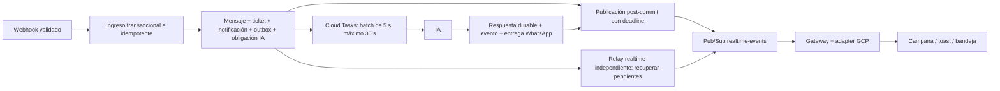

# Plan de corrección realtime — Voz Ciudadana

Fecha: 13 de octubre de 2026. Basado en el [diagnóstico del repositorio](/workspace/voz-ciudadana/docs/analysis/realtime-latency-diagnosis.md) sobre `ef67adb782d044ecb86baa67d60e89e0417d5ba9`.

Este documento define trabajo de implementación; no acredita cambios funcionales ni despliegue. Prioridad: **campana/toast y bandeja**, las superficies confirmadas por el usuario. Configuración que debe conservar su propósito: ventana IA de 5 s, espera máxima nominal 30 s y Scheduler de recuperación cada 5 min. La ventana seguirá agrupando IA; el aviso y el mensaje persistido se producirán al ingreso.

## Resultado esperado y decisiones de arquitectura

1. Al recibir un mensaje válido, guardar mensaje, ticket/vínculo, notificación y outbox antes de devolver éxito. Mostrarlo sin esperar batch ni IA.
2. Publicar eventos realtime después del commit mediante Pub/Sub; conservar el adapter GCP Socket.IO actual para distribuir entre réplicas.
3. Mantener Cloud Tasks para IA, entrega WhatsApp, OCR y exportaciones. Retirar Tasks y Scheduler del camino normal de publicación realtime.
4. Conservar outbox como autoridad de entrega y añadir un relay de recuperación activo. Publicación inmediata más recuperación independiente cubren el fallo entre commit y publish.
5. Reutilizar `conversation.message.new`, `conversation.updated` y `admin.notification`. Añadir campos compatibles antes de exigirlos; introducir versión nueva de contrato solo si la estructura lo requiere.
6. Crear `ticket.created` junto al ticket real; diferenciar reapertura de conversación de creación de ticket. Centralizar este productor en el servicio de tickets.
7. Usar eventos idempotentes y estado versionado. No prometer entrega exactamente una vez: los reintentos pueden entregar el mismo evento varias veces y la UI debe converger.

### Garantías que todos los cambios deben respetar

| Garantía                         | Regla verificable                                                                                                    |
| -------------------------------- | -------------------------------------------------------------------------------------------------------------------- |
| Persistencia antes de aviso      | Ningún evento de creación se publica antes del commit del objeto y sus vínculos.                                     |
| Retry de ingreso                 | Un `wamid` repetido reutiliza InboxEvent, Message y eventos; no crea otro ticket ni otro turno lógico.               |
| Trabajo IA recuperable           | Éxito del webhook implica obligación de procesamiento guardada; fallo al crear Cloud Task no pierde el turno.        |
| Publicación recuperable          | Crash después de commit deja outbox pendiente; crash después de publish puede generar redelivery del mismo event ID. |
| Claims seguros                   | Solo el dueño vigente del claim puede marcar publicado, fallido o liberar lease.                                     |
| Orden y convergencia             | Un patch antiguo no sobreescribe estado nuevo; un mensaje antiguo no recibido sí se incorpora al historial una vez.  |
| Batch correcto                   | 5 s de silencio o cap 30 s cierran el lote; los nuevos fragmentos durante IA quedan pendientes para otro lote.       |
| Reconexión                       | Join confirmado + recuperación paginada + merge de live sin perder eventos ni duplicar unread.                       |
| Durabilidad del centro de avisos | La entrada recuperable de notificación existe independientemente de si había socket conectado.                       |

## Secuencia de cambios revisables

La entrega se divide en cambios pequeños con pruebas de comportamiento. Pueden corresponder a commits o PRs futuros; este plan no crea PRs.

### Cambio 1 — Medición y casos de regresión

**Prioridad:** P0. **Dependencias:** ninguna.

Extender instrumentación en [observabilidad backend](/workspace/voz-ciudadana/backend/src/services/realtime/realtime-observability.service.ts:46), [telemetría frontend](/workspace/voz-ciudadana/frontend/lib/realtime/telemetry.ts:65) y [ruta de telemetría](/workspace/voz-ciudadana/backend/src/routes/realtime-telemetry.routes.ts:22). Registrar ingreso, commit, claim, publish, push, emit, recepción y actualización visible para inbound y tickets. Propagar correlation ID desde webhook hasta worker; añadir `surface` para distinguir campana, toast y bandeja. IDs en logs/trazas, no como labels de alta cardinalidad.

Crear fixtures y escenarios de regresión para: IA bloqueada, ruta cloud_tasks sin reconciliación, ventana de 5 s, ráfaga de más de 30 s, crash post-commit, duplicate webhook y layout real recibiendo nuevo ticket. Activar en CI la integración de dos gateways con emulador Pub/Sub; el test existente hace skip sin emulador. [Suite existente](/workspace/voz-ciudadana/backend/src/__tests__/unit/realtime/websocket-gateway.adapter.fanout.test.ts:34).

**Aceptación:** se puede seguir un event ID hasta las tres superficies afectadas; los casos nuevos fallan por las esperas o defectos actuales. No tratar el timestamp del beacon recibido en backend como timestamp exacto de pintado. Medir duraciones internas con reloj monotónico y calibrar offset para medición browser-servidor.

### Cambio 2 — Publicador durable y recuperación independiente

**Prioridad:** P0. **Dependencias:** cambio 1; migración aditiva de ownership si se necesita.

Modificar [notifier](/workspace/voz-ciudadana/backend/src/services/realtime/realtime-notifier.service.ts:36), [relay](/workspace/voz-ciudadana/backend/src/services/realtime/realtime-outbox-relay.service.ts:59), [helper Pub/Sub](/workspace/voz-ciudadana/backend/src/services/realtime/pubsub.util.ts:30), [runtime factory](/workspace/voz-ciudadana/backend/src/services/realtime/realtime-runtime.factory.ts:65) y wiring de API/worker. Introducir `RealtimeCommittedPublisher` como servicio compartido y un punto de entrada propuesto `backend/src/realtime-relay.ts`.

El notifier sigue escribiendo dentro de la TX. El productor obtiene los event IDs confirmados y el publicador los reclama/publica después del commit, antes de IA u otro trabajo pesado. API y worker usan el mismo protocolo de claims; no publicar directamente por fuera para después publicar de nuevo con otro ID.

Añadir `claimToken` o reutilizar ownership con un token único por intento, nunca solo PID. Todas las finalizaciones filtran por ID, estado y token. Respetar `nextRetryAt`, distinguir claim ocupado de error transitorio y recuperar leases vencidos. Conservar event ID y envelope en cada intento; contabilizar el lease del publicador inmediato y del relay con la misma lógica.

Cachear Topic/publisher por cliente/topic, provisionar topics y suscripciones durante deploy y retirar RPC `create()` por evento/chunk. Configurar deadline real de las llamadas y retries acotados para la vía inmediata; no limitar solo con `Promise.race` dejando una publicación sin control. Si el RPC queda ambiguo, permitir redelivery con el mismo ID y recovery. No degradar ordering silenciosamente; usar versión de agregado además de orderingKey.

**Decisión de recovery:** servicio dedicado Cloud Run para relay con min 1, CPU asignada fuera de requests, ciclo inicial propuesto de 250 ms, concurrencia interna acotada y exclusión entre ciclos. El Scheduler de 5 min queda como reparación adicional. Esta configuración es una propuesta con costo recurrente; debe constar en el cambio de infraestructura. Si se elige recovery únicamente por cron, se documenta un SLA de recuperación de minutos y no se declara el objetivo de recuperación rápida cumplido.

Mantener el endpoint `/tasks/notifications` durante transición; hacer que use el mismo claim. Después dejar que las tareas antiguas drenen, y quitar su despacho habitual del reconciliador. El nuevo relay solo reclama realtime outbox; no ejecuta IA/OCR.

**Aceptación:** un evento confirmado se recibe con Scheduler sin ejecutarse; duplicados del publicador/relay convergen; dueño vencido no modifica resultado de dueño nuevo; fallos de transporte preservan pendientes y recovery los entrega. Gauge de edad pendiente y backlog se emite desde el relay aunque no exista `runCycle` en el worker de Tasks.

### Cambio 3 — Creación de ticket y eventos coherentes

**Prioridad:** P0, antes de habilitar avisos rápidos de tickets. **Dependencias:** infraestructura de pruebas; publicación del cambio 2 puede permanecer desactivada.

Refactorizar [TicketService.createTicket](/workspace/voz-ciudadana/backend/src/services/tickets/ticket.service.ts:124), [TicketRepository](/workspace/voz-ciudadana/backend/src/repositories/ticket.repository.ts:155), [productor del orquestador](/workspace/voz-ciudadana/backend/src/services/orchestrator/message-orchestrator.service.ts:598) y builders de eventos.

Exponer métodos que acepten `Prisma.TransactionClient`, sin transacciones anidadas. Mantener validaciones, índice único parcial de ticket activo, folio y recuperación del ganador en carreras. Dentro de la TX: crear/reutilizar ticket real, fijar `activeTicketId`, asociar Message y TicketMessage, construir el evento con ticket ID y escribir outbox. `created=false` no genera otro evento de creación.

Mover la responsabilidad `ticket.created` del orquestador al servicio de tickets. Los llamados actuales que anuncian un ciclo antes de crear ticket pasan a usar el resultado transaccional o un evento separado de reapertura. Mantener transport `conversation.updated` para clientes existentes y añadir un payload suficiente para la lista nueva: ID, folio, status, priority, fechas, conversación y contexto autorizado de presentación.

**Aceptación:** todo aviso de ticket creado apunta a un ticket consultable y su mensaje vinculado; dos ingresos concurrentes producen un activo; reopen mantiene semántica de ciclo; fallo de TX no deja evento huérfano. La deduplicación cubre la operación lógica, no solo el UUID aleatorio de un intento.

### Cambio 4 — Persistencia y aviso al ingreso del webhook

**Prioridad:** P0; es el cambio que elimina los 5 s del primer aviso. **Dependencias:** cambios 2 y 3, consumidores compatibles.

Crear `backend/src/services/ingress/inbound-ingestion.service.ts` y builders compartidos. Integrarlo en [WebhookController](/workspace/voz-ciudadana/backend/src/controllers/webhook.controller.ts:120), [middleware de idempotencia](/workspace/voz-ciudadana/backend/src/middlewares/idempotency.middleware.ts:51), [InboxProcessor](/workspace/voz-ciudadana/backend/src/services/events/inbox-processor.service.ts:82) y las dos entradas del orquestador.

Agregar campos aditivos nullable a InboxEvent para enlazar el mensaje/contexto persistido, correlation ID y marca de ingreso terminado. Conservar su `status` como progreso del trabajo background: “ingresado” no significa “IA procesada”. Los nombres exactos deben seguir las convenciones Prisma; no esconder nuevas obligaciones solo en JSON sin índices/validación.

El ingreso realiza, sin cargar runtime IA: normalización, resolución canónica de ciudadano/conversación/línea, creación mínima de ticket, mensaje inbound, asociación, notificación durable, eventos y obligación de procesamiento IA/batch. Usar métodos TX y locks breves para carreras del mismo agregado. Deduplicar por wamid y externalMessageId con restricciones DB; reutilizar lo ya ingresado. No ejecutar reglas semánticas que pueden transferir/cerrar o llamar IA dentro de esta TX; ocurren después y producen sus propios eventos de actualización.

Después del commit: intentar publish inmediato con presupuesto acotado; crear las tareas según obligación persistida; devolver 200 cuando esa obligación sea recuperable aunque falle su despacho. Un fallo antes de commit devuelve error para retry de Meta. El middleware actual responde éxito solo porque InboxEvent existe: cambiar esa condición para no impedir reparación de ingresos parciales/pendientes del modelo anterior.

Worker/orquestador reciben IDs persistidos y ejecutan el turno. Evitar repetir find-or-create, mensaje, ticket y evento. Para InboxEvents antiguos sin enlace, usar el mismo servicio de ingreso idempotente como camino de compatibilidad. Manejar explícitamente el resultado de “nuevo ciclo” para no volver a emitir ticket created desde un worker que encuentra una conversación ya abierta.

**Aceptación:** campana/toast y bandeja reciben inbound mientras el reloj del batch aún no llegó a 5 s; detener IA no altera el primer aviso; reintentar después de commit o fallo de enqueue no crea mensaje/ticket/evento adicional. InboxEvents previos a migración siguen procesándose.

### Cambio 5 — Batch de IA con máximo efectivo de 30 s

**Prioridad:** P1, obligatorio para cerrar corrección. **Dependencias:** cambio 4 y compatibilidad con trabajo antiguo.

Rehacer apertura, extensión, cierre y sucesión de ventanas en [InboxProcessor](/workspace/voz-ciudadana/backend/src/services/events/inbox-processor.service.ts:294), junto con BatchWindow/BatchWindowClaim y reconciliador. Un cambio de fórmula aislado no basta: también hay que corregir generación, programación y selección de fragmentos.

Usar hora DB como autoridad. Para una ventana abierta: `readyAt = min(openedAt + 30000 ms, latestFragmentAt + 5000 ms)`. Programar Cloud Task usando el `readyAt` retornado por la TX. Mantener `openedAt` durante extensiones; resetearlo solo al crear una ventana sucesora. Evitar que una tarea temprana retorne 2xx y deje trabajo sin una tarea futura u obligación recuperable.

Al cerrar/claimar una ventana, registrar conjunto o frontera estable de fragmentos en la misma TX. Si el cap vence a los 30 s, incluir todos los fragmentos ya comprometidos de esa ventana; no seguir drenando únicamente `now - 5 s`, que excluiría sus últimos mensajes. Serializar ingresso/claim con el mismo lock breve del agregado; cada fragmento pertenece a un solo lote lógico.

Reintentar usando el mismo claim/turno lógico y los mismos miembros. Las actualizaciones de processed/failed filtran por sus IDs y token vigente, no por teléfono y un `lockedBy='batch-processor'` compartido. Si la IA anterior sigue ocupando el lease de conversación, el siguiente lote se reprograma; no marcar sus mensajes procesados por un resultado `lock_conflict` sin atención. El cap limita cierre/elegibilidad del lote; la espera por un turno anterior o falta de capacidad se mide aparte, porque no puede garantizarse arranque IA en 30 s bajo cualquier carga.

**Aceptación:** mensaje único elegible a los 5 s; ráfaga cada 4 s cierra a los 30 s; fragmentos posteriores pertenecen al siguiente lote; tareas antiguas/out-of-order son noop seguro; crash y lease vencido reintentan mismos miembros; reloj app distinto del DB no altera el deadline.

### Cambio 6 — Respuesta IA durable y streaming acotado

**Prioridad:** P1. **Dependencias:** cambios 2–4.

Modificar [AIService.persistOutboundReply](/workspace/voz-ciudadana/backend/src/ai/services/ai.service.ts:182), tools de envío y fábrica de runtime. Guardar respuesta, asociación a ticket, obligación de entrega WhatsApp y realtime outbox de forma coherente, con clave idempotente del turno. Publicar post-commit y encolar entrega WhatsApp; una avería realtime no elimina la respuesta del ciudadano.

Emitir `conversation.message.new` para el saliente y patches de resumen. Typing/progreso son efímeros; mensaje final es durable. Coalescer chunks por run con secuencia y buffer acotado (valor inicial 30–50 ms a medir), sin esperar un RPC por token. El done no sustituye el mensaje final persistido. Ampliar contratos backend/frontend conjuntamente cuando se añadan estados.

**Aceptación:** cortar stream o Pub/Sub no pierde el saliente; retry del mismo turno no duplica respuesta/entrega lógica; último mensaje y preview convergen aunque chunks y evento durable lleguen en distinto orden.

### Cambio 7 — Avisos, listas y estado frontend inmediato

**Prioridad:** P0 para campana/bandeja; P1 para mejoras adicionales de tickets. **Dependencias:** consumidores opcionales pueden prepararse con cambio 1; activación completa después de 3–4.

En [RealtimeManager](/workspace/voz-ciudadana/frontend/lib/realtime/realtime-manager.ts:227), conservar event ID en `admin.notification` y llevarlo al store. Concentrar toast/sonido/preferencias en [useRealtimeNotifications](/workspace/voz-ciudadana/frontend/hooks/useRealtimeNotifications.ts:93); el manager recibe/enruta/actualiza, y una sola capa decide presentación. Incluir `NUEVO_TICKET`, distinguir ticket ID de conversation ID y corregir la navegación de avisos para la ruta real de detalle.

Actualizar [useAdminInboxConversations](/workspace/voz-ciudadana/frontend/hooks/useAdminInboxConversations.ts:524) e [inbox-sync](/workspace/voz-ciudadana/frontend/lib/realtime/inbox-sync.ts:31): patch inmediato de filas existentes; upsert si el evento incluye datos completos/autorizados; si no, consultar la fila faltante con coalescing de ventana fija. Evitar debounce que se reinicia indefinidamente por ráfagas y REST viejo que reemplaza cambios nuevos.

Añadir consumidor en [useTickets](/workspace/voz-ciudadana/frontend/hooks/tickets/useTickets.ts:134), primero refetch coalesced por lifecycle y luego upsert por ticket ID. Los filtros y páginas cargadas deben preservarse. Polling queda como reparación y fallback.

Añadir versión de agregado a patches. Aplicar orden de estado por versión, incorporación de mensajes por message ID y dedupe por event ID; no descartar un mensaje nuevo solo porque pertenece a una versión de conversación anterior. Sustituir unreadDelta por contador absoluto/versionado donde sea posible. Actualizar refs junto con estado para que eventos del mismo tick no pisen patches.

Campana/store se actualizan inmediatamente. Para toasts en ráfaga, agrupar por conversación y ofrecer aviso resumido en vez de ocultar eventos detrás de una cola larga; registrar espera visual por separado. Respetar preferencias y una entrega por pestañas según el coordinador.

**Aceptación:** entregar eventos al layout montado actualiza campana y fila, produce un solo toast permitido y ofrece enlace al ticket correcto; ráfaga no difiere estado; filtros y permisos se respetan; respuesta REST tardía no revierte patch.

### Cambio 8 — Join confirmado y recuperación sin gaps

**Prioridad:** P1. **Dependencias:** IDs/versión del cambio 7, notificaciones durables del 4.

Modificar [gateway](/workspace/voz-ciudadana/backend/src/services/realtime/websocket-gateway.service.ts:202), manager, [subscription store](/workspace/voz-ciudadana/frontend/stores/use-subscription-store.ts:11), hooks de threads/ticket detail y [NotificationsController](/workspace/voz-ciudadana/backend/src/controllers/notifications.controller.ts:57).

Registrar listeners antes de subscribe. Añadir acknowledgement después de autorización y `await join`, con respuesta de error/timeout manejada. Implementar refcount por room; solo el último consumidor hace unsubscribe. Reconexión: preparar buffer → join confirmado → snapshot/delta → merge de buffer → live; bloquear respuestas de snapshots anteriores mediante request generation/version.

Proyectar avisos en la TX de negocio para productores nuevos. Mantener proyección subscriber idempotente para eventos antiguos durante transición; una vez migrados, no requiere escritura DB anterior al emit para los nuevos. Cubrir ticket lifecycle. Corregir fallos de proyección legacy para que no sean pérdidas silenciosas aceptadas con 2xx. Revisar también dedupe del subscriber: no dejar una entrega fallida marcada como completada antes de emitir; liberar/resolver la reserva ante error y permitir retries. La deduplicación de distintos procesos sigue descansando en escrituras idempotentes y event IDs, no en su mapa local.

Paginar catch-up ascendente con cursor de creación/entrega persistida e ID, asociado al usuario y scope autorizado, conservando occurredAt solo como fecha del hecho. No avanzar el cursor desde live al máximo ocurrido, ni devolver solo los últimos 100. Definir un rango de snapshot y solapamiento con dedupe para inserciones cuyo commit aparece tarde; el margen debe superar la duración máxima transaccional y probarse con commits demorados. Si se adopta secuencia de stream, asignarla con protocolo que respete commits: un ID autoincremental por sí solo no garantiza ausencia de gaps de commit.

**Aceptación:** join lento, cambio de página, reconnect durante snapshot, >100 avisos, timestamps iguales y mensaje viejo publicado tarde no pierden elementos; dos consumidores de room siguen recibiendo tras desmontar uno; cambio de usuario no comparte cursor/avisos.

### Cambio 9 — Despliegue GCP y capacidad

**Prioridad:** P1 para timeout y relay; tuning de capacidad tras medir. **Dependencias:** binaries/health del cambio 2; baseline del 1.

En [workflow](/workspace/voz-ciudadana/.github/workflows/deploy-gcp.yml:363) y [infraestructura](/workspace/voz-ciudadana/deploy-infrastructure.sh:24): aumentar timeout API a 3600 s y actualizar verificación que esperaba 60 s; añadir despliegue/health/IAM del relay dedicado; separar colas por tipo de trabajo y routing en `CloudTasksDispatcher`. Mantener publicación de dominio por push OIDC y adapter por suscripción propia de réplica.

Registrar revisión y flags reales antes del canary. Mantener WebSocket como transporte principal; si se requiere polling, configurar fallback explícito, cookies/afinidad y pruebas multiinstancia. Evitar que un push destinado a realtime se acepte cuando gateway/subscriber está deshabilitado accidentalmente.

Ajustar concurrency y pool con un presupuesto global Cloud SQL; revisar combinación API 80/pool 1 y worker 50/pool 8. Medir espera por pool y DB antes de elevar límites. Para cumplir primer aviso tras inactividad, evaluar min 1 de API; worker IA puede conservar escala a cero porque ya no produce el primer aviso. Verificar regiones reales y arranque sin readiness IA innecesario en API.

**Aceptación:** WebSocket dura más de 60 s; fan-out funciona entre réplicas; relay recupera mientras API/worker no tienen peticiones; carga con OCR/exports no retrasa avisos por compartir cola; CI verifica nuevos parámetros. Registrar impacto en costo y conexiones DB.

### Cambio 10 — SLO, canary y cierre operativo

**Prioridad:** obligatorio para declarar terminado. **Dependencias:** cambios anteriores aplicables al alcance.

Crear distribuciones y alertas a partir de instrumentación, actualizar guías y runbooks. Medir warm/cold, red del navegador y superficies separadas; no usar `gateway.emit` como prueba de recepción.

Objetivos iniciales de diseño, sujetos a baseline: warm ingreso→primer aviso p95 ≤500 ms/p99 ≤1 s; browser received→estado visible p95 ≤100 ms; recovery por relay tras fallo transitorio objetivo p95 ≤2 s una vez disponible transporte. Validar capacidad para lograrlo; si red/DB dominan, declarar el resultado medido y revisar el presupuesto, sin maquillar percentiles ni excluir errores. Disponibilidad de transporte es condición del recovery, no una garantía durante su caída.

**Aceptación:** informe de staging/canary con muestra, carga, revisión, percentiles, tasa de pérdida/duplicado lógico y costo; IA bloqueada 30 s no altera primer aviso; todos los escenarios críticos pasan y equipo tiene procedimiento de recuperar pending/failed/stale.

## Migración y rollout

| Etapa    | Acción                                                                                                                                                                                                          | Condición antes de avanzar                                                             |
| -------- | --------------------------------------------------------------------------------------------------------------------------------------------------------------------------------------------------------------- | -------------------------------------------------------------------------------------- |
| Expandir | Añadir columnas nullable, índices y contratos con campos opcionales; mantener clientes/revisiones anteriores.                                                                                                   | Migraciones probadas con snapshot de esquema y volumen representativo.                 |
| Preparar | Desplegar consumidores tolerantes, publicador apagado y relay nuevo con protocolo compatible de claims.                                                                                                         | No cambia comportamiento de productores antiguos ni se duplican obligaciones lógicas.  |
| Ingreso  | Habilitar ingreso nuevo por línea WhatsApp o porcentaje determinista del agregado; usar flags propuestos `REALTIME_IMMEDIATE_PUBLISH_ENABLED` y `INBOUND_EAGER_INGESTION_ENABLED`, default false hasta pruebas. | Todos los workers en tráfico entienden eventos nuevos y los antiguos nullable.         |
| Publicar | Habilitar post-commit para agregado elegido; relay antiguo/new comparten ownership.                                                                                                                             | Tests de crash y dos publicadores; backlog y deliver latency observados.               |
| Ampliar  | 5% →25% →100% del ámbito elegido; incluir low traffic para frío y carga para pool.                                                                                                                              | Muestra suficiente por superficie y revisión; no avanzar solo por tiempo transcurrido. |
| Retirar  | Dejar drenar Tasks notifications; retirar dispatch habitual y proyección extra de nuevas rutas; actualizar docs.                                                                                                | Cero obligaciones incompatibles/antiguas sin recovery y canary estable.                |
| Contraer | Hacer campos requeridos o eliminar compatibilidad antigua en cambio posterior.                                                                                                                                  | Ya no hay revisiones ni filas que dependan del modelo anterior.                        |

El gate de habilitación requiere todos los consumidores preparados; no activar eager ingestion mientras un worker antiguo pueda repetir lógica del ciclo. Para cambios de membresía/generaciones de batch, pausar brevemente despachos IA o drenar generaciones antiguas durante el corte si no se puede garantizar interoperabilidad. Webhook puede seguir guardando obligación durable; el aviso inmediato queda independiente. Reanudar y reconciliar sin borrar claims/filas pendientes.

Rollback: desactivar vía inmediata/eager ingreso por flag manteniendo columnas, IDs y relay de recuperación. El worker nuevo conserva compatibilidad con mensajes ingresados; no volver a binarios antiguos que ignoran el enlace. Restaurar batch antiguo solo tras gestionar generaciones compatibles. No borrar outbox ni activar EventEmitter local como fallback de API/worker separados. Si el relay nuevo debe retirarse, reactivar dispatch notifications y registrar el SLA temporal de recuperación de minutos.

## Matriz de validación obligatoria

| Escenario                                                        | Resultado esperado                                                                     |
| ---------------------------------------------------------------- | -------------------------------------------------------------------------------------- |
| Mensaje inbound con IA bloqueada 30 s y batch 5 s                | Aviso/fila tras commit y antes del batch; IA después de elegibilidad.                  |
| Scheduler no ejecutado                                           | Primer aviso llega; recuperación no depende del cron normal.                           |
| Meta repite webhook después de crash/200 perdido                 | Un mensaje/ticket/evento lógico; obligación IA recuperada.                             |
| Publish falla o confirma y el proceso muere antes de update      | Pending/lease recuperado; redelivery mismo ID sin doble unread/toast.                  |
| Dos workers, lease antiguo termina tarde                         | Dueño antiguo no finaliza claim ajeno.                                                 |
| Ráfaga cada 4 s por >30 s, tarea antigua y llegada durante IA    | Lote cierra al cap, miembros estables y sucesor pendiente; no pierde último fragmento. |
| Ticket nuevo/reapertura concurrente                              | Ticket consultable, vínculo íntegro, un activo y lifecycle correcto.                   |
| Push en API A, navegador en B                                    | Fan-out real del adapter; recepción y aplicación medidas.                              |
| Join lento, REST viejo y reconnect durante snapshot              | Merge sin pérdida/reversión; permisos y room refcounts correctos.                      |
| >100 avisos offline, timestamp empatado y evento publicado tarde | Replay paginado completo y cursor por usuario; ID deduplica.                           |
| Ráfaga de avisos y preferencias/múltiples pestañas               | Campana/bandeja rápidas; una política de toast/sonido sin duplicados.                  |
| OCR/export/IA concurrentes, API fría y socket >60 s              | Cola realtime aislada, costo/pool medidos y reconexión recuperable.                    |

Tests unitarios para política/contratos, integración Postgres para TX/claims/batch y browser + Pub/Sub emulator/staging para primer aviso y fan-out. No sustituir estos últimos por mocks de publish. La validación previa del diagnóstico —42 backend y 76 frontend— acredita el estado anterior, no estos cambios todavía propuestos.

## Orden de ejecución y estimación

Ruta crítica: **1 → 2 y 3 → 4 → 5/6/7 → 8/9 → 10**. Preparar consumidores frontend compatibles antes de habilitar ingreso nuevo; desplegar relay y su infraestructura junto a publicación inmediata. El timeout WS puede corregirse temprano, acompañado del check CI.

| Paquete                                     | Estimación de esfuerzo orientativa |
| ------------------------------------------- | ---------------------------------- |
| Instrumentación + publisher/claims/recovery | 3–5 días de ingeniería             |
| Ticket TX + ingreso mínimo + compatibilidad | 4–6 días                           |
| Batch + respuesta IA                        | 3–5 días                           |
| Frontend + joins/replay                     | 4–6 días                           |
| Infra, carga, canary y documentación        | 3–5 días                           |

Total orientativo: 17–27 días de ingeniería, sin contar espera de accesos ni revisiones. Ajustar tras pruebas iniciales; las cifras no son compromiso ni latencias esperadas. La primera entrega útil elimina espera del cron; el objetivo completo exige además ingreso independiente del batch, datos consistentes y UI/recovery verificados.

## Definición de terminado

- Campana/toast y bandeja muestran inbound antes del batch y antes de respuesta IA con métricas verificadas.
- El camino normal realtime no usa Scheduler ni Tasks notifications; las obligaciones sobreviven a crash/retry.
- Batch respeta 5 s/cap 30 s para elegibilidad y no pierde fragmentos ni turnos por conflictos de lease.
- Ticket y respuesta IA tienen eventos durables consistentes; duplicados y reordenamiento convergen.
- Rooms, replay y frontend funcionan tras reconexión y entre réplicas reales.
- Alertas, capacidad, costo, rollback y guías corresponden a la arquitectura desplegada.
