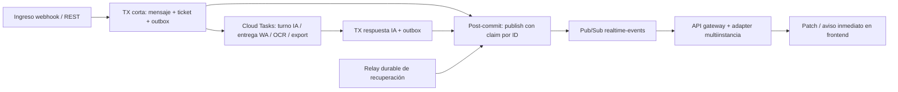

# Diagnóstico de latencia realtime — Voz Ciudadana

Fecha: 13 de octubre de 2026. Código inspeccionado: `ef67adb782d044ecb86baa67d60e89e0417d5ba9`.

## Plan de exploración y alcance

Se inspeccionaron los puntos de entrada de Express, runtimes API/worker, todos los productores y consumidores realtime, inbox/outbox, FSM/IA, tickets, cliente Socket.IO, hooks de bandeja y tickets, esquema Prisma, scripts de infraestructura, workflow GCP, documentación y pruebas relacionadas. El [inventario de llamadas](/workspace/voz-ciudadana/docs/analysis/realtime-call-inventory.md) contiene las coincidencias de emisión, publicación y encolado del código de aplicación.

| Archivos explorados                                                                                                                                                                                           | Propósito                                                                                |
| ------------------------------------------------------------------------------------------------------------------------------------------------------------------------------------------------------------- | ---------------------------------------------------------------------------------------- |
| `backend/src/server.ts`, `worker.ts`, `worker-app.ts`, `routes/index.ts`, `routes/pubsub.routes.ts`                                                                                                           | Wiring real, separación de procesos y rutas de recepción/despacho.                       |
| `backend/src/controllers/webhook.controller.ts`, `services/events/*`, `services/tasks/*`                                                                                                                      | Persistencia inbound, procesamiento pesado, reconciliación, colas y retries.             |
| `backend/src/services/realtime/*`, `services/notifications/notification-projector.service.ts`                                                                                                                 | Outbox durable, Pub/Sub de dominio, adapter Socket.IO, rooms y proyección.               |
| `backend/src/services/orchestrator/*`, `ai/fsm/*`, `ai/services/ai.service.ts`, `ai/orchestrator/orchestrator.ts`, `ai/providers/*`                                                                           | Orden antes/después de IA, streaming, locks y límites.                                   |
| `backend/src/services/tickets/ticket.service.ts`, repositorios de mensajes/conversaciones/tickets, `backend/prisma/schema.prisma`                                                                             | Creación mínima, límites transaccionales, idempotencia e índices.                        |
| `frontend/lib/realtime/*`, `frontend/hooks/conversaciones/useAdminInboxConversations.ts`, `useConversations.ts`, `useConversationMessages.ts`, `useConversationThread.ts`, `hooks/tickets/*`, layout y capas de notificación | Conexión, suscripción, aplicación de patches y recuperación REST.                        |
| `.github/workflows/deploy-gcp.yml`, `deploy-infrastructure.sh`, Compose, configuración y guías realtime                                                                                                       | Parámetros de despliegue, regiones, modos local/GCP y diferencias respecto de las guías. |
| Tests backend/frontend relacionados                                                                                                                                                                           | Garantías cubiertas y huecos de validación end-to-end.                                   |

**Configuración de producción confirmada por el usuario:** las superficies afectadas son **campana/toast y bandeja de conversaciones**; `BATCHING_WINDOW_MS=5000`, `BATCHING_MAX_WAIT_MS=30000` y Scheduler `background-tasks-reconcile` con `*/5 * * * *`. No se proporcionó duración observada ni revisión desplegada. El listado de tickets se analiza como un problema adicional del alcance pedido, separado del síntoma confirmado.

**Límite de evidencia:** el workflow describe el despliegue previsto, no acredita la revisión activa de Cloud Run. No hay identidad GCP configurada en este entorno, export de producción, trazas ni métricas de eventos reales. No se afirma una latencia p95/p99 medida ni la frecuencia real de cold starts. El cron y batching dejan de ser supuestos tras la confirmación del usuario; el resto de configuración runtime necesita corroboración. Las conclusiones sobre código son verificables; los tiempos de infraestructura quedan pendientes de medición.

## 1. Resumen ejecutivo

- **Causa principal comprobada en el camino GCP: no existe despacho inmediato de los eventos realtime durables.** `RealtimeNotifier.notifyCritical` solo inserta una fila; el worker no arranca el relay por polling en `cloud_tasks`. El reconciliador despacha esas filas y el Scheduler tiene cron por defecto `*/5 * * * *`. Esto introduce una espera residual de hasta casi 300 s en condiciones normales, antes de cola/red/procesamiento. [Notifier](/workspace/voz-ciudadana/backend/src/services/realtime/realtime-notifier.service.ts:36), [worker](/workspace/voz-ciudadana/backend/src/worker.ts:81), [reconciliador](/workspace/voz-ciudadana/backend/src/services/tasks/background-task-reconciler.service.ts:104), [cron](/workspace/voz-ciudadana/deploy-infrastructure.sh:36).
- **El inbound durable ya se escribe antes de IA, pero después de la ventana batch de 5 s confirmada.** En `handleInboundMessage`, persistencia + outbox ocurren en líneas 174–186 y la llamada FSM en 257; en batch los fragmentos también se guardan antes de IA. El `eventBus.emit('message.received')` legacy individual sí ocurre después de esperar al FSM. En producción con batching positivo la ruta relevante es `handleInboundBatch`, no ese emit legacy individual. [Orquestador](/workspace/voz-ciudadana/backend/src/services/orchestrator/message-orchestrator.service.ts:385).
- **Cloud Tasks sí está en el camino crítico de las notificaciones actuales**, tanto para llevar el inbound al worker como para publicar después su outbox realtime mediante `/tasks/notifications`. OCR, exportación, entrega WhatsApp y realtime comparten una cola y su límite de concurrencia por defecto es 10. [Dispatcher](/workspace/voz-ciudadana/backend/src/services/tasks/cloud-tasks-dispatcher.service.ts:42), [cola](/workspace/voz-ciudadana/deploy-infrastructure.sh:25).
- **El listado de tickets depende de polling, aunque haya socket conectado.** `useTickets` no registra un consumidor de eventos; usa 15 s desconectado y 60 s conectado. Recibir un evento no agrega la fila al listado. [Hook](/workspace/voz-ciudadana/frontend/hooks/tickets/useTickets.ts:134).
- **Cloud Run API se despliega con timeout de 60 s.** Un WebSocket que supera ese tiempo se desconecta; reaparecen handshake, auth, joins y refetch. API y worker tienen `min-instances=0`, y la API combina concurrencia 80 con un pool Prisma configurado en 1. Son factores de cola/reconexión comprobados en la configuración, con impacto cuantitativo aún no medido. [API](/workspace/voz-ciudadana/.github/workflows/deploy-gcp.yml:363), [worker](/workspace/voz-ciudadana/.github/workflows/deploy-gcp.yml:409).
- **Ya existe adapter multiinstancia: `@socket.io/gcp-pubsub-adapter`, no Redis.** Un push de dominio llega a una API; el adapter usa un segundo topic para fan-out a todas las réplicas. Instalar otro adapter no elimina la espera de cinco minutos. [Gateway](/workspace/voz-ciudadana/backend/src/services/realtime/websocket-gateway.service.ts:447).
- **La suscripción a rooms carece de acknowledgement.** Se autoriza con consultas DB y luego se hace join; el frontend supone que emitir `conversation.subscribe` basta. Hay una ventana entre snapshot, join y evento que puede perder actualizaciones. [Servidor](/workspace/voz-ciudadana/backend/src/services/realtime/websocket-gateway.service.ts:202), [cliente](/workspace/voz-ciudadana/frontend/lib/shared/realtime/realtime-manager.ts:178).
- **El push espera una proyección DB antes del socket emit.** Con el pool API de una conexión, cada escritura de notificación compite con REST, webhook y autorización de rooms. El catch evita abortar la entrega si la proyección falla, pero no evita esperar una operación lenta. [Subscriber](/workspace/voz-ciudadana/backend/src/services/realtime/realtime-api-subscriber.service.ts:105).
- **Hay problemas adicionales de visibilidad y recuperación de tickets.** `ticket.created` viaja como `conversation.updated`, puede generarse antes de crear el ticket real y omitir `ticketPatch`; la capa activa de notificaciones no escucha `NUEVO_TICKET`, y el catch-up no proyecta ese evento. Esto puede producir ausencia de aviso, además de latencia. [Builder](/workspace/voz-ciudadana/backend/src/services/orchestrator/message-orchestrator.service.ts:677), [layout](</workspace/voz-ciudadana/frontend/app/(admin)/layout.tsx:27>), [capa activa](/workspace/voz-ciudadana/frontend/hooks/shared/useRealtimeNotifications.ts:172).
- **La observabilidad aún no prueba recepción/pintado del mensaje.** `relay_latency_ms` empieza al procesar la fila, omitiendo su espera pendiente; la telemetría frontend solo cubre lifecycle de tickets y no incluye timestamps del navegador. Las métricas son logs que requieren distribución/alertas en GCP. [Relay](/workspace/voz-ciudadana/backend/src/services/realtime/realtime-outbox-relay.service.ts:132), [telemetría](/workspace/voz-ciudadana/frontend/lib/shared/realtime/telemetry.ts:65).

## 2. Secuencia actual y arquitectura end-to-end

El ciudadano entra por WhatsApp/Meta, **no por el socket del dashboard**. El frontend administrativo observa el resultado. El envío de un agente desde el dashboard utiliza REST → `MessageService.sendMessage`, con otro outbox para entregar a WhatsApp.

El diagrama representa el modo que configura el workflow GCP: durable activado, API sin workers, worker `cloud_tasks`, más batching de 5 s y cron de 5 min confirmados por el usuario. `Δ` significa tiempo no medido. Los 0–300 s son el residual analítico del cron confirmado, no una medición ni un SLA.

```mermaid
sequenceDiagram
    participant C as Ciudadano / Meta
    participant F as Frontend admin
    participant A as API Express + Socket.IO
    participant DB as PostgreSQL / Cloud SQL
    participant T as Cloud Tasks (cola compartida)
    participant W as Worker
    participant S as Scheduler (por defecto 5 min)
    participant P as Pub/Sub realtime-events
    participant B as Pub/Sub socketio-adapter
    participant R as Otras réplicas API
    F->>A: Handshake /admin con JWT (Δ)
    F->>A: conversation.subscribe(id)
    A->>DB: Autorización (Δ)
    A->>A: join conversation:id; sin ack de join
    C->>A: POST /webhook (Δ ingreso)
    A->>DB: Upsert InboxEvent (Δ DB)
    A->>T: createTask process-inbox o process-batch
    A-->>C: HTTP 200 después de persistir y encolar
    T->>W: process-batch tras 5 s sin nuevos fragmentos + Δ cola/cold start
    W->>DB: Ciudadano + conversación + contexto
    opt Nuevo ciclo de contacto
        W->>DB: Outbox ticket.created / conversation.updated
        Note over W,DB: Puede faltar ticket real / ticketPatch
    end
    W->>DB: TX mensaje inbound + 2 eventos realtime
    Note over DB,S: Evento pending sin despacho inmediato; residual 0–300 s con cron confirmado
    par Trabajo de IA
        W->>W: FSM + lease + IA (Δ; timeout configurado 30 s)
        W->>P: Typing por Pub/Sub directo
        Note over W,A: Chunks/done usan otro topic ai-stream, fuera del outbox realtime
        W->>DB: Guardar respuesta outbound
        W->>T: process-outbox para entrega WhatsApp
        W->>W: message.received legacy tras FSM
    and Notificación durable independiente, pero diferida
        S->>W: POST /tasks/reconcile
        W->>DB: Buscar realtime pending/failed/stale
        W->>T: /tasks/notifications(id)
        T->>W: Despacho (Δ cola)
        W->>DB: Claim por id
        W->>P: publish evento; await confirmación
        W->>DB: Marcar published
        P->>A: Push /pubsub/realtime (OIDC)
        A->>DB: Proyectar notification cuando aplica (await, Δ)
        A->>B: Emit distribuido por adapter
        B->>R: Fan-out a réplicas
        A-->>F: Emit a sockets locales
        R-->>F: Emit a sockets remotos (Δ red)
        F->>F: Router / store / patch / toast
    end
    Note over F: useTickets no aplica eventos: fila depende de REST cada 15/60 s
```

### Conexión, transporte y fan-out

- `defaultSocketFactory` crea Socket.IO `/admin`, `autoConnect:false`, JWT dinámico, `transports:['websocket','polling']`, reconexión infinita, demora base 1.5 s y timeout de handshake 10 s. Registra listeners antes de `socket.connect()`. [Factory y conexión](/workspace/voz-ciudadana/frontend/lib/shared/realtime/realtime-manager.ts:110).
- Es **WebSocket primero**, no el handshake polling primero descrito en una parte de la guía local. La lista incluye polling, pero no se configura `tryAllTransports:true`; por tanto no debe darse por garantizado que falle WebSocket y se intente polling automáticamente. Registrar el transporte efectivo y errores. [Opciones oficiales del cliente](https://socket.io/docs/v4/client-options/#tryalltransports).
- El gateway no sobreescribe transports, ping ni upgrade; Engine.IO instalado usa `pingInterval=25000`, `pingTimeout=20000`, `upgradeTimeout=10000` y polling/websocket habilitados. Estos parámetros detectan desconexiones, no solucionan la espera del outbox. [Factory gateway](/workspace/voz-ciudadana/backend/src/services/realtime/websocket-gateway.service.ts:470).
- El workflow no activa afinidad de sesión. Si se usa HTTP long-polling con réplicas, Socket.IO requiere sticky sessions; para una conexión WebSocket estable no hace falta afinidad entre sus frames. La afinidad Cloud Run es best-effort y no sustituye el adapter. [Socket.IO multi-servidor](https://socket.io/docs/v4/using-multiple-nodes/), [Cloud Run WebSockets](https://docs.cloud.google.com/run/docs/triggering/websockets).
- Auth verifica access JWT; room `user:<userId>` se añade al conectar. `conversation:<id>` necesita evento de suscripción; valida UUID, existencia y permiso `conversaciones.view` o `tickets.view`. Namespace no equivale a autorización de cada conversación. [Auth de room](/workspace/voz-ciudadana/backend/src/services/realtime/socket-subscribe-auth.ts:10).
- No todas las APIs reciben cada push del topic de dominio. Hay una suscripción push compartida que entrega a una instancia; **cada instancia crea su propia suscripción pull efímera del adapter**. La factory espera inicialización del adapter antes de escuchar HTTP. Las suscripciones distintas son las que permiten el fan-out. [Arranque API](/workspace/voz-ciudadana/backend/src/server.ts:167), [infra push](/workspace/voz-ciudadana/deploy-infrastructure.sh:219).
- El adapter GCP soporta broadcasts con ack, pero **no connection state recovery**. El servidor tampoco configura esa opción. El outbox conserva eventos para publicar, no una cola de replay por navegador. [Capacidades oficiales](https://socket.io/docs/v4/gcp-pubsub-adapter/).

### Orden, granularidad y diferencias de runtime

| Flujo                                         | Orden real                                                                                                        | Consecuencia                                                                                                                                              |
| --------------------------------------------- | ----------------------------------------------------------------------------------------------------------------- | --------------------------------------------------------------------------------------------------------------------------------------------------------- |
| Inbound individual durable                    | Resolver contexto → evento de ciclo opcional → reglas determinísticas → mensaje + outbox → ticket/attach → FSM/IA | Escritura inbound anterior a IA; despacho depende del relay.                                                                                              |
| Inbound batch durable (producción confirmada) | Esperar ventana de 5 s/dispatch → persistir fragmentos + outbox → ticket/attach → FSM/IA conjunta                 | Debounce también demora la primera visibilidad, porque el webhook solo guarda InboxEvent. No hay `message.received` legacy al final de este método batch. |
| Inbound legacy                                | Procesar/persistir → FSM/IA → `message.received`, `message.created`, `conversation.updated` en EventEmitter       | Latencia ligada a IA; EventEmitter es local y no cruza worker/API.                                                                                        |
| Mensaje saliente de agente                    | `MessageService`: mensaje + realtime outbox → enqueue WhatsApp → respuesta REST                                   | El mensaje puede aparecer por respuesta REST; sockets siguen esperando reconciliación.                                                                    |
| Respuesta IA                                  | Guardar `Message` → enqueue outbox WhatsApp → stream done                                                         | `AIService.persistOutboundReply` no escribe realtime outbox; el mensaje final puede depender de REST/stream en esa ruta.                                  |
| Ticket de nuevo ciclo                         | `emitTicketCreatedEvent` antes de `getOrCreateActiveTicket`; query de ticket activo puede devolver null           | Evento de ticket con semántica de ciclo, sin ID/patch suficiente para insertar fila CRM.                                                                  |

Evidencia: [inbound](/workspace/voz-ciudadana/backend/src/services/orchestrator/message-orchestrator.service.ts:82), [batch](/workspace/voz-ciudadana/backend/src/services/orchestrator/message-orchestrator.service.ts:350), [saliente agente](/workspace/voz-ciudadana/backend/src/services/message.service.ts:115), [saliente IA](/workspace/voz-ciudadana/backend/src/ai/services/ai.service.ts:138).

Los eventos actuales son `message.created` → `conversation.message.new`, `conversation.updated`, `ticket.created` → `conversation.updated`, handover/cierre/status y typing. `message.received` es evento del bus local y tipo de `admin.notification`; **no es el nombre de un evento Socket.IO durable recibido directamente por el navegador**. No existen contratos separados `message.processing`, `ai.thinking` o `ai.responded` durables en este camino.

En Compose dev el durable está desactivado por defecto y el inbox se ejecuta junto a la API, de modo que el puente EventEmitter funciona y muestra el retraso por IA. Ese comportamiento local no representa el modo GCP. [Compose dev](/workspace/voz-ciudadana/docker-compose.dev.yml:66).

### Frontend: recibir no equivale a ver

- El provider global se monta dentro de `ProtectedRoute` y conecta en `useEffect`; permanece sobre la navegación admin. Hay Zustand para conexión, notificaciones y suscripciones, y estado React local en varios hooks; no aparece React Query en estos flujos. [Provider](/workspace/voz-ciudadana/frontend/components/shared/providers/realtime-provider.tsx:18).
- `useTicketDetail` obtiene primero el ticket por REST para conocer `conversationId`, carga mensajes y suscribe sin ack. También refresca al reconectar y cada 15/60 s. `useConversationMessages` intenta aplicar patches sin refetch para el chat de bandeja. [Detalle](/workspace/voz-ciudadana/frontend/hooks/tickets/useTicketDetail.ts:63), [chat](/workspace/voz-ciudadana/frontend/hooks/conversaciones/useConversationMessages.ts:146).
- `useAdminInboxConversations` aplica patches a filas existentes y actualiza su ref inmediatamente. Si la conversación no existe en la lista, `applyInboxEvent` pide refetch; el hook lo coalesce durante 300 ms. `useConversations` siempre hace refetch con debounce de 300 ms, que se reinicia en cada evento: con ráfaga sostenida puede posponerlo indefinidamente. [Bandeja actual](/workspace/voz-ciudadana/frontend/hooks/conversaciones/useAdminInboxConversations.ts:524), [patch](/workspace/voz-ciudadana/frontend/lib/shared/realtime/inbox-sync.ts:31), [otro listado](/workspace/voz-ciudadana/frontend/hooks/conversaciones/useConversations.ts:169).
- `useTickets` únicamente realiza polling y refetch al reconectar, sin consumidor realtime. No extrapolar sus 60 s a la campana: la campana usa el store actualizado al recibir `admin.notification`. [Manager](/workspace/voz-ciudadana/frontend/lib/shared/realtime/realtime-manager.ts:227).
- La cola de toasts del manager limita tres avisos visibles y libera el siguiente 500 ms después de dismiss/autoclose. El store se actualiza antes; un toast puede aparecer tarde aunque el evento ya haya llegado. Hay además otra ruta de toast en `useRealtimeNotifications`, con preferencias y coordinación entre pestañas. [Cola visual](/workspace/voz-ciudadana/frontend/lib/shared/realtime/realtime-manager.ts:519).
- El layout monta la capa unificada, que escucha nuevo mensaje, transferencia y cierre, pero no nuevo ticket. `RealtimeTicketAlertsLayer` y `NuevoTicketAlert` existen sin usos de montaje encontrados en el código de aplicación. `NUEVO_TICKET` se deriva correctamente pero no alcanza un aviso global activo. [Derivación](/workspace/voz-ciudadana/frontend/lib/shared/realtime/realtime-user-events.ts:64).
- En reconexión se reemiten joins y se consulta `/admin/notifications`, sin esperar join. Catch-up limita a 100, ordena por `occurredAt desc` y usa `since > timestamp`; no tiene cursor paginado. Puede saltar eventos antiguos que se publican tarde, empates y más de 100 eventos offline. Su marca localStorage tampoco está asociada al usuario. Ticket created/closed no se proyectan actualmente. [Catch-up frontend](/workspace/voz-ciudadana/frontend/lib/shared/realtime/realtime-manager.ts:363), [endpoint](/workspace/voz-ciudadana/backend/src/controllers/notifications.controller.ts:57), [proyector](/workspace/voz-ciudadana/backend/src/services/notifications/notification-projector.service.ts:27).

## 3. Tabla de latencias por salto

**ND = no determinada:** hace falta medir en producción. Los intervalos derivados de cron/poll son esperas programadas, no benchmarks. La media del residual uniforme del cron sería 150 s; p95 285 s y p99 297 s **solo bajo el modelo de llegada uniforme, sin fallos ni backlog**. No son percentiles reales del sistema.

| Componente / operación                     | Latencia típica o espera comprobable                                     | Causa / interpretación                                                                                                              | Evidencia                                                                                                                                                                                        |
| ------------------------------------------ | ------------------------------------------------------------------------ | ----------------------------------------------------------------------------------------------------------------------------------- | ------------------------------------------------------------------------------------------------------------------------------------------------------------------------------------------------ |
| Meta → API webhook                         | ND                                                                       | Red, edge y posible startup API; el origen no es el dashboard.                                                                      | [Webhook](/workspace/voz-ciudadana/backend/src/controllers/webhook.controller.ts:78)                                                                                                             |
| Dashboard → API `sendMessage`              | ND                                                                       | Auth/permisos, DB, enqueue WhatsApp antes de devolver REST.                                                                         | [Servicio](/workspace/voz-ciudadana/backend/src/services/message.service.ts:115)                                                                                                                 |
| API → DB InboxEvent                        | ND                                                                       | Upsert por wamid; pool API 1 puede serializar trabajo.                                                                              | [Persistencia](/workspace/voz-ciudadana/backend/src/controllers/webhook.controller.ts:124), [pool](/workspace/voz-ciudadana/.github/workflows/deploy-gcp.yml:369)                                |
| API → Cloud Tasks → worker inbound         | ND de cola; batching **5 s confirmado**, extendido por fragmentos nuevos | Una tarea comparte capacidad con OCR/export/WhatsApp/realtime. El cap nominal de 30 s presenta un defecto adicional descrito abajo. | [Enqueue](/workspace/voz-ciudadana/backend/src/services/events/inbox-processor.service.ts:82), [límites](/workspace/voz-ciudadana/deploy-infrastructure.sh:28)                                   |
| Worker → DB mensaje + eventos              | ND; TX tiene maxWait 10 s / timeout 15 s                                 | Lecturas seriales y transacción corta; esos valores son límites, no duraciones normales.                                            | [TX](/workspace/voz-ciudadana/backend/src/services/orchestrator/message-orchestrator.service.ts:544), [opciones](/workspace/voz-ciudadana/backend/src/database/transaction-options.ts:11)        |
| Outbox pending → reconciliación            | 0–casi 300 s con cron **confirmado**; más si hay cap/fallos              | Falta wake-up post-commit. Es el mayor retardo programado.                                                                          | [Cron](/workspace/voz-ciudadana/deploy-infrastructure.sh:36), [scan](/workspace/voz-ciudadana/backend/src/services/tasks/background-task-reconciler.service.ts:104)                              |
| Reconciliación → Cloud Tasks notifications | ND                                                                       | Nueva tarea, cuota/rate/concurrencia compartidos; máximo 250 filas/tipo por ejecución por defecto.                                  | [Dispatcher](/workspace/voz-ciudadana/backend/src/services/tasks/cloud-tasks-dispatcher.service.ts:62), [cap](/workspace/voz-ciudadana/backend/src/config/env.config.ts:99)                      |
| Worker → Pub/Sub                           | ND; batching SDK instalado hasta 10 ms en baja carga                     | Publish + posible RPC de creación de topic en cada llamada; publisher no reutilizado por helper.                                    | [Transporte](/workspace/voz-ciudadana/backend/src/services/realtime/pubsub-realtime-transport.service.ts:43), [helper](/workspace/voz-ciudadana/backend/src/services/realtime/pubsub.util.ts:30) |
| Pub/Sub → API push                         | ND                                                                       | OIDC, startup/cola API, retries; ordering por conversación serializa recepción/ack.                                                 | [Ruta](/workspace/voz-ciudadana/backend/src/routes/pubsub.routes.ts:33), [subscription](/workspace/voz-ciudadana/deploy-infrastructure.sh:219)                                                   |
| Subscriber → DB notification → gateway     | ND                                                                       | Await de proyección antes de emitir; pool API 1.                                                                                    | [Subscriber](/workspace/voz-ciudadana/backend/src/services/realtime/realtime-api-subscriber.service.ts:105)                                                                                      |
| Gateway → adapter → otra API               | ND; otro batching SDK hasta 10 ms                                        | Segundo paso Pub/Sub; suscripción individual pull por réplica.                                                                      | [Adapter](/workspace/voz-ciudadana/backend/src/services/realtime/websocket-gateway.service.ts:519)                                                                                               |
| API → frontend Socket.IO                   | ND                                                                       | Red y disponibilidad del socket; sin confirmación de aplicación/pintado.                                                            | [Emit](/workspace/voz-ciudadana/backend/src/services/realtime/websocket-gateway.service.ts:343)                                                                                                  |
| Frontend → filas de bandeja existentes     | ND de React; nuevas filas 300 ms + REST                                  | Patches parciales; refetch cuando falta fila/datos.                                                                                 | [Hook](/workspace/voz-ciudadana/frontend/hooks/conversaciones/useAdminInboxConversations.ts:570)                                                                                                                |
| Frontend → listado de tickets              | 0–60 s conectado / 0–15 s desconectado + REST                            | Polling en vez de consumir cambios. No necesariamente se suma al retardo del evento: el poll REST puede ver DB antes del socket.    | [Hook](/workspace/voz-ciudadana/frontend/hooks/tickets/useTickets.ts:136)                                                                                                                        |
| Evento → toast en ráfaga                   | ND; 500 ms tras liberación de slot + duración previa                     | Cola visual separada de recepción/store.                                                                                            | [Manager](/workspace/voz-ciudadana/frontend/lib/shared/realtime/realtime-manager.ts:537)                                                                                                                |
| Modo polling local: inbox / relay          | Hasta ~2 s / ~1 s residuales sin backlog                                 | Intervalos default; lotes se procesan secuencialmente y extienden el ciclo.                                                         | [Defaults](/workspace/voz-ciudadana/backend/src/config/env.config.ts:89), [relay](/workspace/voz-ciudadana/backend/src/services/realtime/realtime-outbox-relay.service.ts:52)                    |
| IA / ruta legacy                           | ND; timeout externo default 30 s                                         | IA awaited antes del bus legacy; streaming también espera publish por chunk.                                                        | [FSM](/workspace/voz-ciudadana/backend/src/ai/fsm/fsm-router-v2.ts:515), [provider](/workspace/voz-ciudadana/backend/src/ai/providers/openai.provider.ts:101)                                    |

`dispatchDeadline` no se configura por tarea; no se confunde con `scheduleTime`, ni con el ack deadline push de 60 s, ni con el timeout worker de 300 s. Backoff de Tasks default 10–600 s, 8 intentos; relay usa delays `[1,5,30,120,600]` y lease stale de 300 s. La coexistencia de dos capas de retry debe medirse y simplificarse. [Tasks](/workspace/voz-ciudadana/backend/src/services/tasks/cloud-tasks-dispatcher.service.ts:71), [retry relay](/workspace/voz-ciudadana/backend/src/services/realtime/realtime-outbox-relay.service.ts:213).

## 4. Cuellos de botella, por impacto

| Prioridad | Hallazgo                                                             | Impacto / certeza                                                                                   | Esfuerzo                                              |
| --------- | -------------------------------------------------------------------- | --------------------------------------------------------------------------------------------------- | ----------------------------------------------------- |
| P0        | Dispatch realtime solo por reconciliación                            | Espera programada de minutos con cron confirmado; falta corroborar revisión activa y medir eventos. | Bajo–medio para fast path post-commit.                |
| P0        | Persistencia visible detrás del batch de 5 s                         | Confirmado por usuario y ruta `processBatch`; incluso con fast path worker sigue esa espera.        | Medio para separar ingreso y turno IA.                |
| P0        | `useTickets` sin consumidor realtime                                 | Filas solo por REST/poll; comprobado en código.                                                     | Bajo para refetch al evento; medio para upsert.       |
| P1        | WebSocket timeout Cloud Run API 60 s                                 | Reconexiones periódicas previstas, gaps de join/refetch.                                            | Bajo, con ajuste de verificación CI.                  |
| P1        | Ticket event separado de creación real + aviso sin consumidor activo | Datos incompletos/aviso ausente; más visible al acelerar publicación.                               | Medio: contrato y TX.                                 |
| P1        | Una cola para tareas lentas y notificaciones                         | Si 10 trabajos de IA ocupan slots, notifications espera aunque worker acepte más.                   | Medio para separar colas y retirar realtime de Tasks. |
| P1        | Proyección awaited + pool API 1/concurrencia 80                      | Cola DB antes de socket; amplificación de carga REST/joins.                                         | Medio; dimensionar DB y límites.                      |
| P1        | Join sin ack + recuperación incompleta                               | Eventos perdidos pueden verse mucho después por refetch.                                            | Medio.                                                |
| P2        | Crear topic en cada publicación y awaits por chunk                   | Sobrecoste RPC/costo; acumula demora en streaming y consumo IA.                                     | Bajo–medio.                                           |
| P2        | Debounce/refetch/lista desconocida/toast queue                       | Retardo adicional de UI; no explica por sí solo minutos de outbox.                                  | Bajo–medio.                                           |
| P2        | Cold start con min 0 y arranque previo al listen                     | Riesgo de latencia de primer evento; frecuencia y duración no medidas.                              | Bajo configuración, costo recurrente.                 |

### Detalles de transporte y confiabilidad

**Batching y cap de 30 s:** `upsertBatchWindow` calcula `LEAST(GREATEST(window_opened_at + maxWait, incomingReadyAt), now() + windowMs)`. Bajo relojes equivalentes, esto sigue dando `now + windowMs`, incluso cuando supera el cap: ventana abierta en 0, fragmento en 28 s → ready en 33 s, mayor que 30 s. Además `computeBatchScheduleTime` siempre programa `now + 5 s`, no el `batch_ready_at` retornado por DB. Por tanto **no se puede prometer un máximo efectivo de 30 s** con ese código y ráfagas que siguen extendiendo generaciones. [SQL](/workspace/voz-ciudadana/backend/src/services/events/inbox-processor.service.ts:460), [schedule](/workspace/voz-ciudadana/backend/src/services/events/inbox-processor.service.ts:492). Es un defecto adicional, independiente del cron. El cálculo de 33 s se reprodujo algebraicamente; falta test de integración SQL/generaciones para validar todas las carreras.

Reparación: tratar apertura/sucesión de ventana explícitamente (reset de `window_opened_at` al abrir un nuevo ciclo) y usar `LEAST(windowOpenedAt + maxWait, GREATEST(previousReadyAt, incomingReadyAt))`; devolver `generation` **y `ready_at`** desde el upsert, programar la tarea para ese `ready_at` y probar una ráfaga de más de 30 s. Esto limita la espera de IA; la notificación debe seguir fuera del batching.

`ensureTopicOnce` elimina la promesa en `finally`; coalesce llamadas concurrentes, pero **no recuerda el éxito**. Dos invocaciones secuenciales del helper real con cliente fake produjeron dos `create()`. En streaming esto ocurre por chunk. `publishJsonMessage` llama `client.topic(name)` de nuevo por publicación; en el SDK instalado `PubSub.topic` crea un nuevo objeto Topic. Conviene provisionar una vez y cachear publishers con opciones explícitas.

Evidencia del SDK instalado: [Topic nuevo por llamada](/workspace/voz-ciudadana/backend/node_modules/@google-cloud/pubsub/build/src/pubsub.js:732), [batching default de 10 ms](/workspace/voz-ciudadana/backend/node_modules/@google-cloud/pubsub/build/src/default-options.js:43), [suscripción efímera por adapter y sin replay antiguo](/workspace/voz-ciudadana/backend/node_modules/@socket.io/gcp-pubsub-adapter/dist/index.js:19).

Los comentarios del helper sitúan ordering en el topic; la infraestructura correctamente lo configura en la suscripción. Además el fallback comprueba `options.ordered` en vez del valor efectivo `ordered = options.ordered ?? true`, así que con el default no entra; su map se reactiva en cada llamada con ordering key. No usar fallback silencioso como garantía de orden. [Helper](/workspace/voz-ciudadana/backend/src/services/realtime/pubsub.util.ts:65). El ordering key conserva el **orden de llegada a Pub/Sub**, no el orden de commits si Cloud Tasks despacha publicaciones concurrentes. Añadir versión/secuencia por agregado. Pub/Sub push ordenado permite un solo mensaje pendiente por key, de modo que un ack lento retrasa el siguiente. [Documentación de ordering](https://docs.cloud.google.com/pubsub/docs/ordering).

El relay reclama con `SKIP LOCKED` en polling y con `updateMany` por ID en Tasks. No mantiene una TX SQL abierta durante publish, pero sus marcas de resultado filtran únicamente por ID: si un lease vence y otro dueño reclama, un dueño antiguo puede actualizar el resultado. Introducir token de claim y actualización condicional al dueño. El dedupe del subscriber es local por 60 s; no evita duplicados entre instancias. La UI usa un LRU de 500 event IDs y lo borra al reconectar. Son ayudas de idempotencia, no entrega exactamente una vez.

## 5. Cambios propuestos

### Arquitectura

**Objetivo recomendado:** commit de mensaje/ticket + outbox → publicación inmediata Pub/Sub → gateway distribuido → UI. IA, OCR, exportaciones, correo y entrega WhatsApp conservan ejecución background con retry. El reconciliador pasa a ser recuperación, no despachador habitual realtime.



1. **Fast path after commit en todos los productores.** Devolver IDs de evento junto al resultado transaccional e invocar un servicio de publicación con claim desde API o worker, antes de esperar a IA. Reusar garantías del relay, con timeout de RPC acotado y ownership. Si falla, conservar fila recuperable y responder según persistencia del negocio. No publicar desde dentro de `$transaction`, ni depender de `void publish()` después de responder en Cloud Run con CPU throttling.
2. **Ingreso desacoplado del batch IA.** Mover normalización/persistencia mínima del mensaje a un servicio de ingreso compartido, capaz de resolver ciudadano/conversación, ticket activo y outbox sin instanciar runtime IA. Encolar luego el turno con IDs ya persistidos. La ventana agrupa IA, no visibilidad de fragmentos. Si este cambio aún no existe, el fast path en el worker elimina el cron pero todavía conserva la cola inbound en el camino crítico.
3. **Recovery con objetivo explícito.** Para recuperación subsegundo, relay dedicado con CPU asignada y min ≥1, polling corto o wake-up transaccional de Postgres; el wake-up es señal, la outbox es la autoridad. Reusar scan de pendientes tras restart. Para recovery de menor costo, cron puede permanecer con un SLA de recuperación de minutos: explicitar que no satisface subsegundo durante fallos del publish inmediato. Cambiar solo el cron a cada minuto es mitigación temporal.
4. **Conservar primero el adapter GCP existente.** Ya hace fan-out. Medir por separado push de dominio y adapter. Considerar Redis/Memorystore en la misma región solo si esos saltos dominan p95 tras eliminar esperas. Redis Pub/Sub tampoco ofrece replay durable; no sustituye outbox/catch-up. [Adapter Redis](https://socket.io/docs/v4/redis-adapter/).

### Backend y contratos

- Unificar `TicketService.createTicket/getOrCreateActiveTicket` con la escritura `ticket.created` en la misma TX del ticket real; incluir `ticketId`, `conversationId`, folio y campos de presentación suficientes. El nombre Socket.IO puede seguir siendo `conversation.updated` para compatibilidad. Si se necesita evento de reapertura de ciclo previo, darle semántica distinta de ticket creado.
- Persistir inbound, asociarlo a ticket y escribir sus patches atómicamente. Hoy el attach posterior y la respuesta IA tienen huecos; al publicar inmediatamente, el navegador puede refetchear antes de que exista el vínculo. `TicketRepository` ya tiene transacciones; extenderlo para exponer/aceptar el cliente TX, no confiar en el TODO del orquestador como descripción actual del repo.
- Producir también `conversation.message.new` durable para la respuesta de IA en `AIService.persistOutboundReply` y en rutas de tools que persisten salientes; usar la misma clave idempotente de respuesta/turno y despertar el relay post-commit.
- Mantener eventos `message.created` inbound inmediato y outbound al responder. Añadir `message.processing` / `ai.thinking` efímeros y `ai.responded`/`ai.failed` durables solo si aportan estado útil; ampliar Zod y tipos frontend juntos. Relacionar con `messageId`, `runId` y `eventId` estable, no publicar nombres que el validador actual descarta.
- Cachear Topic/publisher, provisionar topics en deploy, retirar `create()` del camino por evento. Fijar batching bajo medido (por ejemplo 5 ms), endpoint regional donde corresponda y política de ordering sin degradación silenciosa.
- Coalescer chunks de IA por run cada 30–50 ms o umbral de bytes, con buffer acotado. Un único publicador secuencial evita esperar un RPC por token; enviar `sequence` y acumular texto, priorizando done/respuesta persistida. Esos valores son configuración inicial propuesta. El streaming existe, depende de `agent.stream` y no acredita que producción lo tenga activo.
- Sacar el coste de proyección de la entrega live **con durabilidad**, por ejemplo crear la notificación en la TX de dominio o una suscripción de proyección independiente con retries. No cambiar simplemente `await projector` por `void projector`: una proyección perdida implica catch-up perdido. Mantener ack del push tras aceptación de una obligación durable de proyección.
- Corregir los flags incompatibles al arrancar: API sin WS/subscriber debe devolver retry/error para tráfico previsto realtime, no aceptar 204 y descartar. Medir errores del adapter y disponibilidad de suscripción.

### Frontend

- Añadir consumidor a `useTickets`: quick win refetch inmediato/coalesced al lifecycle; luego upsert por ticket ID con datos completos y filtro local. Conservar polling como reconciliación de baja frecuencia y offline, no como mecanismo principal.
- Incluir `NUEVO_TICKET` en la capa activa con preferencias/coordinador, sin montar todas las capas antiguas y duplicar cierre/transferencia. Consolidar también los toasts de `RealtimeManager` y la capa unificada en una sola política.
- Registrar consumidor antes de emitir join. Añadir ack que confirme autorización y `await socket.join`; al conectar/reconectar: listener → join confirmado → snapshot/delta con cursor → merge de eventos que llegaron durante el fetch. `socket.ready` confirma conexión de namespace, no el join de conversación.
- Convertir subscription store de Set simple a conteo de referencias si varios componentes usan la misma conversación: el unsubscribe de uno no debe dejar al otro fuera. Mantener IDs de dedupe estables en reconexión y converger mediante versiones absolutas; `unreadDelta` requiere dedupe para no incrementar dos veces.
- Catch-up paginado por cursor de entrega/proyección y ID, no solo `occurredAt > lastSeen`. Incluir lifecycle de tickets. Si hay retrasos/out-of-order, una secuencia de publicación durable o replay con solapamiento más dedupe evita saltos; no avanzar la marca al máximo de eventos recibidos en vivo hasta recuperar gaps. Asociar cursor al usuario.
- Aplicar patches de filas conocidas inmediatamente y consultar solo el ticket/conversación faltante; merges por versión previenen que REST lento sobreescriba patches nuevos. Medir pintado en React Profiler antes de atribuir lentitud a render.
- UI optimista para acciones originadas en el dashboard: insertar mensaje temporal con clave de cliente y estado pendiente, reconciliar al ack/REST y revertir en error. Para inbound externo, mostrarlo al recibir un evento durable, sin inventar mensajes que el navegador aún no conoce. No hay necesidad de esperar una respuesta IA para mostrar el ciudadano.

### Infraestructura

- Elevar timeout API/WebSocket a 3600 s y actualizar el paso de verificación CI que espera 60 s. Mantener reconexión/replay porque Cloud Run igualmente puede desconectar. [Límites WebSocket oficiales](https://docs.cloud.google.com/run/docs/triggering/websockets).
- Evaluar min ≥1 para gateway y worker si el objetivo incluye primer mensaje tras inactividad. Para relay continuo, CPU siempre asignada; para worker puramente HTTP con Tasks, no activar CPU permanente sin razón. Un WebSocket activo mantiene actividad según el modelo Cloud Run; cambiar timeout afecta ocupación/costo.
- Separar colas IA, OCR/export y entrega WhatsApp; eliminar `/tasks/notifications` del camino normal. Ajustar dispatch y concurrencia según throughput y pool DB, no simplemente subir todo.
- API concurrency 80 / pool 1 y worker 50 / pool 8 necesitan carga y métricas de espera DB. Dimensionar conexiones globales: réplicas máximas × pool, más migrador/otros clientes. Aumentar pool solo con capacidad Cloud SQL y límites por proceso revisados.
- API/worker/Tasks usan la misma variable región del workflow; el script tiene default `us-central1`. La región real de Cloud SQL se obtiene de variables no incluidas; no está acreditada la co-localización. El workflow limpia VPC connector; Cloud SQL usa socket. Redis necesitaría red privada y configuración regional que hoy no existen en el camino realtime.
- Reducir trabajo de arranque previo a listen: API espera DB, reconciliación y readiness IA, y luego crea suscripción adapter; worker espera readiness y reconciliación. IA runtime ya se cachea por worker, pero su primer build es lazy. Medir arranque y sacar readiness IA de API cuando no presta IA, manteniendo health/readiness fieles.

## 6. Código de ejemplo: antes / después

Los snippets siguientes son **propuestas**, no cambios aplicados ni patches listos para copiar completos. Helpers nuevos y wiring deben implementarse y probarse con los contratos existentes.

### 6.1 Publicación post-commit sin esperar reconciliación

Antes, simplificado del notifier y productor actual:

```ts
await prisma.$transaction(async (tx) => {
  const message = await messageRepo.createInTransaction(tx, input);
  await notifier.notifyCritical(tx, buildMessageEvent(message));
});
await fsmRouter.handle(turn); // IA
// El evento pending solo lo despierta el reconciliador en cloud_tasks.
```

Después, reusando `RealtimeOutboxRelay.processEventById` como base:

```ts
const committed = await prisma.$transaction(async (tx) => {
  const message = await messageRepo.createInTransaction(tx, input);
  const events = buildInboundEvents(message); // envelopes válidos, IDs únicos
  for (const event of events) await notifier.notifyCritical(tx, event);
  return { message, eventIds: events.map((event) => event.eventId) };
}, PRISMA_INTERACTIVE_TRANSACTION_OPTIONS);

// Dentro de la petición, tras commit; API y worker reciben este servicio.
for (const eventId of committed.eventIds) {
  try {
    await realtimeRelay.processEventById(eventId);
  } catch (error) {
    logPublishFailure(eventId, error); // fila recuperable, alerta/backlog
  }
}
await aiJobs.enqueue({ messageId: committed.message.id });
```

Antes de implantarlo: configurar deadlines reales del RPC, claims con token, recuperación independiente y su SLO. `processEventById` actual marca failed y propaga errores transitorios; no hace falta publicar doble por fuera del relay. Serializar por agregado o incluir secuencia/versionado para evitar reordenamientos entre procesos. Si el enqueue IA falla después del commit, la obligación de procesar el turno debe persistir y ser reconciliable.

### 6.2 Ticket y evento en una TX, antes de la IA

Antes: el orquestador publica semántica de ticket para un ciclo nuevo y consulta si ya hay ticket; la creación viene después.

```ts
if (conversation.created || conversation.reactivated) {
  await emitTicketCreatedEvent(conversation.id, context);
}
// ...persistencia inbound...
await ticketService.getOrCreateActiveTicket(conversation.id, citizen.id);
```

Después: un servicio compartido hace get-or-create transaccional; solo el ganador escribe el evento de creación.

```ts
const result = await prisma.$transaction(async (tx) => {
  const repo = new TicketRepository(tx); // adaptar tipo TX donde haga falta
  const existing = await repo.findActiveTicketByConversation(conversationId);
  if (existing) return { ticket: existing, eventIds: [] as string[] };

  const ticket = await repo.createTicket(ticketInput); // validaciones/folio preparados
  await repo.setConversationActiveTicket(conversationId, ticket.id);
  const event = buildTicketCreatedFromTicket(ticket, context);
  await notifier.notifyCritical(tx, event);
  return { ticket, eventIds: [event.eventId] };
}, PRISMA_INTERACTIVE_TRANSACTION_OPTIONS);
await publishCommittedIds(result.eventIds);
```

Preservar índice único parcial de ticket activo y recuperación del ganador ante carrera, idempotencia de folio y asociación del mensaje. No sostener esta TX durante IA, correo o HTTP.

### 6.3 Join con acknowledgement y recuperación ordenada

Antes: frontend `socket.emit('conversation.subscribe', id)` y servidor sin callback.

```ts
// Servidor: reemplaza la firma del listener y captura errores.
socket.on(
  "conversation.subscribe",
  (id: unknown, ack?: (r: unknown) => void) => {
    void (async () => {
      if (typeof id !== "string" || !(await authorizeSubscribe(user, id))) {
        ack?.({ ok: false, error: "forbidden" });
        return;
      }
      await socket.join("conversation:" + id);
      ack?.({ ok: true, conversationId: id });
    })().catch(() => ack?.({ ok: false, error: "subscribe_failed" }));
  },
);

// Cliente: registrar/bufferizar primero; usar este mismo flujo al reconectar.
manager.router.register(consumer);
const joined = await socket
  .timeout(3000)
  .emitWithAck("conversation.subscribe", id);
if (!joined.ok) throw new Error(joined.error);
await hydrateAndMergeBufferedEvents(id); // snapshot/delta versionado; sin perder live
```

El timeout 3 s es propuesta. Recuperar gaps exige snapshot/merge; el ack solo elimina la ambigüedad del join.

### 6.4 Quick win para `useTickets`

Antes: el hook solo usa `setInterval(..., socketConnected ? 60000 : 15000)`.

```ts
// Dentro del hook: useRealtimeManager() y consumidor global del listado.
useEffect(() => {
  if (!manager) return;
  let timer: ReturnType<typeof setTimeout> | undefined;
  manager.router.register({
    id: "crm-ticket-list",
    events: ["conversation.updated", "conversation.handover"],
    handler: () => {
      if (timer) return; // ventana fija: no retrasarla con cada nuevo evento
      timer = setTimeout(() => {
        timer = undefined;
        void fetchPage(undefined, false);
      }, 50);
    },
  });
  return () => {
    if (timer) clearTimeout(timer);
    manager.router.unregister("crm-ticket-list");
  };
}, [manager, fetchPage]);
```

Esta mitigación sigue esperando REST. La fase siguiente filtra lifecycle y aplica ticketPatch/upsert completo; preservar páginas ya cargadas y evitar reemplazar datos recientes con respuestas antiguas.

### 6.5 Publishers reutilizados, infraestructura fuera del evento

Antes: `ensureTopicOnce()` por evento y `client.topic(name)` por publicación.

```ts
const realtimeTopic = pubsub.topic("realtime-events", {
  messageOrdering: true,
  batching: { maxMilliseconds: 5 }, // ajustar con medición
});

async function publish(event: RealtimeDurableEvent): Promise<void> {
  await realtimeTopic.publishMessage({
    data: Buffer.from(JSON.stringify(event)),
    orderingKey: event.conversationId,
    attributes: { eventId: event.eventId, correlationId: event.correlationId },
  });
}
```

Provisionar topic/subscription en deploy; configurar deadline/retry y reanudar key tras fallo cuando corresponda. El publisher compartido preserva serialización local; para múltiples productores sigue haciendo falta versión/secuencia. Aplicar configuración de batching al Topic del adapter también, después de medir su coste.

## 7. Plan de implementación por fases

| Fase                               | Trabajo concreto                                                                                                                                               | Criterio de salida                                                              | Estimación orientativa |
| ---------------------------------- | -------------------------------------------------------------------------------------------------------------------------------------------------------------- | ------------------------------------------------------------------------------- | ---------------------- |
| 0: baseline y quick wins           | Capturar revisión/config real; timestamps ingreso/commit/claim/receive/UI; consumidor `useTickets`; timeout WS y check CI; probar aviso `NUEVO_TICKET`.        | Reproducir la espera y localizarla por event ID.                                | 1–2 días               |
| 1: eliminar cron del camino normal | Post-commit publisher en productores API/worker; topic cacheado/provisionado; claim por dueño; fallback durable y alertas.                                     | Evento received antes de liberar IA falsa bloqueada; recovery al crash.         | 2–4 días               |
| 2: ingreso y ticket coherentes     | Ingreso mínimo independiente del turno/batch; corregir cap/schedule batch; ticket + asociación + evento atómicos; respuesta IA durable; separar colas pesadas. | Batching/IA no cambian SLO de primer aviso; evento siempre tiene ticket válido. | 3–6 días               |
| 3: frontend/reconexión             | Ack join, snapshot+live merge, referencias rooms, cursor de replay, upsert de listas y unificar avisos.                                                        | Pérdida/reordenamiento/reconexión convergen sin duplicar contadores.            | 3–5 días               |
| 4: operación continua              | Distribuciones/alertas Cloud Monitoring, trazas, pruebas multiinstancia, carga/cold starts; evaluar min/CPU/pools y luego Redis si procede.                    | SLO verificado en staging y canary producción con costo conocido.               | 2–4 días               |

Tiempos de planificación, no compromiso: dependen de revisión y entorno de staging. Desplegar por canary/flag del fast path, mantener outbox + dedupe y comparar distribución por revisión. Rollback desactiva fast path conservando recuperación; **no volver al bus legacy entre API y worker separados**. Actualizar las guías: actualmente describen polling como relay general y typing por `ai-stream`, mientras el código publica typing en `realtime-events`.

## 8. Tests, instrumentación y métricas

### Verificación ejecutada durante este análisis

- Backend: **5 suites pasaron, 42 tests**: productor inbound, creación ticket/ciclo, relay, handlers HTTP worker y runtime separado con mocks de Pub/Sub. **Una suite / 2 tests omitidos**: fan-out real del adapter requiere `PUBSUB_EMULATOR_HOST`. [Test condicionado](/workspace/voz-ciudadana/backend/src/__tests__/unit/realtime/websocket-gateway.adapter.fanout.test.ts:34).
- Frontend: **3 archivos pasaron, 76 tests**: realtime-manager, patch-helpers y telemetría. Comprueban contratos, dedupe y patches, no distribución de latencia en GCP.
- El primer intento backend encontró `listen EPERM` por restricciones locales de sockets. Se repitió la selección con permiso de red local y terminó correctamente. No se ejecutó un test de carga contra producción.
- Reproducción sin red del helper real: dos `ensureTopicOnce` secuenciales → **2 llamadas create**; publish con default ordered y error fake de ordering → **1 intento**, sin fallback. Esto verifica el control de flujo del helper; no simula comportamiento real de GCP.

Comandos de las selecciones que terminaron:

```bash
NODE_OPTIONS='--experimental-vm-modules --max-old-space-size=6144' pnpm --dir backend exec jest --runInBand --silent --runTestsByPath src/__tests__/unit/realtime/message-orchestrator.producer.test.ts src/__tests__/unit/realtime/message-orchestrator.ticket-created.test.ts src/__tests__/unit/realtime/realtime-outbox-relay.service.test.ts src/__tests__/unit/realtime/websocket-gateway.adapter.fanout.test.ts src/__tests__/unit/worker-app.test.ts src/__tests__/unit/realtime/realtime-separated-runtime.test.ts
pnpm --dir frontend exec vitest run lib/realtime/__tests__/realtime-manager.test.ts lib/realtime/__tests__/patch-helpers.test.ts lib/realtime/__tests__/telemetry.test.ts
```

### Instrumentación necesaria

Preservar `eventId`, `messageId/wamid`, `ticketId`, `conversationId`, `runId`, `correlationId`, `traceparent`, revisión e instancia. Actualmente el webhook genera correlation ID, pero el worker usa idempotencyKey/wamid (batch: phone/generation); la cadena no preserva una sola traza de ingreso. Usar IDs de mensaje/turno para relacionar lotes, con links entre spans.

| Marca / span                                                             | Dónde registrar                                 | Medición que habilita                                                                        |
| ------------------------------------------------------------------------ | ----------------------------------------------- | -------------------------------------------------------------------------------------------- |
| `ingressReceivedAt`                                                      | Middleware webhook / REST, antes de DB          | Origen de latencia percibida bajo control de la plataforma.                                  |
| `inboxCommittedAt`, `messageCommittedAt`, `eventCommittedAt`             | Después del commit, no dentro del notifier      | Ingreso → DB y edad pendiente real. `outbox.write` actual es anterior al commit.             |
| `taskCreatedAt`, `scheduledFor`, `workerStartedAt`                       | Dispatcher y handler worker; ID/intento de Task | Cola, espera intencional batch y cold-start request.                                         |
| `claimStartedAt`, `publishStartedAt`, `publishedAt` + message ID Pub/Sub | Relay/transport                                 | Edad del evento vs coste del RPC.                                                            |
| `pubsubPublishTime`, `pushReceivedAt`, `projectionStarted/Ended`         | Envelope push/ruta/subscriber                   | Transporte de dominio y proyección por separado. Hoy la ruta descarta metadata del envelope. |
| `gatewayEmitAt`, replica emisora, `socketInstanceId`                     | Gateway y bienvenida socket                     | Ruta local/remota por adapter y comparación de réplicas.                                     |
| `browserReceivedAt`, `stateAppliedAt`, `renderedAt`                      | Manager, store/hook y commit/render browser     | Recepción → estado → pintado; no confundir dispatch con render.                              |
| `aiQueued/Started`, `firstTokenAt`, `aiCompletedAt`                      | FSM/provider                                    | Independencia del primer aviso frente a duración IA.                                         |

Usar reloj monotónico para duraciones dentro de un proceso (`performance.now()`/`hrtime`), UTC para correlación entre hosts. Reloj browser-servidor requiere estimación de offset/RTT o un synthetic con reloj común; el timestamp al recibir el beacon backend incluye viaje HTTP y no es momento exacto de render. Registrar offset y error estimado; no inventar precisión a partir de `Date.now()` de relojes distintos.

Extender telemetría a inbound/outbound y estado visual/avisos, con timestamps, correlation ID y surface (`bell`, `toast`, `inbox`, `tickets`, `thread`). Batch de beacons, sampling y allowlist, sin texto/teléfonos. IDs van en logs/trazas, **no labels de métricas de alta cardinalidad**. Los labels estables: eventType, source, surface, transport, outcome, revisión y región según capacidad del backend de métricas.

La app tiene logs estructurados y métricas log-based, no integración OpenTelemetry de aplicación encontrada. El SDK Pub/Sub tiene instrumentación interna, pero no enlaza automáticamente webhook/Prisma/Task/UI. Introducir spans producer/consumer y propagación por atributos Pub/Sub/body Tasks. Crear las métricas de distribución y alertas en GCP; loggear un histograma no acredita que esté creado.

**Distribuciones prioritarias:** `ingress_to_message_commit_ms`, `outbox_pending_age_ms`, `commit_to_publish_ms`, `task_queue_wait_ms`, `publish_to_push_ms`, `notification_projection_ms`, `gateway_to_browser_ms`, `browser_receive_to_render_ms`, `ingress_to_visible_ms`, `join_ack_ms`, `ai_first_token_ms`, `ai_duration_ms`, pool wait y event-loop lag. Segmentar local/remoto, cold/warm y batching. Añadir contadores de duplicados, gaps recuperados, publish/projection failures, desconexiones y fallback refetch.

`relay_latency_ms` actual no cubre pending age; `gateway_emit_latency_ms` mide desde occurredAt del evento hasta intento de emit, sin browser. Las gauges del relay se actualizan en `runCycle`, **no en `processEventById`**, por lo que en modo Tasks no se actualizan regularmente con cada notificación. Exportar backlog mediante collector de recuperación independiente. [Gauge actual](/workspace/voz-ciudadana/backend/src/services/realtime/realtime-outbox-relay.service.ts:295).

### Objetivos iniciales propuestos, a validar con baseline

| SLI                                      | Objetivo warm propuesto          | Límite práctico                                                        |
| ---------------------------------------- | -------------------------------- | ---------------------------------------------------------------------- |
| Ingreso → aviso/primer inbound visible   | p95 ≤500 ms, p99 ≤1 s            | Plataforma+red del usuario; objetivo de diseño, no resultado obtenido. |
| Commit → publish confirmado              | p95 ≤100 ms                      | Incluye post-commit fast path; ajustar según región/RPC.               |
| Recepción browser → actualización visual | p95 ≤100 ms                      | Separar filas, campana y toast en ráfaga.                              |
| IA bloqueada 30 s                        | Primer aviso mantiene SLO warm   | La duración IA no debe entrar en ese SLI.                              |
| Recuperación por fallo de fast path      | SLA definido según relay elegido | Cron de 5 min no puede cumplir recuperación subsegundo.                |

Alertar por eventos pending mayores de 2 s durante operación warm normal, filas publishing stale, tasa de fallos, backlog ascendente y divergencia published/received ajustada por usuarios conectados. Emit no demuestra que hubiera destinatario: no comparar conteos como si un evento tuviera exactamente un navegador.

### Tests nuevos de comportamiento necesarios

1. **IA bloqueada:** promesa de IA que no resuelve hasta que el test la libera. Antes de liberarla comprobar commit, publish, recepción por otro servidor y estado/aviso en browser. Cubrir individual y batch; sin sleeps arbitrarios como garantía.
   Para el caso confirmado, usar ventana 5 s y cap 30 s: aviso inmediato tras ingreso, turno IA después de la ventana, y ráfaga de fragmentos cada 4 s durante >30 s que respete el cap de ejecución IA.
2. **Sin Scheduler:** ejecutar flujo `cloud_tasks` y no invocar reconcile; inbound/ticket deben llegar por fast path. Es el hueco central que no cubren los mocks aislados actuales.
3. **Ticket consistente:** recibir created implica ticket consultable por ID y mensaje asociado; carrera de dos ingress crea un solo activo/evento de creación lógico.
4. **Crash/retry:** después de commit y antes de publish, después de publish y antes de marcar published, expiración de lease, doble entrega push y cliente reconectado. Recuperación sin pérdidas ni doble unread; actualización condicional por token.
5. **Join/snapshot:** evento durante autorización DB lenta, tras join y antes de snapshot, REST viejo tras patch reciente, permiso denegado, dos consumidores de room y unsubscribe de uno.
6. **UI montada:** renderizar layout real, entregar `ticket.created`; comprobar aviso según preferencias y actualización del listado. Testear `useTickets`, no solo derivación en manager.
7. **Replay:** >100 eventos offline, timestamp igual, evento antiguo publicado tarde y cambio de usuario. Paginar sin saltos y dedupe por event ID.
8. **Multirréplica real:** dos API gateways, socket en B y push en A, Pub/Sub emulator o staging; room y namespace, reinicio de réplica y failure adapter. Ejecutar la suite actualmente omitida con emulador.
9. **Carga y cold:** 1/10/50 turnos concurrentes, OCR/exports junto a IA, 0→1 instancia, ráfaga de chunks/toasts y WebSocket abierto >60 s. Medir p50/p95/p99 por salto, pool wait, event-loop y costo, sin usar datos de ciudadanos reales en fixtures.

## 9. Riesgos y trade-offs

| Cambio                          | Beneficio                                       | Riesgo / tratamiento                                                                                                    |
| ------------------------------- | ----------------------------------------------- | ----------------------------------------------------------------------------------------------------------------------- |
| Publish post-commit             | Elimina cron en camino habitual.                | Gap commit→publish al crash: conservar outbox y relay recovery. Doble entrega: mismos event IDs y patches idempotentes. |
| Ingreso mínimo antes de IA      | Primer aviso independiente de proceso pesado.   | Cambia visibilidad/orden de contexto; transacciones cortas, versiones y contratos compatibles.                          |
| Proyección aparte               | Evita DB extra antes de live.                   | Catch-up puede quedar atrás o perder fila si se hace best-effort; obligación durable, retries y cursor de entrega.      |
| Min ≥1 / CPU siempre para relay | Reduce cold starts y permite recovery continuo. | Mayor costo y operación; no aplicar CPU permanente a todos los servicios automáticamente.                               |
| WS timeout 3600                 | Menos reconexiones artificiales.                | Conexiones largas ocupan recursos; reconexión sigue siendo obligatoria.                                                 |
| Redis adapter/transport         | Puede reducir salto de broker.                  | Redis/región/VPC/costo y Pub/Sub no durable; justificar con p95 del broker, conservar replay.                           |
| Más pool/concurrencia           | Reduce waits cuando DB tiene margen.            | Agota Cloud SQL al escalar; presupuesto global de conexiones y carga.                                                   |
| UI optimista/upsert             | Feedback inmediato.                             | Fallo/rollback, filtros y orden; IDs temporales y merge por versión.                                                    |
| Chunks coalesced                | Menos RPC/costo/awaits.                         | Pequeña espera visual; buffer acotado, secuencia/run ID y persistencia final.                                           |
| Una sola ruta de avisos         | Evita doble toast y reglas contradictorias.     | Cambios de preferencias/sonidos; probar layout real y varias pestañas.                                                  |

La reducción principal no exige cambiar de broker: exige despertar y publicar el evento ya persistido, reparar consumidores de UI y recuperar gaps. El grado de instantaneidad bajo caída depende de la arquitectura de recovery que se elija.

## Respuestas explícitas a las preguntas solicitadas

| Pregunta                               | Respuesta respaldada por código                                                                                                                                                                                                                                                                                                                  |
| -------------------------------------- | ------------------------------------------------------------------------------------------------------------------------------------------------------------------------------------------------------------------------------------------------------------------------------------------------------------------------------------------------ |
| ¿Evento antes o después de IA?         | Inbound durable **se escribe antes** de FSM/IA; publish ocurre después cuando relay lo procesa, sin vínculo obligatorio con fin IA. Bus legacy `message.received` **después** de `await fsmRouter.handle`.                                                                                                                                       |
| ¿Tasks en camino crítico?              | **Sí**: webhook → tarea inbound/batch → worker; y outbox realtime → reconcile → tarea `/tasks/notifications` → publish.                                                                                                                                                                                                                          |
| ¿Adapter multiinstancia y cuál?        | **Sí, GCP Pub/Sub adapter** cuando `SOCKETIO_PUBSUB_ADAPTER_ENABLED`; workflow lo activa. No Redis en esa ruta. Estado real requiere revisión desplegada.                                                                                                                                                                                        |
| ¿Join antes del evento?                | **No hay garantía.** Subscribe desde effect, auth DB asíncrona y sin ack; ticket detail espera REST para conocer conversación. Avisos globales no necesitan room de conversación.                                                                                                                                                                |
| ¿Cold starts?                          | **Posibles, no medidos.** API/worker min 0 en workflow; inicialización DB/readiness/reconcile/adapter antes del listen. No se puede afirmar su incidencia real.                                                                                                                                                                                  |
| ¿Polling en vez de WS?                 | Socket está configurado **WebSocket primero**, polling listado pero fallback automático no garantizado. Listado tickets sí usa polling REST 15/60 s; otro modo local usa polling DB inbox/relay.                                                                                                                                                 |
| ¿TX/locks retrasan emisión?            | Hay TX mensaje/outbox y ticket, waits pool y claims. Lease FSM envuelve IA pero no retiene conexión SQL; inbound durable ya está escrito antes de ese lease. No hay evidencia de lock DB sostenido durante IA en esas TX.                                                                                                                        |
| ¿Evento inmediato y otro al responder? | **Sí.** Activar fast path tras commit y desacoplar ingreso de batching/IA; producir outbound durable al responder y estado efímero mientras procesa.                                                                                                                                                                                             |
| ¿Evento exacto de apertura y punto?    | `eventType='ticket.created'`, `socketEventName='conversation.updated'`, `source='message-orchestrator.service'`. `emitTicketCreatedEvent` en línea 598, notify en 628, builder en 643; llamados en 112/210 individual y 376/432 batch. `TicketService.createTicket` línea 176 solo hace log `ticket.created`, no socket/publicación de apertura. |

Para cerrar validación de producción faltan: revisión/flags efectivos restantes, límites de cola reales, región/espera DB, transporte observado, demora cuantificada y trazas de varios eventos correlacionados. Campana/toast, bandeja, cron de 5 min y batching 5 s/cap nominal 30 s fueron confirmados por el usuario. El diagnóstico de código y el plan son accionables con esos límites; los SLO propuestos deben validarse antes de declararlos alcanzados.
