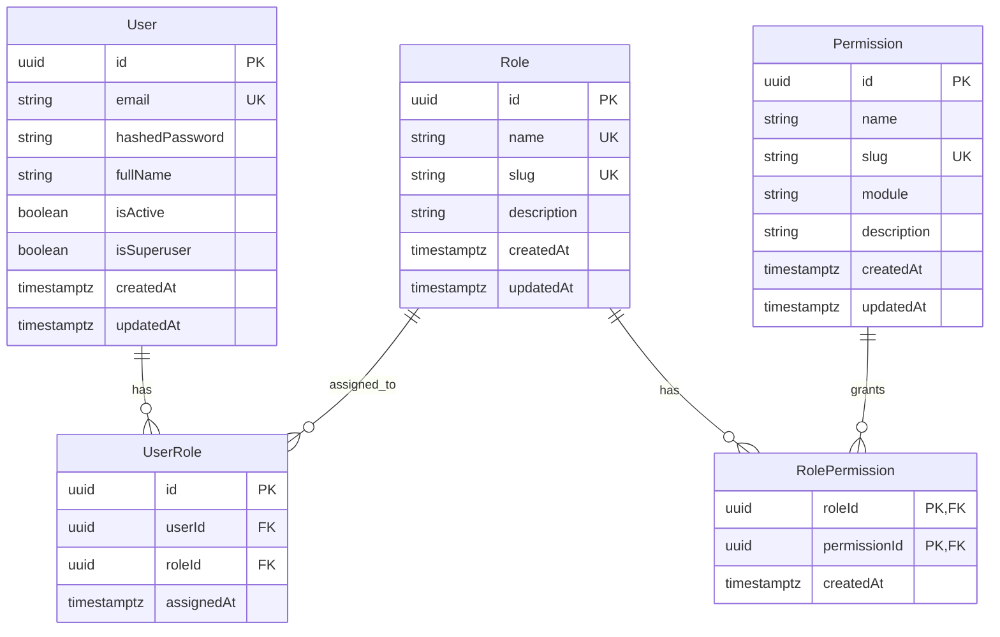
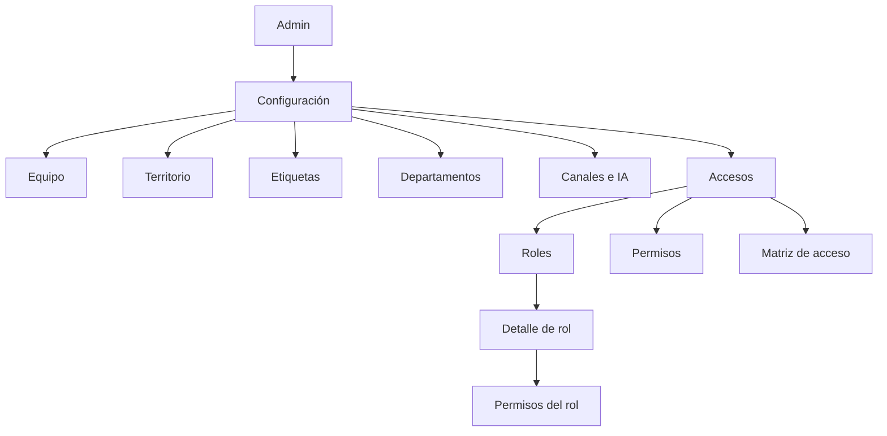
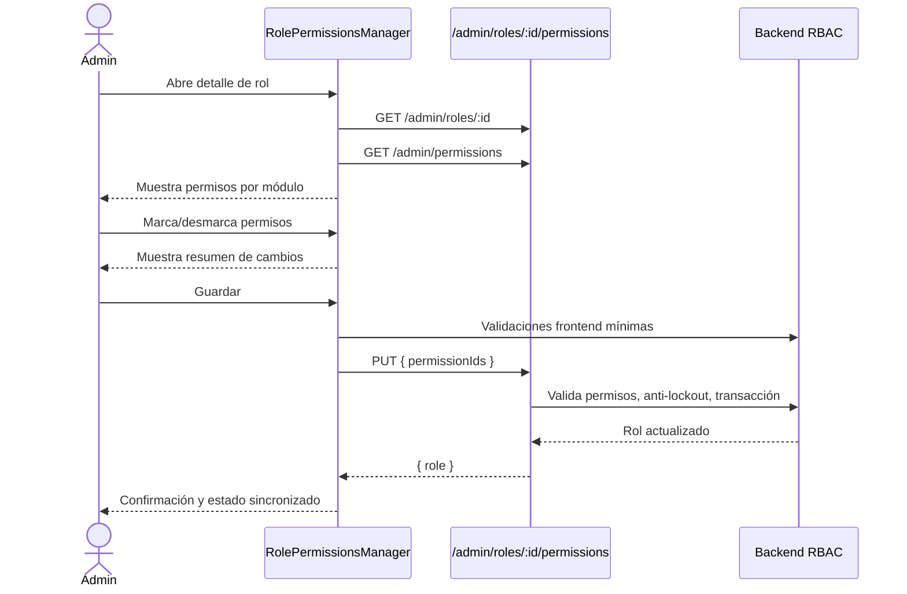
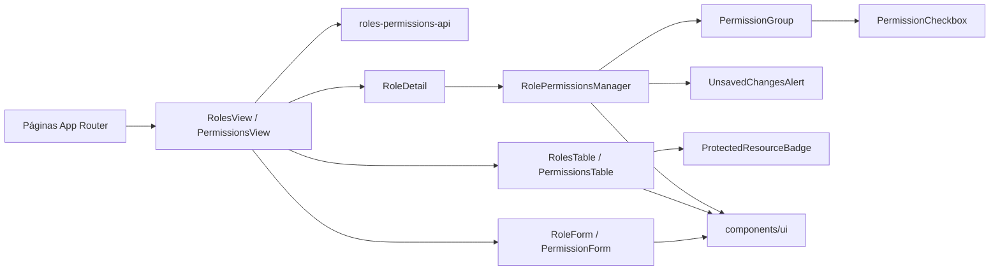

# Análisis para integrar administración de roles y permisos en Voz Ciudadana

## 1. Resumen ejecutivo

Voz Ciudadana ya tiene una base RBAC funcional en backend: modelos `User`, `Role`, `Permission`, `UserRole` y `RolePermission`; seeders idempotentes; rutas protegidas por permisos; y endpoints administrativos para listar roles/permisos, crear/editar/eliminar roles y reemplazar/agregar/quitar permisos de un rol. La integración frontend debe construirse de forma incremental dentro del panel `/admin`, reutilizando Next.js App Router, el layout administrativo, `apiClient`, componentes UI tipo shadcn/Radix, tablas responsive y patrones de formularios/modales existentes.

La recomendación principal es implementar una sección de **Accesos** dentro de **Configuración**, con pantallas independientes para **Roles** y **Permisos**, una pestaña/área de permisos dentro del detalle de rol para asignación por lote, y una **Matriz de acceso** secundaria de consulta. La matriz no debe ser la pantalla principal porque escala mal con muchos roles/permisos.

> **Suposición pendiente de validar:** aunque el backend expone endpoints RBAC, el frontend aún usa guards locales basados en roles y permisos legacy (`manage:users`, `assign:roles`). Será necesario alinear el usuario autenticado o un endpoint de sesión para exponer slugs reales como `roles.view` y `permissions.manage`.

## 2. Estado actual encontrado

### Arquitectura frontend

| Aspecto                | Estado encontrado                                                                                                                                 |
| ---------------------- | ------------------------------------------------------------------------------------------------------------------------------------------------- |
| Framework              | Next.js `16.2.3`, React `^19`, TypeScript `5.7.3`.                                                                                                |
| Rutas                  | App Router con grupos `(admin)`, `(auth)`, `(public)`; admin bajo `frontend/app/(admin)/admin/...`.                                               |
| Layout admin           | `AdminLayoutWrapper` protege con `ProtectedRoute`, agrega `RealtimeProvider` y renderiza `AdminLayout`.                                           |
| Menú                   | `AdminSidebar` define `NAV_ITEMS` estáticos con grupo `Configuración`.                                                                            |
| UI/design system       | Tailwind CSS 4, componentes `components/ui`, Radix, lucide-react, sonner, framer-motion.                                                          |
| Formularios            | Predomina estado local + validación manual y `toast`; dependencias disponibles para `react-hook-form` y `zod`, pero catálogos usan patrón simple. |
| API                    | `apiClient` centraliza `fetch`, base `/api/v1`, Authorization Bearer, refresh y errores tipados `{ ok, data }` / `{ ok:false }`.                  |
| Estado global          | Auth vía Context (`useAuth`) y localStorage; algunas áreas usan hooks de dominio. Zustand instalado, no parece requerido para RBAC.               |
| Autenticación          | JWT + refresh en frontend; backend usa `authMiddleware`.                                                                                          |
| Autorización frontend  | `usePermissions` y `PermissionGate` usan permisos derivados de roles locales, no los slugs RBAC reales.                                           |
| Tablas/modales/loaders | Catálogos usan `Table`, `Dialog`, `Badge`, `Button`, `Switch`, `Skeleton`, empty states y cards móviles.                                          |
| Referencia similar     | Departamentos, barrios/etiquetas y equipo/configuración son las mejores referencias para CRUD administrativo.                                     |

Archivos a revisar/reutilizar:

- `frontend/app/(admin)/layout.tsx`
- `frontend/components/shared/admin-layout.tsx`
- `frontend/components/shared/sidebar.tsx`
- `frontend/lib/shared/api-client.ts`
- `frontend/hooks/shared/useAuth.ts`
- `frontend/hooks/shared/usePermissions.ts`
- `frontend/lib/shared/auth-guards.ts`
- `frontend/lib/shared/auth-storage.ts`
- `frontend/lib/shared/catalog-api.ts`
- `frontend/lib/shared/admin-users-api.ts`
- `frontend/components/domain/catalogs/*`
- `frontend/components/ui/*`

### Arquitectura backend relevante

- Express + Prisma + PostgreSQL.
- Rutas API montadas bajo `/api/v1`.
- `createRolesPermissionsRouter` se monta en `/api/v1/admin`.
- Middleware `requirePermissions` consulta permisos efectivos del usuario en base de datos.
- Auditoría para crear/editar/eliminar roles y modificar permisos de roles.

## 3. Entidades y relaciones



### Campos y restricciones existentes

| Entidad          | Campos                                                                                           | Restricciones/relaciones                                                                                                                 |
| ---------------- | ------------------------------------------------------------------------------------------------ | ---------------------------------------------------------------------------------------------------------------------------------------- |
| `User`           | `id`, `email`, `hashedPassword`, `fullName`, `isActive`, `isSuperuser`, `createdAt`, `updatedAt` | `email` único; `userRoles`; cascada desde `UserRole`; `isActive` existe.                                                                 |
| `Role`           | `id`, `name`, `slug`, `description`, `createdAt`, `updatedAt`                                    | `name` único, `slug` único; índices en `name` y `slug`; relaciones `userRoles`, `rolePermissions`. No tiene `isActive` ni `isProtected`. |
| `Permission`     | `id`, `name`, `slug`, `module`, `description`, `createdAt`, `updatedAt`                          | `slug` único; índices en `module` y `slug`. No tiene `isActive`, `resource`, `action` ni `isProtected`.                                  |
| `UserRole`       | `id`, `userId`, `roleId`, `assignedAt`                                                           | unique `(userId, roleId)`; FK a user/role con `onDelete: Cascade`.                                                                       |
| `RolePermission` | `roleId`, `permissionId`, `createdAt`                                                            | PK compuesta `(roleId, permissionId)`; FK a role/permission con `onDelete: Cascade`.                                                     |

### Roles base existentes

| Rol             | Slug            | Descripción                                                   | Protección actual                                  |
| --------------- | --------------- | ------------------------------------------------------------- | -------------------------------------------------- |
| `SUPERADMIN`    | `superadmin`    | Acceso total al sistema. Gestión de usuarios y configuración. | Backend impide renombrar `name`/`slug` y eliminar. |
| `COORDINADOR`   | `coordinador`   | Coordina operadores y puede ver reportes avanzados.           | No protegido explícitamente.                       |
| `OPERADOR_CHAT` | `operador_chat` | Atiende conversaciones de ciudadanos en el chat.              | No protegido explícitamente.                       |
| `ANALISTA`      | `analista`      | Acceso de solo lectura a datos y reportes.                    | No protegido explícitamente.                       |

### Permisos base existentes

| Slug                 | Nombre               | Módulo        |
| -------------------- | -------------------- | ------------- |
| `users.view`         | Ver usuarios         | `users`       |
| `users.create`       | Crear usuarios       | `users`       |
| `users.update`       | Actualizar usuarios  | `users`       |
| `users.delete`       | Desactivar usuarios  | `users`       |
| `roles.view`         | Ver roles            | `roles`       |
| `roles.create`       | Crear roles          | `roles`       |
| `roles.update`       | Actualizar roles     | `roles`       |
| `roles.delete`       | Eliminar roles       | `roles`       |
| `roles.assign`       | Asignar roles        | `roles`       |
| `permissions.view`   | Ver permisos         | `permissions` |
| `permissions.manage` | Administrar permisos | `permissions` |
| `reports.view`       | Ver reportes         | `reports`     |
| `reports.create`     | Crear reportes       | `reports`     |
| `reports.assign`     | Asignar reportes     | `reports`     |
| `reports.close`      | Cerrar reportes      | `reports`     |

Convención encontrada: `modulo.accion`, por ejemplo `users.view`, `roles.assign`, `permissions.manage`. No usa `roles.read`; usa `roles.view`.

**Recomendaciones de modelo, no existentes hoy:**

- `Role.isActive` o estrategia de desactivación lógica.
- `Role.isSystem` / `Role.isProtected` para no depender de `name === SUPERADMIN`.
- `Permission.isActive`, `Permission.isSystem`, `Permission.sensitivity`.
- Conteos agregados `usersCount`, `permissionsCount`, `rolesCount` en respuestas de listado.
- Control de concurrencia con `updatedAt`/`If-Match` en mutaciones sensibles.

## 4. APIs existentes

Base frontend: `/api/v1`. Base RBAC: `/api/v1/admin`.

| Función                      | Método | Ruta                                         | Permiso backend      | Params/body                              | Respuesta                          | Paginación/filtros | Errores observados            |
| ---------------------------- | -----: | -------------------------------------------- | -------------------- | ---------------------------------------- | ---------------------------------- | ------------------ | ----------------------------- |
| Listar permisos              |    GET | `/admin/permissions`                         | `permissions.view`   | Sin params                               | `{ permissions: Permission[] }`    | No                 | 401, 403                      |
| Listar roles                 |    GET | `/admin/roles`                               | `roles.view`         | Sin params                               | `{ roles: RoleWithPermissions[] }` | No                 | 401, 403                      |
| Consultar rol                |    GET | `/admin/roles/:id`                           | `roles.view`         | `id` UUID                                | `{ role }` con `permissions`       | No                 | 400 UUID inválido, 404        |
| Crear rol                    |   POST | `/admin/roles`                               | `roles.create`       | `{ name, slug, description? }`           | `201 { role }`                     | No                 | 400 validación, 409 duplicado |
| Editar rol                   |  PATCH | `/admin/roles/:id`                           | `roles.update`       | parcial `{ name?, slug?, description? }` | `{ role }`                         | No                 | 400, 404, 409                 |
| Eliminar rol                 | DELETE | `/admin/roles/:id`                           | `roles.delete`       | `id` UUID                                | 204                                | No                 | 400 rol sistema, 404          |
| Sincronizar permisos del rol |    PUT | `/admin/roles/:id/permissions`               | `permissions.manage` | `{ permissionIds: string[] }`            | `{ role }`                         | No                 | 400 IDs inexistentes, 404     |
| Agregar permiso a rol        |   POST | `/admin/roles/:id/permissions/:permissionId` | `permissions.manage` | IDs UUID                                 | `{ role }`                         | No                 | 400, 404, 409 asignado        |
| Retirar permiso de rol       | DELETE | `/admin/roles/:id/permissions/:permissionId` | `permissions.manage` | IDs UUID                                 | `{ role }`                         | No                 | 400, 404 no asignado          |
| Listar usuarios              |    GET | `/admin/users`                               | `users.view`         | Sin params                               | `{ users }` con roles              | No                 | 401, 403                      |
| Asignar rol a usuario        |   POST | `/admin/users/:id/roles/:roleId`             | `roles.assign`       | IDs UUID                                 | `{ user }`                         | No                 | 400, 404, 409 posible         |
| Retirar rol a usuario        | DELETE | `/admin/users/:id/roles/:roleId`             | `roles.assign`       | IDs UUID                                 | `{ user }`                         | No                 | 400, 404                      |

## 5. APIs faltantes

| Necesidad frontend                    | Contrato mínimo recomendado                                                                                                     | Motivo                                                    |
| ------------------------------------- | ------------------------------------------------------------------------------------------------------------------------------- | --------------------------------------------------------- |
| Crear permiso                         | `POST /admin/permissions` body `{ name, slug, module, description? }` permiso `permissions.manage` o nuevo `permissions.create` | Actualmente el catálogo de permisos solo se lista.        |
| Consultar permiso                     | `GET /admin/permissions/:id` permiso `permissions.view`                                                                         | Detalle y edición segura.                                 |
| Editar permiso                        | `PATCH /admin/permissions/:id` body parcial                                                                                     | Gestión de catálogo.                                      |
| Desactivar permiso                    | `PATCH /admin/permissions/:id` con `isActive` si se agrega campo                                                                | Preferible a hard delete.                                 |
| Eliminar permiso seguro               | `DELETE /admin/permissions/:id` solo si no está en uso                                                                          | Hoy no existe; evitar hard delete salvo estrategia clara. |
| Roles asociados a permiso             | `GET /admin/permissions/:id/roles`                                                                                              | Mostrar impacto antes de modificar/eliminar.              |
| Conteos de roles                      | `GET /admin/roles?includeCounts=true` o incluir `usersCount`, `permissionsCount`                                                | Listado eficiente.                                        |
| Búsqueda/filtros/paginación           | `GET /admin/roles?search=&module=&cursor=&limit=` y análogo permisos                                                            | Escalabilidad.                                            |
| Permisos efectivos del usuario actual | `GET /auth/me` o incluir `permissions` en login/refresh                                                                         | Alinear frontend con RBAC real.                           |
| Validación anti-lockout               | Backend en `PUT /roles/:id/permissions` debe rechazar pérdida total de administración                                           | Seguridad no puede depender del frontend.                 |
| Soft delete de rol                    | Si se agrega `isActive`: `PATCH /admin/roles/:id { isActive:false }`                                                            | El modelo actual solo permite delete físico.              |
| Auditoría visible                     | `GET /admin/audit?targetType=Role&targetId=`                                                                                    | Historial de cambios en detalle.                          |

## 6. Arquitectura frontend propuesta

Crear un módulo de accesos manteniendo las convenciones actuales:

```text
frontend/
  app/(admin)/admin/accesos/page.tsx               # landing o redirección
  app/(admin)/admin/accesos/roles/page.tsx
  app/(admin)/admin/accesos/roles/[id]/page.tsx
  app/(admin)/admin/accesos/permisos/page.tsx
  app/(admin)/admin/accesos/matriz/page.tsx        # opcional fase posterior
  components/admin/access-control/
    RolesView.tsx
    RolesTable.tsx
    RoleForm.tsx
    RoleDetail.tsx
    RolePermissionsManager.tsx
    PermissionsView.tsx
    PermissionsTable.tsx
    PermissionForm.tsx
    PermissionGroup.tsx
    PermissionCheckbox.tsx
    AccessMatrix.tsx
    ProtectedResourceBadge.tsx
    UnsavedChangesAlert.tsx
    DeleteOrDisableConfirmation.tsx
  lib/roles-permissions-api.ts
  hooks/useRoles.ts
  hooks/usePermissionsCatalog.ts
  hooks/useRolePermissions.ts
```

Patrones:

- Servicios API en `frontend/lib/*-api.ts` como `catalog-api.ts`.
- Vistas client components en `components/admin/...`.
- Páginas `app` delgadas que renderizan una vista.
- Estado local para filtros, selección, formularios y cambios pendientes.
- Mutaciones pesimistas por defecto; optimistic UI solo para toggles simples no críticos.
- Toasts con `sonner`.
- Dialog/AlertDialog para formularios y confirmaciones.

## 7. Navegación propuesta



Recomendación: agregar un grupo o subgrupo **Accesos** bajo **Configuración**, con:

- **Roles** como pantalla principal para administrar roles y permisos asignados.
- **Permisos** como catálogo separado.
- **Matriz de acceso** como vista secundaria/consulta avanzada, no principal.

| Alternativa                           | Ventajas                                     | Desventajas                                                   | Recomendación            |
| ------------------------------------- | -------------------------------------------- | ------------------------------------------------------------- | ------------------------ |
| Roles y permisos independientes       | Clara separación; escala mejor; CRUD simple. | La asignación requiere navegar a rol.                         | Sí, base del módulo.     |
| Roles con pestaña interna de permisos | Contexto natural para asignar permisos.      | Puede sobrecargar edición de rol si se mezcla con alta.       | Sí, en detalle/edición.  |
| Matriz global                         | Útil para auditoría visual comparativa.      | Mala usabilidad con muchos permisos/roles; difícil en tablet. | Solo secundaria.         |
| Combinación                           | Cubre consulta, edición e impacto.           | Más pantallas.                                                | Alternativa recomendada. |

## 8. Detalle de pantallas

| Pantalla             | Ruta sugerida               | Campos/acciones                                                                                                               | Dependencias backend                                    |
| -------------------- | --------------------------- | ----------------------------------------------------------------------------------------------------------------------------- | ------------------------------------------------------- |
| Listado de roles     | `/admin/accesos/roles`      | nombre, slug, descripción, estado recomendado, permisos count, usuarios count recomendado, actualización, ver/editar/eliminar | GET roles; conteos faltantes.                           |
| Alta/edición rol     | Modal o `/roles/new`        | `name`, `slug`, `description`; permisos opcional solo en edición/detalle; validación regex actual `^[a-z0-9_-]+$`             | POST/PATCH roles.                                       |
| Detalle rol          | `/admin/accesos/roles/[id]` | info general, permisos asignados, usuarios asociados recomendado, auditoría recomendada                                       | GET role; usuarios por rol faltante.                    |
| Asignación permisos  | Dentro de detalle rol       | permisos agrupados por `module`, buscador, seleccionar grupo, resumen added/removed, guardar/descartar                        | PUT replace role permissions.                           |
| Listado permisos     | `/admin/accesos/permisos`   | nombre, slug, descripción, módulo, roles count recomendado, actualización, acciones                                           | GET permissions; conteos faltantes.                     |
| Alta/edición permiso | Modal o drawer              | campos existentes: `name`, `slug`, `module`, `description`; acción/recurso solo recomendación derivable del slug              | Endpoints faltantes.                                    |
| Matriz de acceso     | `/admin/accesos/matriz`     | filas permisos, columnas roles, filtro módulo, modo lectura inicial                                                           | GET roles + permissions; mutación por lote si se edita. |

Notas de ajuste al modelo real:

- No mostrar “estado activo/inactivo” como editable hasta que exista `isActive` en `Role`/`Permission`.
- No mostrar `action` y `resource` como campos reales; pueden derivarse visualmente de `slug` únicamente como ayuda.
- “Protegido” existe por regla de backend solo para `SUPERADMIN`; no hay campo. Mostrarlo por convención hasta crear `isSystem`.

## 9. Componentes a reutilizar

| Componente/archivo                                                                                                 | Uso                                                       |
| ------------------------------------------------------------------------------------------------------------------ | --------------------------------------------------------- |
| `AdminLayout`, `AdminSidebar`                                                                                      | Integrar navegación y títulos.                            |
| `ProtectedRoute`                                                                                                   | Protección de sesión.                                     |
| `PermissionGate`                                                                                                   | Ocultar acciones, previa actualización a permisos reales. |
| `apiClient`                                                                                                        | Consumo de endpoints RBAC.                                |
| `Button`, `Badge`, `Table`, `Dialog`, `AlertDialog`, `Input`, `Textarea`, `Switch`, `Skeleton`, `Tabs`, `Checkbox` | UI consistente.                                           |
| `DepartmentTable`, `DepartmentForm`, `SharedFilters`, `PaginationControls`                                         | Referencia para tablas responsive, forms y filtros.       |
| `adminUsersApi`                                                                                                    | Referencia de servicios admin.                            |
| `toast`/`sonner`                                                                                                   | Éxitos y errores.                                         |

## 10. Componentes nuevos

| Componente sugerido           | Responsabilidad                            | Props principales                                     | Estado interno                            | Eventos                        | Reutilización                 |
| ----------------------------- | ------------------------------------------ | ----------------------------------------------------- | ----------------------------------------- | ------------------------------ | ----------------------------- |
| `RolesView`                   | Orquestar listado, filtros, modal de rol.  | ninguna o `initialFilters`                            | búsqueda, modal abierto, rol seleccionado | create/update/delete           | Página principal roles.       |
| `RolesTable`                  | Tabla/cards de roles.                      | `roles`, `loading`, `canEdit`, `canDelete`, callbacks | ninguno                                   | `onView`, `onEdit`, `onDelete` | Matriz/resumen.               |
| `RoleForm`                    | Alta/edición rol.                          | `open`, `role?`, `onSubmit`                           | form, submitting                          | submit/cancel                  | Crear/editar.                 |
| `RoleDetail`                  | Mostrar info y tabs.                       | `role`, `loading`                                     | tab activa                                | edit/delete                    | Detalle.                      |
| `RolePermissionsManager`      | Asignación por lote.                       | `role`, `allPermissions`, `onSave`                    | seleccionados, búsqueda, módulo, dirty    | save/discard/toggle            | Reusable en matriz o detalle. |
| `PermissionsView`             | Orquestar catálogo permisos.               | —                                                     | búsqueda, módulo, modal                   | create/update                  | Página permisos.              |
| `PermissionsTable`            | Listado permisos responsive.               | `permissions`, `loading`, callbacks                   | ninguno                                   | edit/viewRoles                 | Catálogo.                     |
| `PermissionForm`              | Alta/edición permiso.                      | `permission?`, `onSubmit`                             | form, errors                              | submit                         | Requiere endpoints nuevos.    |
| `PermissionGroup`             | Agrupar permisos por módulo.               | `module`, `permissions`, `selectedIds`                | expand/collapse                           | toggleAll                      | Asignación.                   |
| `PermissionCheckbox`          | Checkbox accesible con descripción.        | `permission`, `checked`, `disabled`                   | ninguno                                   | toggle                         | Asignación/matriz.            |
| `AccessMatrix`                | Consulta comparativa roles-permisos.       | `roles`, `permissions`, `readonly?`                   | filtros, columnas visibles                | toggle opcional                | Auditoría.                    |
| `ProtectedResourceBadge`      | Mostrar rol/permiso del sistema.           | `reason`, `type`                                      | ninguno                                   | —                              | Tablas/detalle.               |
| `UnsavedChangesAlert`         | Advertir cambios pendientes.               | `dirty`, `onDiscard`, `onSave`                        | confirm open                              | save/discard                   | Formularios/asignación.       |
| `DeleteOrDisableConfirmation` | Confirmación de eliminación/desactivación. | `resource`, `impact`, `onConfirm`                     | open/submitting                           | confirm                        | Roles/permisos.               |

## 11. Servicios, hooks y estado

### Servicio API recomendado

`frontend/lib/shared/roles-permissions-api.ts`:

- `rolesPermissionsApi.listRoles()` → GET `/admin/roles`.
- `rolesPermissionsApi.getRole(id)` → GET `/admin/roles/:id`.
- `rolesPermissionsApi.createRole(payload)`.
- `rolesPermissionsApi.updateRole(id, payload)`.
- `rolesPermissionsApi.deleteRole(id)`.
- `rolesPermissionsApi.listPermissions()`.
- `rolesPermissionsApi.replaceRolePermissions(roleId, permissionIds)`.
- `rolesPermissionsApi.addRolePermission(roleId, permissionId)`.
- `rolesPermissionsApi.removeRolePermission(roleId, permissionId)`.

### Hooks

- `useRoles`: carga roles, expone `loading`, `error`, `refresh`, mutaciones.
- `useRole(roleId)`: detalle de rol.
- `usePermissionsCatalog`: catálogo de permisos agrupable por módulo.
- `useRolePermissions(roleId)`: selección, dirty state, diff `added`/`removed`, guardado.

### Guardado de asignaciones

Recomendación: usar el endpoint existente de sincronización por lote:

```json
{ "permissionIds": ["uuid-1", "uuid-2"] }
```

Ventajas:

- Evita múltiples requests y estados parciales.
- Hace más simple calcular el estado final.
- Permite validación atómica en backend.

Precaución: el backend actual borra todo y recrea en una transacción. Debe agregar validaciones anti-lockout antes de ejecutar la transacción.

### Caché e invalidación

No hay React Query instalado. Opciones:

1. Estado local + `refresh()` después de mutación, consistente con el proyecto actual.
2. **Recomendación futura:** incorporar TanStack Query si el equipo acepta dependencia; simplificaría caché, invalidación y estados concurrentes.

## 12. Estrategia de autorización

### Permisos administrativos reales

| Acción UI                      | Permiso real encontrado                | Nota                                                   |
| ------------------------------ | -------------------------------------- | ------------------------------------------------------ |
| Ver roles                      | `roles.view`                           | Existe.                                                |
| Crear roles                    | `roles.create`                         | Existe.                                                |
| Editar roles                   | `roles.update`                         | Existe.                                                |
| Eliminar roles                 | `roles.delete`                         | Existe, pero hoy es hard delete.                       |
| Asignar roles a usuarios       | `roles.assign`                         | Existe para user-role, no role-permission.             |
| Ver permisos                   | `permissions.view`                     | Existe.                                                |
| Administrar permisos de roles  | `permissions.manage`                   | Existe.                                                |
| Crear/editar/eliminar permisos | No granular; solo `permissions.manage` | Recomendado separar si se implementa CRUD de permisos. |

Protecciones:

- **Rutas:** wrapper `RequirePermission` o extensión de `ProtectedRoute` que valide slugs reales.
- **Menú:** ocultar “Accesos” si no tiene `roles.view` ni `permissions.view`.
- **Botones:** `PermissionGate` por acción (`roles.create`, `roles.update`, `permissions.manage`).
- **Formularios:** deshabilitar campos no permitidos o protegidos.
- **Consultas:** no llamar endpoints si falta permiso; mostrar 403 accionable si backend rechaza.
- **Mutaciones:** backend siempre valida con `requirePermissions`; frontend solo mejora UX.

**Brecha actual:** `authStorage.StoredUser.roles` solo guarda roles; `auth-guards.ts` tiene permisos locales tipo `manage:users`. Para permisos reales se requiere: (a) incluir `permissions: string[]` en login/refresh/user, o (b) endpoint `/auth/me`, y actualizar `usePermissions`.

## 13. Reglas de negocio

| Escenario                          | Frontend esperado                                                                                     | Validación backend                                                          | Mensaje recomendado                                                      |
| ---------------------------------- | ----------------------------------------------------------------------------------------------------- | --------------------------------------------------------------------------- | ------------------------------------------------------------------------ |
| Rol duplicado                      | Validar slug/name antes de enviar si hay datos cargados; manejar 409.                                 | Unique `name`, `slug`.                                                      | “Ya existe un rol con ese nombre o clave.”                               |
| Permiso duplicado                  | Igual para `slug`.                                                                                    | Unique `slug`.                                                              | “Ya existe un permiso con esa clave.”                                    |
| Modificar rol protegido            | Mostrar badge y bloquear `name`/`slug`; permitir descripción solo si backend lo permite.              | Bloquea renombrar `SUPERADMIN`; recomendado `isSystem`.                     | “Este rol es interno y no puede renombrarse.”                            |
| Eliminar rol con usuarios          | Mostrar impacto si se conoce.                                                                         | Debe impedir o requerir migración; hoy cascade borraría asignaciones.       | “No se puede eliminar: hay usuarios con este rol.”                       |
| Eliminar permiso en uso            | No ofrecer delete; solo desactivar si existe.                                                         | Debe impedir hard delete o exigir confirmación/transacción.                 | “Este permiso está asignado a roles. Retiralo antes de eliminarlo.”      |
| Dejar rol sin permisos             | Advertencia; permitir solo si no es admin/protegido.                                                  | Reglas por rol.                                                             | “El rol quedará sin acceso a funciones del panel.”                       |
| Retirar acceso admin a SUPERADMIN  | Bloquear o confirmar con validación fuerte.                                                           | Debe impedir pérdida de `roles.view`/`permissions.manage` del último admin. | “No podés retirar permisos indispensables del último rol administrador.” |
| Eliminar último rol admin          | Bloquear.                                                                                             | Conteo/consulta transaccional.                                              | “Debe existir al menos un rol con permisos administrativos.”             |
| Concurrencia                       | Detectar `updatedAt` cambiado y pedir recargar.                                                       | Optimistic locking recomendado.                                             | “Los permisos cambiaron en otra sesión. Recargá antes de guardar.”       |
| Falla parcial                      | Si se usa sync transaccional no debería haber parcial; si hay requests individuales, mostrar detalle. | Transacción.                                                                | “No se pudieron guardar todos los cambios.”                              |
| Permisos desconocidos por frontend | Renderizar genérico por módulo/slug, no romper.                                                       | Ninguna especial.                                                           | No aplica; mostrar slug y descripción.                                   |
| Seeders repetidos                  | No duplicar en UI; confiar en upsert/unique.                                                          | Upsert + unique.                                                            | “Datos base actualizados correctamente.”                                 |
| Datos históricos inconsistentes    | Mostrar fallback y permitir corrección si autorizado.                                                 | Migraciones/normalización.                                                  | “Hay datos con formato antiguo; revisá antes de guardar.”                |

## 14. Riesgos técnicos y funcionales

| Riesgo                                         | Impacto    | Mitigación                                                          |
| ---------------------------------------------- | ---------- | ------------------------------------------------------------------- |
| Frontend no conoce permisos reales del usuario | Alto       | Exponer permisos efectivos en sesión y actualizar guards.           |
| Delete físico de roles con cascada             | Alto       | Preferir soft delete; bloquear delete si tiene usuarios.            |
| Falta CRUD de permisos                         | Medio      | Implementar fase permisos solo lectura hasta backend listo.         |
| Sin paginación/filtros backend                 | Medio      | Filtro client-side temporal; solicitar paginación antes de escalar. |
| Matriz grande                                  | Medio/alto | Hacerla secundaria, con filtros y columnas acotadas.                |
| Anti-lockout no implementado                   | Alto       | Validación backend obligatoria antes de liberar asignación.         |
| Concurrencia                                   | Medio      | Usar `updatedAt` y confirmación de recarga.                         |
| Roles protegidos inferidos por nombre          | Medio      | Agregar `isSystem`/`isProtected`.                                   |
| Permisos sensibles no identificados            | Medio      | Catálogo de sensibilidad o lista backend.                           |

## 15. Plan de implementación por fases

| Fase                          | Alcance                                                                        | Archivos probables                                                                                              | Dependencias                                                  | Riesgos                 | Criterios de aceptación                                                 | Complejidad |
| ----------------------------- | ------------------------------------------------------------------------------ | --------------------------------------------------------------------------------------------------------------- | ------------------------------------------------------------- | ----------------------- | ----------------------------------------------------------------------- | ----------- |
| 1. Lectura y consulta         | Rutas, menú, listados roles/permisos, detalle rol, consulta permisos asignados | `sidebar.tsx`, `admin-layout.tsx`, nuevas páginas, `roles-permissions-api.ts`, `RolesTable`, `PermissionsTable` | Endpoints existentes                                          | Guards reales faltantes | Un admin ve roles/permisos y detalle sin editar                         | Media       |
| 2. Administración de roles    | Crear/editar/eliminar o desactivar si backend cambia; roles protegidos         | `RoleForm`, `DeleteOrDisableConfirmation`, hooks roles                                                          | Endpoints existentes para CRUD roles; soft delete recomendado | Delete físico           | Crear/editar roles y manejar duplicados/protegidos                      | Media       |
| 3. Administración de permisos | Alta/edición/desactivación, módulo                                             | `PermissionForm`, `PermissionsView`                                                                             | Endpoints faltantes                                           | Modelo sin `isActive`   | CRUD permisos funcional cuando backend lo exponga                       | Media/alta  |
| 4. Asignación de permisos     | Selector agrupado, diff, sync por lote, confirmaciones                         | `RolePermissionsManager`, `PermissionGroup`, `UnsavedChangesAlert`                                              | PUT existente; anti-lockout backend recomendado               | Pérdida de acceso       | Guardar conjunto final, descartar cambios, bloquear escenarios críticos | Alta        |
| 5. Pruebas y endurecimiento   | Unit/component/integration/e2e/a11y/auth/concurrencia                          | tests en `frontend/**/__tests__` y e2e si existe harness                                                        | Fixtures y mocks API                                          | Cobertura insuficiente  | Casos críticos automatizados y a11y básica                              | Alta        |

## 16. Casos de prueba

- Carga de roles exitosa, vacía y con error 500.
- Carga de permisos agrupados por `module`.
- Búsqueda por `name`, `slug`, `description`.
- Filtro por módulo en permisos y asignación.
- Paginación cuando backend la implemente; mientras tanto, no mostrar controles falsos.
- Crear rol válido; duplicado 409; slug inválido; descripción >255.
- Editar rol normal; intentar renombrar `SUPERADMIN`.
- Eliminar rol no protegido; bloquear `SUPERADMIN`; bloquear rol con usuarios si backend lo informa.
- Crear/editar permiso cuando existan endpoints; slug duplicado.
- Asignar permiso individual; seleccionar todo un módulo.
- Retirar permiso sensible y confirmar.
- Guardar por lote y refrescar detalle.
- Cancelar cambios y restaurar selección original.
- Advertencia al navegar con cambios no guardados.
- 401: limpiar sesión/redirigir; 403: mostrar “No tenés permisos”.
- Permisos protegidos/sistema: campos bloqueados.
- Prevención de pérdida total de acceso administrativo.
- Concurrencia: backend devuelve conflicto o `updatedAt` distinto.
- Accesibilidad: foco en modales, labels, navegación teclado, `aria-label` en switches/checkboxes.

## 17. Criterios de aceptación

- La sección aparece solo para usuarios autorizados.
- Los listados reutilizan estilos, loaders, empty states y responsive patterns del panel.
- No se inventan estados activos para roles/permisos hasta que backend/modelo los exponga.
- Las acciones no autorizadas se ocultan o deshabilitan, y backend las rechaza igualmente.
- La asignación de permisos muestra cambios pendientes antes de guardar.
- El guardado por lote usa el conjunto final de permisos y muestra éxito/error claro.
- Roles internos muestran indicador visible y bloquean acciones peligrosas.
- No se recomienda hard delete para permisos/roles en uso.
- La matriz de acceso es secundaria y filtrable.
- Los errores 400/401/403/404/409 tienen mensajes accionables.

## 18. Preguntas o decisiones pendientes

1. ¿Se agregará `permissions` al usuario autenticado o habrá endpoint `/auth/me`?
2. ¿Se aceptan nuevos campos `isActive`, `isSystem`, `isProtected` para roles/permisos?
3. ¿El CRUD de permisos será permitido en producción o solo se administrará por migraciones/seeders?
4. ¿Qué permisos se consideran indispensables para no bloquear la administración?
5. ¿Se requiere auditoría visible en UI o solo registro backend?
6. ¿Se implementará paginación backend antes de liberar el módulo?
7. ¿La eliminación de roles debe cambiarse a desactivación lógica?
8. ¿Debe separarse `permissions.manage` en `permissions.create/update/delete` y `roles.assign_permissions`?

## Flujo de asignación de permisos



## Dependencias entre componentes


