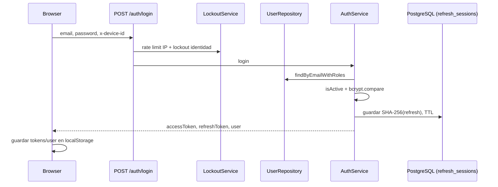

# Flujo actual de autenticación

## Proveedor y estrategia

Autenticación propia en Express:

- usuarios y hash bcrypt en PostgreSQL;
- access y refresh JWT firmados;
- hashes de refresh tokens/sesiones en PostgreSQL (tabla `refresh_sessions`);
- cliente Next.js con tokens en `localStorage`.

No se encontró OAuth/OIDC, proveedor SaaS, MFA, passwordless, verificación de email ni recuperación de contraseña.

## Login

Evidencia:

- ruta: `backend/src/routes/auth.routes.ts:29-39`;
- controller/device ID: `backend/src/controllers/auth.controller.ts:25-54`;
- credenciales/roles/tokens: `backend/src/services/auth.service.ts:78-126`;
- firmas JWT: `backend/src/utils/token.util.ts:28-71`;
- almacenamiento cliente: `frontend/lib/shared/auth-storage.ts:42-75`.

## Claims

Access token:

- `sub`
- `email`
- `fullName`
- `roles[]`
- `type: access`
- `iat`, `exp`

Refresh token:

- `sub`
- `type: refresh`
- `jti`
- `deviceId`
- `iat`, `exp`

El access token no lleva tenant, municipio, departamento, permisos ni versión de sesión.

## Sesiones y refresh

PostgreSQL usa:

- `refresh_sessions` (`userId`, `deviceId`, `jti`) → hash SHA-256 del refresh (`tokenHash`);
- `refresh_sessions` por `userId` → catálogo de sesiones activas.

El refresh:

1. valida firma/expiración y `type`;
2. busca el hash en `refresh_sessions`;
3. compara el token recibido;
4. vuelve a consultar usuario activo y roles;
5. elimina el refresh anterior;
6. emite y persiste un par nuevo.

Valores por defecto:

| Configuración           | Valor                |
| ----------------------- | -------------------- |
| Access JWT              | 15 min               |
| Refresh JWT             | 7 días               |
| Sesiones simultáneas    | 5                    |
| Login por IP            | 10 / 15 min          |
| Refresh por IP          | 60 / 5 min           |
| Fallos antes de lockout | 5                    |
| Lockouts                | 60, 300, 900, 3600 s |

Fuente: `backend/src/config/env.config.ts:90-130`.

La evicción FIFO se implementa sobre `refresh_sessions`, ordenando por `createdAt` ascendente para eliminar las sesiones más antiguas al superar `AUTH_MAX_SESSIONS_PER_USER` (`auth.service.ts:455-468`).

⚠️ Los middlewares resuelven IP leyendo directamente el primer `X-Forwarded-For` (`rate-limit.middleware.ts:36-42`). No se encontró `app.set('trust proxy', ...)`; si Express es alcanzable sin un proxy que reescriba ese header, un cliente puede evadir el límite por IP. El lockout por email sigue siendo una barrera separada.

## Resolución del usuario actual

- `authMiddleware` solo verifica JWT y copia claims a `req.user` (`backend/src/middlewares/auth.middleware.ts:18-49`).
- `/auth/me` sí consulta DB y rechaza usuario inexistente/inactivo (`auth.service.ts:230-246`).
- El frontend restaura directamente `StoredUser` si el access token local no expiró; no llama `/auth/me` en esa ruta (`frontend/hooks/shared/useAuth.ts:85-110`).

Por tanto, roles/desactivación cambian efectivamente al renovar o consultar `/me`, pero no en cada request.

## Logout

- Logout individual necesita refresh token para revocar su fila en `refresh_sessions`.
- `logoutAll` elimina todas las sesiones del usuario.
- El frontend hace revocación best-effort, limpia storage y redirige.
- Un access token previamente emitido sigue criptográficamente válido hasta `exp`.

## Almacenamiento del navegador

`vc_access_token`, `vc_refresh_token`, `vc_user` y `vc_device_id` viven en `localStorage`. Además, el access token se copia a `vc_access_token` cookie `SameSite=Strict`, pero sin `Secure` ni `HttpOnly` explícitos (`frontend/lib/shared/auth-storage.ts:51-60`).

Consecuencias comprobadas:

- CSRF se reduce porque las APIs usan Bearer header, no la cookie.
- XSS puede leer y exfiltrar access y refresh tokens.
- La cookie es una señal para Edge, pero `proxy.ts` actualmente no la valida.

## Controles no demostrados

- ❓ Política de complejidad más allá de longitud mínima 8.
- ❓ Rotación operacional de `JWT_SECRET`/`JWT_REFRESH_SECRET`.
- ❓ Detección y respuesta a robo de access token.
- ❓ MFA.
- ❓ Recuperación de cuenta.
- ❓ Alertas centralizadas a partir de `logSecurityEvent`.
