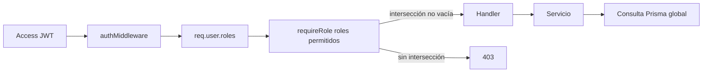

# Flujo actual de autorización

## Modelo efectivo

El backend aplica RBAC por nombre de rol. No existe ABAC general, ACL ni permisos persistidos.

`requireRole` presupone que `authMiddleware` ya pobló `req.user` y permite si existe al menos un rol coincidente (`backend/src/middlewares/rbac.ts:28-47`).

## Capas

### Frontend

- `ProtectedRoute`: autenticación cliente.
- `PermissionGate`: visibilidad por permiso/rol local.
- `AdminSidebar`: no filtra por rol.
- Botones de algunas acciones usan roles hardcodeados.

Estado: ⚠️ útil para UX, no autoridad.

### Backend

- `authMiddleware`: firma/expiración/tipo del token.
- `requireRole`: rol por endpoint.
- Zod: allowlist de campos.
- Servicios: reglas de estado y existencia.

Estado: ✅ autoridad principal para APIs REST.

### Base de datos

- FKs y constraints de integridad.
- Sin RLS/policies.
- Sin sesión DB configurada con identidad de usuario.

Estado: ❌ no autoriza filas.

## Reglas por dominio

### Usuarios

`SUPERADMIN` muta cuentas/roles. `COORDINADOR` puede leer. No hay self-service ni protección del último superadmin.

### Conversaciones, mensajes y handover

- lectura: cuatro roles;
- escritura: `SUPERADMIN|COORDINADOR|OPERADOR_CHAT`;
- no se verifica asignación actual, `departmentSlug`, propiedad ni ciudadanía;
- assign/transfer aceptan IDs de usuario enviados por cliente.

### Ciudadanos

- lectura: `SUPERADMIN|COORDINADOR`;
- CRUD: `SUPERADMIN`;
- tag assign/remove/bulk: `SUPERADMIN|COORDINADOR`.

### Eventos

`SUPERADMIN|COORDINADOR` puede listar, crear, editar, invitar, registrar, confirmar y check-in. `organizerUserId` no limita autorización.

### Analytics

`SUPERADMIN|COORDINADOR|ANALISTA`, sin scope de filas.

### Catálogos

`SUPERADMIN|COORDINADOR` leen; `SUPERADMIN` muta neighborhoods, tags y departments.

### IA y sistema

Solo `SUPERADMIN`.

### WebSocket

El namespace `/admin` verifica access JWT, pero:

- no exige ninguno de los cuatro roles;
- no revalida `isActive`;
- no autoriza `conversation.subscribe`;
- eventos globales se emiten a todo el namespace.

Evidencia: `backend/src/services/realtime/websocket-gateway.service.ts:35-78,126-153,166-188`.

## IDs del cliente y ownership

| Campo/ID                 | Validación            | Autorización                |
| ------------------------ | --------------------- | --------------------------- |
| `conversationId` URL     | UUID/existencia       | Sin ownership/scope         |
| `userId` assign          | UUID/FK               | Cualquier usuario existente |
| `toUserId` transfer      | UUID/FK               | Cualquier usuario existente |
| `departmentSlug`         | string/uso de dominio | No scope                    |
| `organizerUserId` evento | UUID/FK               | No limita actor             |
| `citizenId`, `tagId`     | UUID/existencia       | Solo rol de ruta            |
| room WebSocket           | string no vacío       | Ninguna                     |

## Bypass

- Una acción ocultada por frontend **no** omite `requireRole` en REST.
- Manipular roles en `localStorage` puede alterar la UI, pero no firma un JWT válido.
- Un access JWT válido con rol permitido sí puede llamar directamente cualquier endpoint del mismo rol, incluso si el frontend no muestra la acción.
- WebSocket constituye una ruta alternativa de lectura en tiempo real con autorización más débil que REST.

## Código legado

- `jwt.middleware.ts` re-exporta `authMiddleware`.
- `checkRole` sigue exportado para compatibilidad y serializa errores diferente.
- `isSuperuser` no se usa.
- Archivos históricos eliminados `user.controller.ts`/`admin.routes.ts` no forman parte del wiring actual; el router efectivo es `users.routes.ts`, montado en `routes/index.ts:213-220`.
