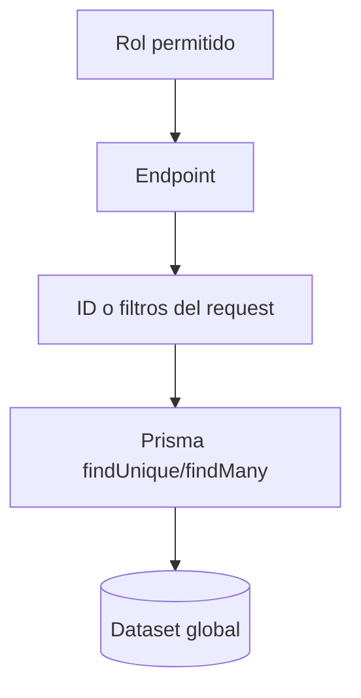

# Multi-tenancy y aislamiento de información

## Veredicto

**❌ Multi-tenancy no está implementado.**

El sistema observado modela una sola instancia municipal/global. No existen tenants, organizaciones o memberships y las consultas no aplican filtros institucionales.

## Evidencia negativa comprobada

En `backend/prisma/schema.prisma` no existen modelos:

- `Organization`
- `Tenant`
- `Municipality`
- `Membership`
- `Team`
- `Area`
- `Profile`

Tampoco se encontraron campos `organizationId`, `tenantId`, `municipalityId`, `membershipId` o `teamId` en código, schema o migraciones.

## Elementos que no constituyen tenant

| Elemento            | Función real                                             | ¿Boundary? |
| ------------------- | -------------------------------------------------------- | ---------- |
| `Department`        | Catálogo de routing y horarios                           | No         |
| `departmentSlug`    | Etiqueta denormalizada en conversación/ticket/asignación | No         |
| `Neighborhood`      | Catálogo territorial plano                               | No         |
| `CommunicationLine` | Línea/canal WhatsApp                                     | No         |
| `assignedUserId`    | Responsable operativo                                    | No         |
| `organizerUserId`   | Organizador de evento                                    | No         |

Ninguno se incorpora al JWT o a `req.user`; ninguno aparece como filtro obligatorio de autorización.

## Flujo real de datos

Ejemplos:

- `ConversationRepository.listWithContext` lista sin `where` de actor/departamento (`conversation.repository.ts:218-232`).
- `getConversationContext` busca solo por ID (`conversation.repository.ts:146-160`).
- `CitizensService.list` crea filtros de negocio, no institucionales (`citizens.service.ts:146-205`).
- Analytics recibe filtros de métricas, no tenant (`analytics.repository.ts:15-32`).

## Respuestas a las preguntas de aislamiento

### ¿Un usuario de una organización puede consultar otra?

❓ El concepto “organización” no existe. Si los datos de dos organizaciones se cargaran en las mismas tablas, **no habría aislamiento**.

### ¿Un municipio puede acceder a otro?

❓ No existen usuarios/claims/filas asociados a municipio. El repositorio contiene contenido de Cintalapa, pero no una barrera técnica municipal.

### ¿El scope viene de sesión o request?

No hay scope institucional. `departmentSlug` puede venir del request en acciones operativas y no es una credencial.

### ¿El cliente puede manipularlo?

Sí puede enviar `departmentSlug`, `userId`, `toUserId`, `organizerUserId` e IDs de recursos dentro de los schemas permitidos. El backend valida forma/existencia y rol, pero no pertenencia institucional.

## Base de datos

- ❌ No se encontraron `ENABLE ROW LEVEL SECURITY`, `CREATE POLICY`, grants por tenant ni funciones SQL de contexto.
- ✅ Existen FKs y uniques generales.
- ⚠️ `departmentSlug` en `ConversationMeta`, `Ticket` y `Assignment` no tiene FK a `Department`.

## Estado y riesgo

- Para despliegue estrictamente single-tenant: **⚠️ decisión arquitectónica**, no aislamiento roto entre tenants inexistentes.
- Para SaaS, múltiples municipios o separación por dependencia: **Alto**, porque todos los roles permitidos operarían sobre un dataset común.

No debe afirmarse “aislamiento por departamento” o “multi-municipio” hasta que exista evidencia en modelo, token, middleware, consultas y DB.
