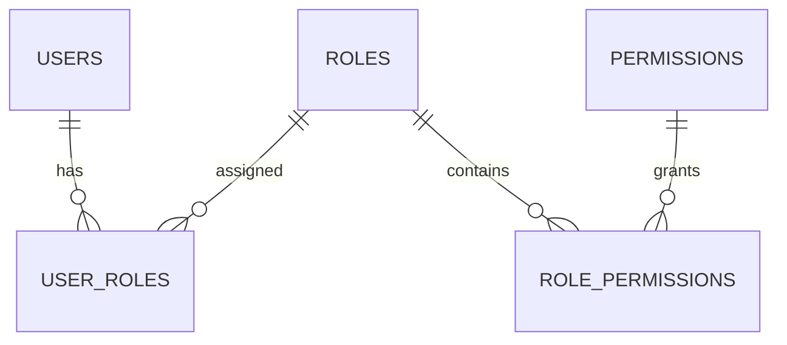

# Sistema de roles y permisos con Prisma

## Resumen ejecutivo

Se implementa autorización basada en permisos efectivos derivados de roles. El token JWT conserva identidad mínima y roles para compatibilidad; las decisiones de autorización consultan permisos vigentes en base de datos mediante middleware reutilizable.

## Diagnóstico anterior

- Existían `users`, `roles` y `user_roles` con relación muchos-a-muchos usuario/rol.
- La autorización administrativa usaba roles (`SUPERADMIN`, `COORDINADOR`, etc.) directamente en rutas.
- `GET /auth/me` devolvía usuario y roles, pero no permisos.
- No existía catálogo auditable de permisos ni pivote `role_permissions`.

## Arquitectura final



### Tablas

- `users`: identidad, credenciales hash, estado y auditoría temporal.
- `roles`: roles administrativos con `name`, `slug`, descripción y timestamps.
- `user_roles`: pivote usuario/rol con unicidad `(user_id, role_id)`.
- `permissions`: catálogo idempotente de permisos `module.action`.
- `role_permissions`: pivote rol/permiso con PK compuesta `(role_id, permission_id)` y cascada.

## Catálogo inicial de permisos

El catálogo cubre módulos reales del backend: usuarios administrativos, roles, permisos y reportes/analíticas/tickets.

- `users.view`, `users.create`, `users.update`, `users.delete`
- `roles.view`, `roles.create`, `roles.update`, `roles.delete`, `roles.assign`
- `permissions.view`, `permissions.manage`
- `reports.view`, `reports.create`, `reports.assign`, `reports.close`

## Matriz inicial

| Rol | Permisos |
| --- | --- |
| `SUPERADMIN` | Todos los permisos asignados explícitamente |
| `COORDINADOR` | Lectura administrativa y gestión operativa de reportes |
| `OPERADOR_CHAT` | Gestión operativa de reportes/tickets |
| `ANALISTA` | Lectura de usuarios, roles, permisos y reportes |

## Superadministrador

La estrategia elegida es explícita y auditable: `SUPERADMIN` recibe todos los permisos en `role_permissions`. No se agregó bypass oculto por nombre de rol ni por `is_superuser`.

## Flujo de autenticación

1. Login valida credenciales y estado.
2. Access token incluye identidad mínima y roles para compatibilidad.
3. Refresh token sigue rotación en PostgreSQL (`refresh_sessions`) y device binding.
4. `GET /auth/me` consulta base de datos para devolver permisos vigentes.

## Flujo de autorización

1. `authMiddleware` valida JWT y llena `req.user`.
2. `requirePermissions(prisma, permisos, modo)` consulta permisos efectivos vigentes.
3. Responde `401` si no hay autenticación.
4. Responde `403` si el usuario autenticado no tiene permisos suficientes.

## Endpoint del usuario autenticado

`GET /api/v1/auth/me` responde:

```json
{
  "user": {
    "id": "uuid",
    "email": "usuario@correo.com",
    "fullName": "Nombre",
    "roles": ["SUPERADMIN"],
    "isActive": true,
    "permissions": ["users.view", "roles.assign"],
    "permissionsByModule": { "users": ["view"], "roles": ["assign"] }
  }
}
```

No expone `hashedPassword`, tokens internos ni secretos.

## Endpoints administrativos

Base `/api/v1/admin`:

- `GET /permissions` — `permissions.view`
- `GET /roles` — `roles.view`
- `GET /roles/:id` — `roles.view`
- `POST /roles` — `roles.create`
- `PATCH /roles/:id` — `roles.update`
- `DELETE /roles/:id` — `roles.delete`
- `PUT /roles/:id/permissions` — `permissions.manage`
- `POST /roles/:id/permissions/:permissionId` — `permissions.manage`
- `DELETE /roles/:id/permissions/:permissionId` — `permissions.manage`
- Usuarios existentes ahora se protegen por `users.*` y `roles.assign`.

## Ejemplos de validación

```ts
router.post('/users', authMiddleware, requirePermissions(prisma, 'users.create'), ctrl.create);
router.get('/reports', authMiddleware, requirePermissions(prisma, ['reports.view', 'reports.create'], 'any'), ctrl.list);
```

Utilidades disponibles:

```ts
hasPermission(userPermissions, 'users.create');
hasAnyPermission(userPermissions, ['users.create', 'users.update']);
hasAllPermissions(userPermissions, ['roles.view', 'permissions.view']);
hasRole(userRoles, 'superadmin');
hasAnyRole(userRoles, ['coordinador', 'analista']);
```

## Migración

Aplicar en entornos desplegados:

```bash
cd backend
npm run prisma:migrate:prod
npm run prisma:generate
```

Reversión segura, si no existen migraciones posteriores dependientes y tras respaldo:

```sql
DROP TABLE IF EXISTS "role_permissions";
DROP TABLE IF EXISTS "permissions";
ALTER TABLE "roles" DROP COLUMN IF EXISTS "slug", DROP COLUMN IF EXISTS "updated_at";
```

## Seeders

```bash
cd backend
npm run prisma:seed:core
npm run prisma:seed:all
```

Los seeders son idempotentes mediante `upsert` y `createMany({ skipDuplicates: true })`.

## Pruebas

```bash
cd backend
npm test -- --runTestsByPath src/__tests__/unit/authorization.util.test.ts src/__tests__/unit/authorization.service.test.ts
npm run typecheck
```

## Riesgos y recomendaciones

- Migrar gradualmente rutas restantes que aún usen roles hacia permisos específicos.
- Considerar caché corta invalidable para permisos si el volumen de tráfico administrativo crece.
- Añadir pruebas de integración con base PostgreSQL para restricciones compuestas reales.
- Extender catálogo cuando se formalicen módulos administrativos adicionales.
