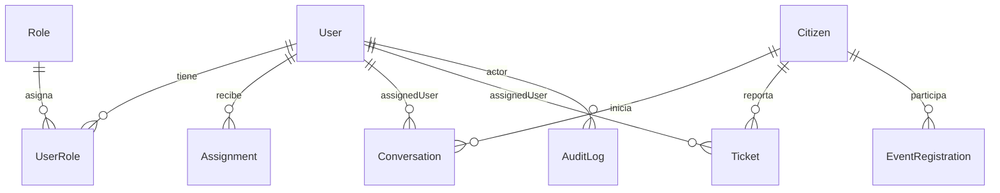

# Usuarios, roles y permisos actuales

> Evidencia del repositorio al 2026-07-09.

## Entidades

### `User`

Identidad autenticable del panel (`backend/prisma/schema.prisma:70-94`).

- Clave UUID, email único y contraseña local.
- `isActive` controla login, refresh y `/auth/me`.
- `isSuperuser` está deprecado y no autoriza.
- No contiene organización, municipio, departamento, perfil ni preferencias.

### `Role` y `UserRole`

RBAC many-to-many (`schema.prisma:96-121`). `UserRole` tiene unique compuesto `(userId, roleId)`. `Role.name` es la fuente de los claims y del middleware.

No existen tablas `Permission`, `RolePermission`, ACL o policy. Los “permisos” frontend son constantes derivadas de roles y no se persisten.

### `Citizen`

Registro CRM, no cuenta autenticable (`schema.prisma:140-168`). Tiene datos personales, conversaciones, tags, eventos y tickets, pero ninguna relación de identidad con `User`.

### Otros actores

- `NewsletterSubscriber`: identidad de newsletter con tokens de confirmación, sin sesión.
- Meta/WhatsApp: sistema externo autenticado por firma HMAC.
- Bot/IA: actor de dominio en `TicketActorType`, no cuenta de panel.

## Roles definidos y realmente usados

| Rol                | Definido   | En JWT | Backend | Frontend | Observación                                           |
| ------------------ | ---------- | ------ | ------- | -------- | ----------------------------------------------------- |
| `SUPERADMIN`       | ✅         | ✅     | ✅      | ✅       | Administración total por rutas                        |
| `COORDINADOR`      | ✅         | ✅     | ✅      | ✅       | Lectura administrativa y varias mutaciones operativas |
| `OPERADOR_CHAT`    | ✅         | ✅     | ✅      | ✅       | Conversaciones, mensajes y handover                   |
| `ANALISTA`         | ✅         | ✅     | ✅      | ✅       | Analytics y lectura de conversaciones                 |
| `isSuperuser=true` | ✅ columna | ❌     | ❌      | ❌       | 🧟 Legado                                             |

Los roles se insertan por migración y seed:

- `backend/prisma/migrations/00000000000023_seed_panel_roles/migration.sql`
- `backend/prisma/seed/core/roles.seed.ts`

## Permisos explícitos e implícitos

### Backend

No hay permisos granulares. Cada router contiene listas hardcodeadas:

- lectura de conversación: los cuatro roles;
- operación de conversación: `SUPERADMIN|COORDINADOR|OPERADOR_CHAT`;
- analytics: `SUPERADMIN|COORDINADOR|ANALISTA`;
- lectura de usuarios/catálogos/ciudadanos: `SUPERADMIN|COORDINADOR`;
- administración: principalmente `SUPERADMIN`;
- eventos: `SUPERADMIN|COORDINADOR` para todas las acciones.

### Frontend

`frontend/lib/auth-guards.ts:16-45` define siete permisos locales. No son seguridad:

| Permiso UI        | Roles UI                               | Correspondencia backend                         |
| ----------------- | -------------------------------------- | ----------------------------------------------- |
| `view:dashboard`  | SUPERADMIN, COORDINADOR, ANALISTA      | Coincide con analytics                          |
| `view:inbox`      | SUPERADMIN, COORDINADOR, OPERADOR_CHAT | Backend además deja leer a ANALISTA             |
| `view:citizens`   | Todos                                  | Backend solo SUPERADMIN, COORDINADOR            |
| `view:events`     | SUPERADMIN, COORDINADOR, ANALISTA      | Backend solo SUPERADMIN, COORDINADOR            |
| `manage:users`    | SUPERADMIN                             | Backend sí, pero la UI no implementa alta/roles |
| `manage:settings` | SUPERADMIN, COORDINADOR                | No existe como permiso backend                  |
| `assign:roles`    | SUPERADMIN                             | Backend sí                                      |

### Reglas implícitas

- `req.user.id` se registra como actor de auditoría.
- Handover usa al usuario autenticado; assign puede aceptar `body.userId`.
- Eventos aceptan `organizerUserId`, pero no restringen acciones al organizador.
- `assignedUserId`, `lockedByUserId` y `departmentSlug` describen estado; no limitan lectura/escritura.

## Creación y modificación

| Flujo                         | Quién                 | Rol inicial                              | Evidencia                                     |
| ----------------------------- | --------------------- | ---------------------------------------- | --------------------------------------------- |
| Seed superadmin               | Proceso de despliegue | SUPERADMIN                               | `backend/prisma/seed/dev/superadmin.seed.ts:5-13` |
| `/auth/register`              | SUPERADMIN            | Uno o más nombres de rol                 | `auth.routes.ts:50-54`                        |
| `/admin/users`                | SUPERADMIN            | `roleIds` opcional, puede quedar sin rol | `users.routes.ts:25`; `user.service.ts:53-80` |
| Invitación/OAuth/primer login | Nadie                 | —                                        | ❌ No encontrado                              |

Los cambios de rol se aplican por ID de rol. No se encontró:

- prohibición de cambiar roles propios;
- protección del último superadmin;
- invalidación inmediata de sesiones al cambiar roles;
- historial DB de asignación distinto de `assignedAt` y `AuditLog`.

## Estados y cuentas anómalas

- Cuenta activa con cero roles: posible y autenticable; rutas RBAC la bloquean, Socket.IO no.
- Cuenta inactiva: no inicia/refresca sesión, pero su access token vigente continúa aceptado hasta expirar.
- Perfil huérfano: no aplica, porque no existe `Profile`.
- Ciudadano “huérfano” de usuario: esperado; son dominios separados.
