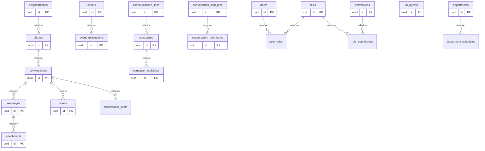

# Esquema histórico verificado y línea base implementada

Fecha de auditoría: 2026-11-24 (zona de Ciudad de México). Fuente de verificación: PostgreSQL 16 aislado, 78 migraciones aplicadas con `prisma migrate deploy`; catálogo `pg_catalog` e `information_schema`.

## Criterio de diseño

La línea base implementada conserva **exactamente los 58 objetos tabla actuales** y sus columnas, tipos, nulabilidad, predeterminados, claves, índices y relaciones que constan abajo. La línea base SQL se implementó en `backend/prisma/migrations/` y se verificó en PostgreSQL 16. Los 15 objetos transitorios ya desaparecidos de la cadena no se recrean. `schema.prisma` es una descripción complementaria; cuando difiere del catálogo, se preserva el comportamiento SQL hasta decidirlo explícitamente.

**Tamaño implementado:** 58 migraciones de tabla, 1 migración inicial de enums/extensiones y 1 migración complementaria para claves foráneas circulares: **60**. La migración complementaria puede absorber también objetos compartidos que requieren tablas ya creadas.

## Orden de creación implementado

Primero enums/extensiones; después una migración por tabla en este orden topológico (las claves entre miembros de ciclos se agregan en la migración complementaria):

`ai_agents` → `ai_prompts` → `ai_topics` → `ai_tools` → `batch_window_claims` → `batch_windows` → `conversation_bulk_jobs` → `departments` → `export_jobs` → `identity_lockouts` → `inbox_events` → `managed_templates` → `neighborhoods` → `newsletter_subscribers` → `notifications` → `outbox_events` → `permissions` → `rate_limit_counters` → `realtime_outbox_events` → `roles` → `tags` → `template_status_events` → `users` → `webhook_event_logs` → `ai_agent_topics` → `ai_topic_tools` → `audit_logs` → `citizens` → `communication_lines` → `conversation_bulk_items` → `department_schedule_exceptions` → `department_schedules` → `events` → `password_resets` → `refresh_sessions` → `role_permissions` → `user_invitations` → `user_notification_preferences` → `user_roles` → `campaigns` → `citizen_tags` → `conversations` → `tickets` → `department_exception_intervals` → `department_schedule_intervals` → `event_registrations` → `ai_runs` → `assignments` → `attachments` → `messages` → `campaign_attachments` → `campaign_recipients` → `conversation_meta` → `conversation_reads` → `event_checkins` → `ai_tool_calls` → `message_statuses` → `ticket_messages`

Ciclos de referencias detectados: ai_prompts ↔ ai_topics; conversations ↔ tickets; attachments ↔ messages. La relación de `messages` con `attachments` se debe revisar además por los dos FK opcionales.

## Diagrama ER (relaciones principales)

El diagrama resume la red principal; las definiciones FK completas de cada tabla siguen abajo.

## Objetos compartidos

Enums vigentes (nombre y valores verificados):

- `CampaignDispatchState`: `queued`, `sending`, `accepted`, `finished`, `uncertain`
- `CampaignMessageStatus`: `pending`, `sent`, `delivered`, `read`, `failed`
- `CampaignStatus`: `queued`, `running`, `completed`, `needs_review`
- `ai_prompt_type`: `system`, `tool`, `topic`, `fallback`
- `ai_provider`: `openai`, `anthropic`
- `ai_run_status`: `running`, `completed`, `failed`, `skipped`
- `ai_tool_call_status`: `running`, `completed`, `failed`, `blocked`
- `ai_tool_execution_type`: `function`, `http`
- `ai_tool_http_method`: `GET`, `POST`, `PUT`, `PATCH`, `DELETE`
- `ai_tool_kind`: `internal`, `external`
- `attendance_mode`: `bot`, `human`
- `attendance_status`: `pending`, `attended`, `no_show`
- `conversation_channel`: `whatsapp`, `web_chat`, `email`, `sms`, `other`
- `conversation_flow_state`: `BOT_FLOW`, `REGISTERING`, `DEPARTMENT_ROUTING`, `HUMAN_FLOW`, `ESCALATED`, `CLOSED`
- `conversation_status`: `open`, `in_progress`, `resolved`, `closed`
- `department_day_of_week`: `MONDAY`, `TUESDAY`, `WEDNESDAY`, `THURSDAY`, `FRIDAY`, `SATURDAY`, `SUNDAY`
- `department_exception_recurrence_type`: `NONE`, `YEARLY`, `WEEKLY`, `SPECIFIC_WEEKDAYS`
- `department_schedule_exception_type`: `PARTIALLY_OPEN`, `PARTIALLY_CLOSED`, `FULLY_CLOSED`
- `event_status`: `draft`, `published`, `completed`, `cancelled`
- `event_type`: `townhall`, `community`, `volunteer`, `campaign`, `rally`
- `event_visibility`: `public`, `private`
- `export_job_status`: `queued`, `processing`, `ready`, `failed`, `expired`
- `export_module`: `citizens`
- `inbox_event_status`: `pending`, `processing`, `processed`, `failed`, `dead_lettered`
- `lead_status`: `new`, `contacted`, `engaged`, `converted`, `unsubscribed`
- `message_direction`: `inbound`, `outbound`
- `message_status_value`: `sent`, `delivered`, `read`, `failed`
- `message_type`: `text`, `image`, `audio`, `video`, `document`, `location`, `template`, `interactive`, `system`, `sticker`, `contacts`, `unsupported`
- `newsletter_subscriber_status`: `pending`, `active`, `unsubscribed`
- `outbox_event_status`: `pending`, `sending`, `sent`, `failed`, `dead_lettered`
- `realtime_outbox_status`: `pending`, `publishing`, `published`, `failed`, `dead_lettered`
- `registration_status`: `invited`, `registered`, `confirmed`, `cancelled`, `waitlist`
- `source_channel`: `whatsapp`, `web`, `event`, `referral`, `other`
- `ticket_actor_type`: `CITIZEN`, `AGENT`, `BOT`, `SYSTEM`
- `ticket_priority`: `LOW`, `MEDIUM`, `HIGH`, `URGENT`
- `ticket_source`: `WHATSAPP`, `WEB`, `OTHER`
- `ticket_status`: `OPEN`, `IN_PROGRESS`, `RESOLVED`, `CLOSED`
- `user_invitation_status`: `pending`, `sent`, `failed`, `accepted`, `expired`, `revoked`

Extensiones presentes: `pg_trgm`, `pgcrypto`, `plpgsql`, `unaccent`. `plpgsql` es la extensión del lenguaje. Se conservaron todas en la línea base para reproducir el catálogo efectivo; `pg_trgm` sostiene los índices trigram vigentes de `neighborhoods`.

Función propia vigente: `sync_conversation_line_scope()`; trigger `conversation_meta_line_scope` sobre `conversation_meta` (migraciones `20261102000000` y `20261105000000`). El trigger temporal de `event_internal_details` fue eliminado. La secuencia `template_status_events_id_seq` pertenece a la columna `BIGSERIAL` de `template_status_events.id` y debe crearse con esa tabla. El catálogo público contiene cero vistas y cero políticas RLS.

## Tablas y definición efectiva

Cada definición es el **resultado ejecutado**, no la suma textual de migraciones. `NO` en nulabilidad significa `NOT NULL`; `—` significa ausencia de predeterminado. Los FK incluyen acciones de borrado y actualización en la propia definición. Índices de PK y UNIQUE se listan para evitar perder nombres y propiedades.

### `ai_agents` — AiAgent

Módulo: IA y canales. Clasificación: **CONSOLIDAR**. Migraciones relacionadas directamente: `00000000000010_create_ai_agents`, `20260716120000_add_uuid_database_defaults`.

| Columna | Tipo PostgreSQL | Nulo | Predeterminado |
|---|---|---|---|
| `id` | `uuid` | NO | `gen_random_uuid()` |
| `slug` | `varchar(100)` | NO | — |
| `name` | `varchar(255)` | NO | — |
| `description` | `text` | YES | — |
| `provider` | `ai_provider` | NO | — |
| `model` | `varchar(255)` | NO | — |
| `temperature` | `numeric(4,2)` | YES | — |
| `max_tokens` | `integer` | YES | — |
| `is_active` | `boolean` | NO | `true` |
| `metadata` | `jsonb` | NO | `'{}'::jsonb` |
| `created_at` | `timestamp with time zone` | NO | `CURRENT_TIMESTAMP` |
| `updated_at` | `timestamp with time zone` | NO | — |

Restricciones: `ai_agents_pkey` PRIMARY KEY (id).

Índices: `ai_agents_is_active_idx` CREATE INDEX ai_agents_is_active_idx ON public.ai_agents USING btree (is_active) ; `ai_agents_pkey` CREATE UNIQUE INDEX ai_agents_pkey ON public.ai_agents USING btree (id) ; `ai_agents_slug_key` CREATE UNIQUE INDEX ai_agents_slug_key ON public.ai_agents USING btree (slug).

### `ai_prompts` — AiPrompt

Módulo: IA y canales. Clasificación: **CONSOLIDAR**. Migraciones relacionadas directamente: `00000000000012_create_ai_prompts`, `20260716120000_add_uuid_database_defaults`.

| Columna | Tipo PostgreSQL | Nulo | Predeterminado |
|---|---|---|---|
| `id` | `uuid` | NO | `gen_random_uuid()` |
| `topic_id` | `uuid` | YES | — |
| `name` | `varchar(255)` | NO | — |
| `type` | `ai_prompt_type` | NO | `'topic'::ai_prompt_type` |
| `version` | `integer` | NO | `1` |
| `content` | `text` | NO | — |
| `is_active` | `boolean` | NO | `true` |
| `metadata` | `jsonb` | NO | `'{}'::jsonb` |
| `created_at` | `timestamp with time zone` | NO | `CURRENT_TIMESTAMP` |
| `updated_at` | `timestamp with time zone` | NO | — |

Restricciones: `ai_prompts_pkey` PRIMARY KEY (id) ; `ai_prompts_topic_id_fkey` FOREIGN KEY (topic_id) REFERENCES ai_topics(id) ON UPDATE CASCADE ON DELETE CASCADE.

Índices: `ai_prompts_pkey` CREATE UNIQUE INDEX ai_prompts_pkey ON public.ai_prompts USING btree (id) ; `ai_prompts_topic_id_is_active_idx` CREATE INDEX ai_prompts_topic_id_is_active_idx ON public.ai_prompts USING btree (topic_id, is_active) ; `uq_ai_prompts_topic_version` CREATE UNIQUE INDEX uq_ai_prompts_topic_version ON public.ai_prompts USING btree (topic_id, version).

### `ai_topics` — AiTopic

Módulo: IA y canales. Clasificación: **CONSOLIDAR**. Migraciones relacionadas directamente: `00000000000011_create_ai_topics`, `00000000000012_create_ai_prompts`, `20260716120000_add_uuid_database_defaults`.

| Columna | Tipo PostgreSQL | Nulo | Predeterminado |
|---|---|---|---|
| `id` | `uuid` | NO | `gen_random_uuid()` |
| `slug` | `varchar(100)` | NO | — |
| `name` | `varchar(255)` | NO | — |
| `description` | `text` | YES | — |
| `system_prompt_id` | `uuid` | YES | — |
| `matcher_keywords` | `ARRAY` | YES | `ARRAY[]::text[]` |
| `is_active` | `boolean` | NO | `true` |
| `created_at` | `timestamp with time zone` | NO | `CURRENT_TIMESTAMP` |
| `updated_at` | `timestamp with time zone` | NO | — |

Restricciones: `ai_topics_pkey` PRIMARY KEY (id) ; `ai_topics_system_prompt_id_fkey` FOREIGN KEY (system_prompt_id) REFERENCES ai_prompts(id) ON UPDATE CASCADE ON DELETE SET NULL.

Índices: `ai_topics_is_active_idx` CREATE INDEX ai_topics_is_active_idx ON public.ai_topics USING btree (is_active) ; `ai_topics_pkey` CREATE UNIQUE INDEX ai_topics_pkey ON public.ai_topics USING btree (id) ; `ai_topics_slug_key` CREATE UNIQUE INDEX ai_topics_slug_key ON public.ai_topics USING btree (slug) ; `ai_topics_system_prompt_id_idx` CREATE INDEX ai_topics_system_prompt_id_idx ON public.ai_topics USING btree (system_prompt_id).

### `ai_tools` — AiTool

Módulo: IA y canales. Clasificación: **CONSOLIDAR**. Migraciones relacionadas directamente: `00000000000013_create_ai_tools`, `20260716120000_add_uuid_database_defaults`.

| Columna | Tipo PostgreSQL | Nulo | Predeterminado |
|---|---|---|---|
| `id` | `uuid` | NO | `gen_random_uuid()` |
| `name` | `varchar(120)` | NO | — |
| `description` | `text` | NO | — |
| `type` | `ai_tool_kind` | NO | `'internal'::ai_tool_kind` |
| `execution_type` | `ai_tool_execution_type` | NO | `'function'::ai_tool_execution_type` |
| `config` | `jsonb` | NO | `'{}'::jsonb` |
| `kind` | `ai_tool_kind` | NO | — |
| `internal_key` | `varchar(120)` | YES | — |
| `external_url` | `text` | YES | — |
| `external_method` | `ai_tool_http_method` | YES | — |
| `external_headers` | `jsonb` | YES | — |
| `external_auth_env_key` | `varchar(120)` | YES | — |
| `timeout_ms` | `integer` | NO | `8000` |
| `allowlist_domains` | `ARRAY` | YES | `ARRAY[]::text[]` |
| `input_schema` | `jsonb` | YES | — |
| `output_schema` | `jsonb` | YES | — |
| `is_active` | `boolean` | NO | `true` |
| `created_at` | `timestamp with time zone` | NO | `CURRENT_TIMESTAMP` |
| `updated_at` | `timestamp with time zone` | NO | — |

Restricciones: `ai_tools_pkey` PRIMARY KEY (id).

Índices: `ai_tools_kind_is_active_idx` CREATE INDEX ai_tools_kind_is_active_idx ON public.ai_tools USING btree (kind, is_active) ; `ai_tools_name_key` CREATE UNIQUE INDEX ai_tools_name_key ON public.ai_tools USING btree (name) ; `ai_tools_pkey` CREATE UNIQUE INDEX ai_tools_pkey ON public.ai_tools USING btree (id).

### `batch_window_claims` — BatchWindowClaim

Módulo: Atención/mensajería. Clasificación: **CONSERVAR**. Migraciones relacionadas directamente: `20260922090000_add_message_batch_windows`.

| Columna | Tipo PostgreSQL | Nulo | Predeterminado |
|---|---|---|---|
| `phone` | `varchar(30)` | NO | — |
| `batch_generation` | `integer` | NO | — |
| `claim_token` | `varchar(64)` | YES | — |
| `claim_lease_until` | `timestamp with time zone` | YES | — |
| `drain_boundary` | `timestamp with time zone` | YES | — |
| `completed_at` | `timestamp with time zone` | YES | — |
| `created_at` | `timestamp with time zone` | NO | `CURRENT_TIMESTAMP` |
| `updated_at` | `timestamp with time zone` | NO | `CURRENT_TIMESTAMP` |

Restricciones: `batch_window_claims_pkey` PRIMARY KEY (phone, batch_generation).

Índices: `batch_window_claims_lease_idx` CREATE INDEX batch_window_claims_lease_idx ON public.batch_window_claims USING btree (claim_lease_until, completed_at) ; `batch_window_claims_phone_completion_idx` CREATE INDEX batch_window_claims_phone_completion_idx ON public.batch_window_claims USING btree (phone, completed_at, batch_generation) ; `batch_window_claims_pkey` CREATE UNIQUE INDEX batch_window_claims_pkey ON public.batch_window_claims USING btree (phone, batch_generation).

### `batch_windows` — BatchWindow

Módulo: Atención/mensajería. Clasificación: **CONSERVAR**. Migraciones relacionadas directamente: `20260922090000_add_message_batch_windows`.

| Columna | Tipo PostgreSQL | Nulo | Predeterminado |
|---|---|---|---|
| `phone` | `varchar(30)` | NO | — |
| `batch_generation` | `integer` | NO | `0` |
| `batch_ready_at` | `timestamp with time zone` | YES | — |
| `window_opened_at` | `timestamp with time zone` | YES | — |
| `created_at` | `timestamp with time zone` | NO | `CURRENT_TIMESTAMP` |
| `updated_at` | `timestamp with time zone` | NO | `CURRENT_TIMESTAMP` |

Restricciones: `batch_windows_pkey` PRIMARY KEY (phone).

Índices: `batch_windows_pkey` CREATE UNIQUE INDEX batch_windows_pkey ON public.batch_windows USING btree (phone) ; `batch_windows_ready_generation_idx` CREATE INDEX batch_windows_ready_generation_idx ON public.batch_windows USING btree (batch_ready_at, batch_generation).

### `conversation_bulk_jobs` — ConversationBulkJob

Módulo: Atención/mensajería. Clasificación: **CONSERVAR**. Migraciones relacionadas directamente: `20261014170000_conversation_bulk_jobs`.

| Columna | Tipo PostgreSQL | Nulo | Predeterminado |
|---|---|---|---|
| `id` | `uuid` | NO | — |
| `actorId` | `uuid` | NO | — |
| `requestKey` | `uuid` | NO | — |
| `payloadHash` | `text` | NO | — |
| `payload` | `jsonb` | NO | — |
| `createdAt` | `timestamp with time zone` | NO | `CURRENT_TIMESTAMP` |

Restricciones: `conversation_bulk_jobs_pkey` PRIMARY KEY (id).

Índices: `conversation_bulk_jobs_actorId_requestKey_key` CREATE UNIQUE INDEX "conversation_bulk_jobs_actorId_requestKey_key" ON public.conversation_bulk_jobs USING btree ("actorId", "requestKey") ; `conversation_bulk_jobs_pkey` CREATE UNIQUE INDEX conversation_bulk_jobs_pkey ON public.conversation_bulk_jobs USING btree (id).

### `departments` — Department

Módulo: Administración/departamentos. Clasificación: **CONSOLIDAR**. Migraciones relacionadas directamente: `00000000000004_create_departments`, `20260716120000_add_uuid_database_defaults`.

| Columna | Tipo PostgreSQL | Nulo | Predeterminado |
|---|---|---|---|
| `id` | `uuid` | NO | `gen_random_uuid()` |
| `slug` | `varchar(100)` | NO | — |
| `name` | `varchar(255)` | NO | — |
| `description` | `text` | YES | — |
| `service_hours` | `varchar(255)` | YES | — |
| `service_schedule` | `jsonb` | YES | — |
| `is_active` | `boolean` | NO | `true` |
| `keywords` | `ARRAY` | YES | `ARRAY[]::text[]` |
| `created_at` | `timestamp with time zone` | NO | `CURRENT_TIMESTAMP` |
| `updated_at` | `timestamp with time zone` | NO | — |

Restricciones: `departments_pkey` PRIMARY KEY (id).

Índices: `departments_is_active_idx` CREATE INDEX departments_is_active_idx ON public.departments USING btree (is_active) ; `departments_pkey` CREATE UNIQUE INDEX departments_pkey ON public.departments USING btree (id) ; `departments_slug_idx` CREATE INDEX departments_slug_idx ON public.departments USING btree (slug) ; `departments_slug_key` CREATE UNIQUE INDEX departments_slug_key ON public.departments USING btree (slug).

### `export_jobs` — ExportJob

Módulo: Ciudadanos/catálogos. Clasificación: **CONSOLIDAR**. Migraciones relacionadas directamente: `20260906000000_add_export_jobs`, `20260906000001_add_export_download_token`, `20261023180000_gcs_object_paths`, `20261123000000_remove_campaign_modules`.

| Columna | Tipo PostgreSQL | Nulo | Predeterminado |
|---|---|---|---|
| `id` | `uuid` | NO | — |
| `module` | `export_module` | NO | — |
| `filters_json` | `jsonb` | NO | `'{}'::jsonb` |
| `scope_snapshot` | `jsonb` | NO | — |
| `status` | `export_job_status` | NO | `'queued'::export_job_status` |
| `drive_file_id` | `varchar(255)` | YES | — |
| `drive_folder_id` | `varchar(255)` | YES | — |
| `drive_filename` | `varchar(255)` | YES | — |
| `row_count` | `integer` | YES | — |
| `error_code` | `varchar(80)` | YES | — |
| `last_error` | `text` | YES | — |
| `requested_by_user_id` | `uuid` | NO | — |
| `requested_at` | `timestamp with time zone` | NO | `CURRENT_TIMESTAMP` |
| `expires_at` | `timestamp with time zone` | NO | — |
| `completed_at` | `timestamp with time zone` | YES | — |
| `created_at` | `timestamp with time zone` | NO | `CURRENT_TIMESTAMP` |
| `updated_at` | `timestamp with time zone` | NO | — |
| `download_token_hash` | `varchar(64)` | YES | — |
| `download_token_expires_at` | `timestamp with time zone` | YES | — |
| `download_token_consumed_at` | `timestamp with time zone` | YES | — |
| `file_path` | `text` | YES | — |

Restricciones: `export_jobs_pkey` PRIMARY KEY (id).

Índices: `export_jobs_pkey` CREATE UNIQUE INDEX export_jobs_pkey ON public.export_jobs USING btree (id) ; `export_jobs_requested_by_user_id_created_at_idx` CREATE INDEX export_jobs_requested_by_user_id_created_at_idx ON public.export_jobs USING btree (requested_by_user_id, created_at) ; `export_jobs_status_completed_at_idx` CREATE INDEX export_jobs_status_completed_at_idx ON public.export_jobs USING btree (status, completed_at) ; `export_jobs_status_expires_at_idx` CREATE INDEX export_jobs_status_expires_at_idx ON public.export_jobs USING btree (status, expires_at).

### `identity_lockouts` — IdentityLockout

Módulo: Identidad/RBAC. Clasificación: **CONSERVAR**. Migraciones relacionadas directamente: `20260916120000_redis_free_models`.

| Columna | Tipo PostgreSQL | Nulo | Predeterminado |
|---|---|---|---|
| `id` | `uuid` | NO | `gen_random_uuid()` |
| `identity_key` | `varchar(255)` | NO | — |
| `fails` | `integer` | NO | `0` |
| `level` | `integer` | NO | `0` |
| `locked_until` | `timestamp with time zone` | YES | — |
| `last_failure_at` | `timestamp with time zone` | YES | — |
| `created_at` | `timestamp with time zone` | NO | `CURRENT_TIMESTAMP` |
| `updated_at` | `timestamp with time zone` | NO | `CURRENT_TIMESTAMP` |

Restricciones: `identity_lockouts_pkey` PRIMARY KEY (id).

Índices: `identity_lockouts_identity_key_key` CREATE UNIQUE INDEX identity_lockouts_identity_key_key ON public.identity_lockouts USING btree (identity_key) ; `identity_lockouts_locked_until_idx` CREATE INDEX identity_lockouts_locked_until_idx ON public.identity_lockouts USING btree (locked_until) ; `identity_lockouts_pkey` CREATE UNIQUE INDEX identity_lockouts_pkey ON public.identity_lockouts USING btree (id).

### `inbox_events` — InboxEvent

Módulo: Atención/mensajería. Clasificación: **CONSOLIDAR**. Migraciones relacionadas directamente: `00000000000008_create_messaging_queues`, `20260716120000_add_uuid_database_defaults`, `20260819120000_add_messaging_queue_leases`, `20260918232300_add_queue_fsm_indexes`, `20261013170000_realtime_ingress`.

| Columna | Tipo PostgreSQL | Nulo | Predeterminado |
|---|---|---|---|
| `id` | `uuid` | NO | `gen_random_uuid()` |
| `wamid` | `varchar(255)` | NO | — |
| `phone` | `varchar(30)` | NO | — |
| `payload` | `jsonb` | NO | — |
| `status` | `inbox_event_status` | NO | `'pending'::inbox_event_status` |
| `retry_count` | `integer` | NO | `0` |
| `last_error_at` | `timestamp with time zone` | YES | — |
| `last_error` | `text` | YES | — |
| `idempotency_key` | `varchar(255)` | YES | — |
| `created_at` | `timestamp with time zone` | NO | `CURRENT_TIMESTAMP` |
| `processed_at` | `timestamp with time zone` | YES | — |
| `locked_at` | `timestamp with time zone` | YES | — |
| `locked_by` | `varchar(255)` | YES | — |
| `ingested_at` | `timestamp with time zone` | YES | — |
| `message_id` | `uuid` | YES | — |
| `correlation_id` | `varchar(255)` | YES | — |
| `batch_generation` | `integer` | YES | — |

Restricciones: `inbox_events_pkey` PRIMARY KEY (id).

Índices: `inbox_events_created_at_idx` CREATE INDEX inbox_events_created_at_idx ON public.inbox_events USING btree (created_at) ; `inbox_events_message_id_idx` CREATE INDEX inbox_events_message_id_idx ON public.inbox_events USING btree (message_id) ; `inbox_events_phone_batch_generation_status_idx` CREATE INDEX inbox_events_phone_batch_generation_status_idx ON public.inbox_events USING btree (phone, batch_generation, status) ; `inbox_events_phone_idx` CREATE INDEX inbox_events_phone_idx ON public.inbox_events USING btree (phone) ; `inbox_events_pkey` CREATE UNIQUE INDEX inbox_events_pkey ON public.inbox_events USING btree (id) ; `inbox_events_status_created_at_idx` CREATE INDEX inbox_events_status_created_at_idx ON public.inbox_events USING btree (status, created_at) ; `inbox_events_wamid_key` CREATE UNIQUE INDEX inbox_events_wamid_key ON public.inbox_events USING btree (wamid).

### `managed_templates` — ManagedTemplate

Módulo: Campañas WhatsApp/plantillas. Clasificación: **CONSERVAR**. Migraciones relacionadas directamente: `20261014000000_template_management`.

| Columna | Tipo PostgreSQL | Nulo | Predeterminado |
|---|---|---|---|
| `template_id` | `varchar(100)` | NO | — |
| `waba_id` | `varchar(100)` | NO | — |
| `created_at` | `timestamp with time zone` | YES | — |
| `updated_at` | `timestamp with time zone` | YES | — |

Restricciones: `managed_templates_pkey` PRIMARY KEY (template_id).

Índices: `managed_templates_pkey` CREATE UNIQUE INDEX managed_templates_pkey ON public.managed_templates USING btree (template_id) ; `managed_templates_waba_id_idx` CREATE INDEX managed_templates_waba_id_idx ON public.managed_templates USING btree (waba_id).

### `neighborhoods` — Neighborhood

Módulo: Ciudadanos/catálogos. Clasificación: **CONSOLIDAR**. Migraciones relacionadas directamente: `00000000000002_create_neighborhoods`, `20260716120000_add_uuid_database_defaults`, `20260817140000_promovidos_crm_neighborhood_matching`, `20260822120000_add_geo_fields_to_neighborhoods`, `20260822130000_neighborhood_match_key_municipality_unique`, `20261123000000_remove_campaign_modules`.

| Columna | Tipo PostgreSQL | Nulo | Predeterminado |
|---|---|---|---|
| `id` | `uuid` | NO | `gen_random_uuid()` |
| `name` | `varchar(255)` | NO | — |
| `zone` | `varchar(100)` | YES | — |
| `created_at` | `timestamp with time zone` | NO | `CURRENT_TIMESTAMP` |
| `updated_at` | `timestamp with time zone` | NO | — |
| `match_key` | `varchar(255)` | NO | — |
| `postal_code` | `varchar(10)` | YES | — |
| `municipality` | `varchar(100)` | YES | — |
| `state` | `varchar(100)` | NO | `'Chiapas'::character varying` |
| `state_code` | `varchar(5)` | NO | `'CHP'::character varying` |

Restricciones: `neighborhoods_pkey` PRIMARY KEY (id).

Índices: `neighborhoods_match_key_trgm_idx` CREATE INDEX neighborhoods_match_key_trgm_idx ON public.neighborhoods USING gin (match_key gin_trgm_ops) ; `neighborhoods_municipality_idx` CREATE INDEX neighborhoods_municipality_idx ON public.neighborhoods USING btree (municipality) ; `neighborhoods_municipality_trgm_idx` CREATE INDEX neighborhoods_municipality_trgm_idx ON public.neighborhoods USING gin (municipality gin_trgm_ops) ; `neighborhoods_name_idx` CREATE INDEX neighborhoods_name_idx ON public.neighborhoods USING btree (name) ; `neighborhoods_pkey` CREATE UNIQUE INDEX neighborhoods_pkey ON public.neighborhoods USING btree (id) ; `neighborhoods_postal_code_idx` CREATE INDEX neighborhoods_postal_code_idx ON public.neighborhoods USING btree (postal_code) ; `neighborhoods_state_idx` CREATE INDEX neighborhoods_state_idx ON public.neighborhoods USING btree (state) ; `neighborhoods_zone_idx` CREATE INDEX neighborhoods_zone_idx ON public.neighborhoods USING btree (zone) ; `uq_neighborhoods_match_key_municipality` CREATE UNIQUE INDEX uq_neighborhoods_match_key_municipality ON public.neighborhoods USING btree (match_key, municipality).

### `newsletter_subscribers` — NewsletterSubscriber

Módulo: Ciudadanos/catálogos. Clasificación: **CONSOLIDAR**. Migraciones relacionadas directamente: `00000000000020_create_newsletter_subscribers`, `20260716120000_add_uuid_database_defaults`.

| Columna | Tipo PostgreSQL | Nulo | Predeterminado |
|---|---|---|---|
| `id` | `uuid` | NO | `gen_random_uuid()` |
| `email` | `varchar(255)` | NO | — |
| `name` | `varchar(255)` | YES | — |
| `status` | `newsletter_subscriber_status` | NO | `'pending'::newsletter_subscriber_status` |
| `source` | `varchar(50)` | NO | — |
| `subscribed_at` | `timestamp with time zone` | YES | — |
| `unsubscribed_at` | `timestamp with time zone` | YES | — |
| `ip_address` | `varchar(45)` | YES | — |
| `confirm_token_hash` | `varchar(64)` | YES | — |
| `confirm_token_expires_at` | `timestamp with time zone` | YES | — |
| `unsubscribe_token_hash` | `varchar(64)` | YES | — |
| `created_at` | `timestamp with time zone` | NO | `CURRENT_TIMESTAMP` |
| `updated_at` | `timestamp with time zone` | NO | — |

Restricciones: `newsletter_subscribers_pkey` PRIMARY KEY (id).

Índices: `newsletter_subscribers_confirm_token_hash_idx` CREATE INDEX newsletter_subscribers_confirm_token_hash_idx ON public.newsletter_subscribers USING btree (confirm_token_hash) ; `newsletter_subscribers_email_key` CREATE UNIQUE INDEX newsletter_subscribers_email_key ON public.newsletter_subscribers USING btree (email) ; `newsletter_subscribers_pkey` CREATE UNIQUE INDEX newsletter_subscribers_pkey ON public.newsletter_subscribers USING btree (id) ; `newsletter_subscribers_status_idx` CREATE INDEX newsletter_subscribers_status_idx ON public.newsletter_subscribers USING btree (status) ; `newsletter_subscribers_unsubscribe_token_hash_idx` CREATE INDEX newsletter_subscribers_unsubscribe_token_hash_idx ON public.newsletter_subscribers USING btree (unsubscribe_token_hash).

### `notifications` — Notification

Módulo: Atención/mensajería. Clasificación: **CONSOLIDAR**. Migraciones relacionadas directamente: `20261009000000_add_notifications`, `20261013170000_realtime_ingress`, `20261018000000_message_media_history`.

| Columna | Tipo PostgreSQL | Nulo | Predeterminado |
|---|---|---|---|
| `id` | `uuid` | NO | — |
| `event_id` | `uuid` | NO | — |
| `type` | `varchar(100)` | NO | — |
| `conversation_id` | `uuid` | YES | — |
| `contact_name` | `text` | YES | — |
| `phone` | `text` | YES | — |
| `message_preview` | `text` | YES | — |
| `flow_state` | `text` | YES | — |
| `channel` | `text` | YES | — |
| `priority` | `text` | YES | — |
| `department_slug` | `text` | YES | — |
| `assigned_user_id` | `uuid` | YES | — |
| `occurred_at` | `timestamp with time zone` | NO | — |
| `created_at` | `timestamp with time zone` | NO | `CURRENT_TIMESTAMP` |
| `ticket_id` | `uuid` | YES | — |
| `communication_line_id` | `uuid` | YES | — |

Restricciones: `notifications_pkey` PRIMARY KEY (id).

Índices: `notifications_created_at_id_idx` CREATE INDEX notifications_created_at_id_idx ON public.notifications USING btree (created_at, id) ; `notifications_event_id_key` CREATE UNIQUE INDEX notifications_event_id_key ON public.notifications USING btree (event_id) ; `notifications_occurred_at_idx` CREATE INDEX notifications_occurred_at_idx ON public.notifications USING btree (occurred_at) ; `notifications_pkey` CREATE UNIQUE INDEX notifications_pkey ON public.notifications USING btree (id).

### `outbox_events` — OutboxEvent

Módulo: Atención/mensajería. Clasificación: **CONSOLIDAR**. Migraciones relacionadas directamente: `00000000000008_create_messaging_queues`, `20260716120000_add_uuid_database_defaults`, `20260819120000_add_messaging_queue_leases`.

| Columna | Tipo PostgreSQL | Nulo | Predeterminado |
|---|---|---|---|
| `id` | `uuid` | NO | `gen_random_uuid()` |
| `conversation_id` | `uuid` | YES | — |
| `phone` | `varchar(30)` | NO | — |
| `payload` | `jsonb` | NO | — |
| `status` | `outbox_event_status` | NO | `'pending'::outbox_event_status` |
| `retry_count` | `integer` | NO | `0` |
| `next_retry_at` | `timestamp with time zone` | YES | — |
| `last_error` | `text` | YES | — |
| `wamid` | `varchar(255)` | YES | — |
| `idempotency_key` | `varchar(255)` | NO | — |
| `created_at` | `timestamp with time zone` | NO | `CURRENT_TIMESTAMP` |
| `sent_at` | `timestamp with time zone` | YES | — |
| `locked_at` | `timestamp with time zone` | YES | — |
| `locked_by` | `varchar(255)` | YES | — |

Restricciones: `outbox_events_pkey` PRIMARY KEY (id).

Índices: `outbox_events_conversation_id_idx` CREATE INDEX outbox_events_conversation_id_idx ON public.outbox_events USING btree (conversation_id) ; `outbox_events_idempotency_key_key` CREATE UNIQUE INDEX outbox_events_idempotency_key_key ON public.outbox_events USING btree (idempotency_key) ; `outbox_events_phone_idx` CREATE INDEX outbox_events_phone_idx ON public.outbox_events USING btree (phone) ; `outbox_events_pkey` CREATE UNIQUE INDEX outbox_events_pkey ON public.outbox_events USING btree (id) ; `outbox_events_status_next_retry_at_idx` CREATE INDEX outbox_events_status_next_retry_at_idx ON public.outbox_events USING btree (status, next_retry_at).

### `permissions` — Permission

Módulo: Identidad/RBAC. Clasificación: **CONSOLIDAR**. Migraciones relacionadas directamente: `00000000000024_add_role_permissions`, `20260716120000_add_uuid_database_defaults`, `20260722120000_add_permission_management`.

| Columna | Tipo PostgreSQL | Nulo | Predeterminado |
|---|---|---|---|
| `id` | `uuid` | NO | `gen_random_uuid()` |
| `name` | `varchar(100)` | NO | — |
| `slug` | `varchar(120)` | NO | — |
| `module` | `varchar(80)` | NO | — |
| `description` | `varchar(255)` | YES | — |
| `created_at` | `timestamp with time zone` | NO | `CURRENT_TIMESTAMP` |
| `updated_at` | `timestamp with time zone` | NO | — |
| `is_active` | `boolean` | NO | `true` |
| `is_system` | `boolean` | NO | `false` |

Restricciones: `permissions_pkey` PRIMARY KEY (id).

Índices: `permissions_is_active_idx` CREATE INDEX permissions_is_active_idx ON public.permissions USING btree (is_active) ; `permissions_is_system_idx` CREATE INDEX permissions_is_system_idx ON public.permissions USING btree (is_system) ; `permissions_module_idx` CREATE INDEX permissions_module_idx ON public.permissions USING btree (module) ; `permissions_pkey` CREATE UNIQUE INDEX permissions_pkey ON public.permissions USING btree (id) ; `permissions_slug_idx` CREATE INDEX permissions_slug_idx ON public.permissions USING btree (slug) ; `permissions_slug_key` CREATE UNIQUE INDEX permissions_slug_key ON public.permissions USING btree (slug).

### `rate_limit_counters` — RateLimitCounter

Módulo: Identidad/RBAC. Clasificación: **CONSERVAR**. Migraciones relacionadas directamente: `20260916120000_redis_free_models`.

| Columna | Tipo PostgreSQL | Nulo | Predeterminado |
|---|---|---|---|
| `scope` | `varchar(50)` | NO | — |
| `bucket_key` | `varchar(255)` | NO | — |
| `window_start` | `timestamp with time zone` | NO | — |
| `count` | `integer` | NO | `0` |
| `updated_at` | `timestamp with time zone` | NO | `CURRENT_TIMESTAMP` |

Restricciones: `rate_limit_counters_pkey` PRIMARY KEY (scope, bucket_key, window_start).

Índices: `rate_limit_counters_pkey` CREATE UNIQUE INDEX rate_limit_counters_pkey ON public.rate_limit_counters USING btree (scope, bucket_key, window_start) ; `rate_limit_counters_scope_window_start_idx` CREATE INDEX rate_limit_counters_scope_window_start_idx ON public.rate_limit_counters USING btree (scope, window_start).

### `realtime_outbox_events` — RealtimeOutboxEvent

Módulo: Atención/mensajería. Clasificación: **CONSOLIDAR**. Migraciones relacionadas directamente: `00000000000021_create_realtime_outbox_events`, `20260716120000_add_uuid_database_defaults`.

| Columna | Tipo PostgreSQL | Nulo | Predeterminado |
|---|---|---|---|
| `id` | `uuid` | NO | `gen_random_uuid()` |
| `event_type` | `varchar(100)` | NO | — |
| `socket_event_name` | `varchar(100)` | NO | — |
| `payload` | `jsonb` | NO | — |
| `status` | `realtime_outbox_status` | NO | `'pending'::realtime_outbox_status` |
| `attempts` | `integer` | NO | `0` |
| `next_retry_at` | `timestamp with time zone` | YES | — |
| `locked_at` | `timestamp with time zone` | YES | — |
| `locked_by` | `varchar(255)` | YES | — |
| `published_at` | `timestamp with time zone` | YES | — |
| `last_error` | `text` | YES | — |
| `created_at` | `timestamp with time zone` | NO | `CURRENT_TIMESTAMP` |
| `updated_at` | `timestamp with time zone` | NO | — |

Restricciones: `realtime_outbox_events_pkey` PRIMARY KEY (id).

Índices: `realtime_outbox_events_created_at_idx` CREATE INDEX realtime_outbox_events_created_at_idx ON public.realtime_outbox_events USING btree (created_at) ; `realtime_outbox_events_event_type_idx` CREATE INDEX realtime_outbox_events_event_type_idx ON public.realtime_outbox_events USING btree (event_type) ; `realtime_outbox_events_pkey` CREATE UNIQUE INDEX realtime_outbox_events_pkey ON public.realtime_outbox_events USING btree (id) ; `realtime_outbox_events_status_next_retry_at_idx` CREATE INDEX realtime_outbox_events_status_next_retry_at_idx ON public.realtime_outbox_events USING btree (status, next_retry_at).

### `roles` — Role

Módulo: Identidad/RBAC. Clasificación: **CONSOLIDAR**. Migraciones relacionadas directamente: `00000000000001_create_users_roles`, `00000000000024_add_role_permissions`, `20260716120000_add_uuid_database_defaults`.

| Columna | Tipo PostgreSQL | Nulo | Predeterminado |
|---|---|---|---|
| `id` | `uuid` | NO | `gen_random_uuid()` |
| `name` | `varchar(50)` | NO | — |
| `description` | `varchar(255)` | YES | — |
| `created_at` | `timestamp with time zone` | NO | `CURRENT_TIMESTAMP` |
| `slug` | `varchar(80)` | NO | — |
| `updated_at` | `timestamp with time zone` | NO | — |

Restricciones: `roles_pkey` PRIMARY KEY (id).

Índices: `roles_name_idx` CREATE INDEX roles_name_idx ON public.roles USING btree (name) ; `roles_name_key` CREATE UNIQUE INDEX roles_name_key ON public.roles USING btree (name) ; `roles_pkey` CREATE UNIQUE INDEX roles_pkey ON public.roles USING btree (id) ; `roles_slug_idx` CREATE INDEX roles_slug_idx ON public.roles USING btree (slug) ; `roles_slug_key` CREATE UNIQUE INDEX roles_slug_key ON public.roles USING btree (slug).

### `tags` — Tag

Módulo: Ciudadanos/catálogos. Clasificación: **CONSOLIDAR**. Migraciones relacionadas directamente: `00000000000006_create_tags_and_citizen_tags`, `00000000000022_add_raw_sql_invariants`, `20260716120000_add_uuid_database_defaults`.

| Columna | Tipo PostgreSQL | Nulo | Predeterminado |
|---|---|---|---|
| `id` | `uuid` | NO | `gen_random_uuid()` |
| `name` | `varchar(100)` | NO | — |
| `description` | `text` | YES | — |
| `color` | `varchar(20)` | YES | — |
| `created_at` | `timestamp with time zone` | NO | `CURRENT_TIMESTAMP` |

Restricciones: `tags_pkey` PRIMARY KEY (id).

Índices: `tags_name_idx` CREATE INDEX tags_name_idx ON public.tags USING btree (name) ; `tags_name_key` CREATE UNIQUE INDEX tags_name_key ON public.tags USING btree (name) ; `tags_pkey` CREATE UNIQUE INDEX tags_pkey ON public.tags USING btree (id) ; `uq_tags_name_lower` CREATE UNIQUE INDEX uq_tags_name_lower ON public.tags USING btree (lower((name)::text)).

### `template_status_events` — TemplateStatusEvent

Módulo: Campañas WhatsApp/plantillas. Clasificación: **CONSERVAR**. Migraciones relacionadas directamente: `20261014000000_template_management`.

| Columna | Tipo PostgreSQL | Nulo | Predeterminado |
|---|---|---|---|
| `id` | `bigint` | NO | `nextval('template_status_events_id_seq'::regclass)` |
| `dedupe_key` | `varchar(64)` | NO | — |
| `waba_id` | `varchar(100)` | NO | — |
| `template_id` | `varchar(100)` | NO | — |
| `template_name` | `varchar(512)` | NO | — |
| `status` | `varchar(100)` | NO | — |
| `reason` | `text` | YES | — |
| `occurred_at` | `timestamp with time zone` | NO | — |
| `received_at` | `timestamp with time zone` | NO | `CURRENT_TIMESTAMP` |

Restricciones: `template_status_events_dedupe_key_key` UNIQUE (dedupe_key) ; `template_status_events_pkey` PRIMARY KEY (id).

Índices: `template_status_events_dedupe_key_key` CREATE UNIQUE INDEX template_status_events_dedupe_key_key ON public.template_status_events USING btree (dedupe_key) ; `template_status_events_pkey` CREATE UNIQUE INDEX template_status_events_pkey ON public.template_status_events USING btree (id) ; `template_status_events_waba_id_id_idx` CREATE INDEX template_status_events_waba_id_id_idx ON public.template_status_events USING btree (waba_id, id).

### `users` — User

Módulo: Identidad/RBAC. Clasificación: **CONSOLIDAR**. Migraciones relacionadas directamente: `00000000000001_create_users_roles`, `20260716120000_add_uuid_database_defaults`, `20261019000000_add_user_phone`.

| Columna | Tipo PostgreSQL | Nulo | Predeterminado |
|---|---|---|---|
| `id` | `uuid` | NO | `gen_random_uuid()` |
| `email` | `varchar(255)` | NO | — |
| `hashed_password` | `varchar(255)` | NO | — |
| `full_name` | `varchar(255)` | YES | — |
| `is_active` | `boolean` | NO | `true` |
| `is_superuser` | `boolean` | NO | `false` |
| `created_at` | `timestamp with time zone` | NO | `CURRENT_TIMESTAMP` |
| `updated_at` | `timestamp with time zone` | NO | — |
| `phone` | `varchar(30)` | YES | — |

Restricciones: `users_pkey` PRIMARY KEY (id).

Índices: `users_email_idx` CREATE INDEX users_email_idx ON public.users USING btree (email) ; `users_email_key` CREATE UNIQUE INDEX users_email_key ON public.users USING btree (email) ; `users_pkey` CREATE UNIQUE INDEX users_pkey ON public.users USING btree (id).

### `webhook_event_logs` — WebhookEventLog

Módulo: Atención/mensajería. Clasificación: **CONSOLIDAR**. Migraciones relacionadas directamente: `00000000000008_create_messaging_queues`, `20260716120000_add_uuid_database_defaults`, `20261018000000_message_media_history`.

| Columna | Tipo PostgreSQL | Nulo | Predeterminado |
|---|---|---|---|
| `id` | `uuid` | NO | `gen_random_uuid()` |
| `correlation_id` | `varchar(255)` | NO | — |
| `raw_payload` | `jsonb` | NO | — |
| `signature` | `varchar(255)` | YES | — |
| `processed_ok` | `boolean` | NO | `false` |
| `error_message` | `text` | YES | — |
| `ip_address` | `varchar(45)` | YES | — |
| `created_at` | `timestamp with time zone` | NO | `CURRENT_TIMESTAMP` |

Restricciones: `webhook_event_logs_pkey` PRIMARY KEY (id).

Índices: `webhook_event_logs_correlation_id_idx` CREATE INDEX webhook_event_logs_correlation_id_idx ON public.webhook_event_logs USING btree (correlation_id) ; `webhook_event_logs_created_at_idx` CREATE INDEX webhook_event_logs_created_at_idx ON public.webhook_event_logs USING btree (created_at) ; `webhook_event_logs_pkey` CREATE UNIQUE INDEX webhook_event_logs_pkey ON public.webhook_event_logs USING btree (id) ; `webhook_event_logs_processed_ok_created_at_idx` CREATE INDEX webhook_event_logs_processed_ok_created_at_idx ON public.webhook_event_logs USING btree (processed_ok, created_at).

### `ai_agent_topics` — AiAgentTopic

Módulo: IA y canales. Clasificación: **CONSOLIDAR**. Migraciones relacionadas directamente: `00000000000015_create_ai_agent_topics`, `20260716120000_add_uuid_database_defaults`.

| Columna | Tipo PostgreSQL | Nulo | Predeterminado |
|---|---|---|---|
| `id` | `uuid` | NO | `gen_random_uuid()` |
| `agent_id` | `uuid` | NO | — |
| `topic_id` | `uuid` | NO | — |
| `prompt_id` | `uuid` | NO | — |
| `priority` | `integer` | NO | `100` |
| `is_default` | `boolean` | NO | `false` |
| `is_active` | `boolean` | NO | `true` |
| `created_at` | `timestamp with time zone` | NO | `CURRENT_TIMESTAMP` |
| `updated_at` | `timestamp with time zone` | NO | — |

Restricciones: `ai_agent_topics_agent_id_fkey` FOREIGN KEY (agent_id) REFERENCES ai_agents(id) ON UPDATE CASCADE ON DELETE CASCADE ; `ai_agent_topics_pkey` PRIMARY KEY (id) ; `ai_agent_topics_prompt_id_fkey` FOREIGN KEY (prompt_id) REFERENCES ai_prompts(id) ON UPDATE CASCADE ON DELETE CASCADE ; `ai_agent_topics_topic_id_fkey` FOREIGN KEY (topic_id) REFERENCES ai_topics(id) ON UPDATE CASCADE ON DELETE CASCADE.

Índices: `ai_agent_topics_agent_id_is_active_idx` CREATE INDEX ai_agent_topics_agent_id_is_active_idx ON public.ai_agent_topics USING btree (agent_id, is_active) ; `ai_agent_topics_pkey` CREATE UNIQUE INDEX ai_agent_topics_pkey ON public.ai_agent_topics USING btree (id) ; `ai_agent_topics_prompt_id_idx` CREATE INDEX ai_agent_topics_prompt_id_idx ON public.ai_agent_topics USING btree (prompt_id) ; `ai_agent_topics_topic_id_is_active_idx` CREATE INDEX ai_agent_topics_topic_id_is_active_idx ON public.ai_agent_topics USING btree (topic_id, is_active) ; `uq_ai_agent_topics_agent_topic` CREATE UNIQUE INDEX uq_ai_agent_topics_agent_topic ON public.ai_agent_topics USING btree (agent_id, topic_id).

### `ai_topic_tools` — AiTopicTool

Módulo: IA y canales. Clasificación: **CONSOLIDAR**. Migraciones relacionadas directamente: `00000000000014_create_ai_topic_tools`, `20260716120000_add_uuid_database_defaults`.

| Columna | Tipo PostgreSQL | Nulo | Predeterminado |
|---|---|---|---|
| `id` | `uuid` | NO | `gen_random_uuid()` |
| `topic_id` | `uuid` | NO | — |
| `tool_id` | `uuid` | NO | — |
| `sort_order` | `integer` | NO | `100` |
| `is_required` | `boolean` | NO | `false` |
| `is_active` | `boolean` | NO | `true` |
| `created_at` | `timestamp with time zone` | NO | `CURRENT_TIMESTAMP` |

Restricciones: `ai_topic_tools_pkey` PRIMARY KEY (id) ; `ai_topic_tools_tool_id_fkey` FOREIGN KEY (tool_id) REFERENCES ai_tools(id) ON UPDATE CASCADE ON DELETE CASCADE ; `ai_topic_tools_topic_id_fkey` FOREIGN KEY (topic_id) REFERENCES ai_topics(id) ON UPDATE CASCADE ON DELETE CASCADE.

Índices: `ai_topic_tools_pkey` CREATE UNIQUE INDEX ai_topic_tools_pkey ON public.ai_topic_tools USING btree (id) ; `ai_topic_tools_tool_id_idx` CREATE INDEX ai_topic_tools_tool_id_idx ON public.ai_topic_tools USING btree (tool_id) ; `ai_topic_tools_topic_id_is_active_idx` CREATE INDEX ai_topic_tools_topic_id_is_active_idx ON public.ai_topic_tools USING btree (topic_id, is_active) ; `uq_ai_topic_tools_topic_tool` CREATE UNIQUE INDEX uq_ai_topic_tools_topic_tool ON public.ai_topic_tools USING btree (topic_id, tool_id).

### `audit_logs` — AuditLog

Módulo: Transversal/auditoría. Clasificación: **CONSOLIDAR**. Migraciones relacionadas directamente: `00000000000008_create_messaging_queues`, `20260716120000_add_uuid_database_defaults`.

| Columna | Tipo PostgreSQL | Nulo | Predeterminado |
|---|---|---|---|
| `id` | `uuid` | NO | `gen_random_uuid()` |
| `actor_id` | `uuid` | YES | — |
| `action` | `varchar(100)` | NO | — |
| `target_type` | `varchar(50)` | NO | — |
| `target_id` | `varchar(255)` | YES | — |
| `metadata` | `jsonb` | NO | `'{}'::jsonb` |
| `ip` | `varchar(45)` | YES | — |
| `user_agent` | `varchar(512)` | YES | — |
| `created_at` | `timestamp with time zone` | NO | `CURRENT_TIMESTAMP` |

Restricciones: `audit_logs_actor_id_fkey` FOREIGN KEY (actor_id) REFERENCES users(id) ON UPDATE CASCADE ON DELETE SET NULL ; `audit_logs_pkey` PRIMARY KEY (id).

Índices: `audit_logs_action_idx` CREATE INDEX audit_logs_action_idx ON public.audit_logs USING btree (action) ; `audit_logs_actor_id_idx` CREATE INDEX audit_logs_actor_id_idx ON public.audit_logs USING btree (actor_id) ; `audit_logs_created_at_idx` CREATE INDEX audit_logs_created_at_idx ON public.audit_logs USING btree (created_at) ; `audit_logs_pkey` CREATE UNIQUE INDEX audit_logs_pkey ON public.audit_logs USING btree (id) ; `audit_logs_target_type_target_id_idx` CREATE INDEX audit_logs_target_type_target_id_idx ON public.audit_logs USING btree (target_type, target_id).

### `citizens` — Citizen

Módulo: Ciudadanos/catálogos. Clasificación: **CONSOLIDAR**. Migraciones relacionadas directamente: `00000000000003_create_citizens`, `20260716120000_add_uuid_database_defaults`, `20260817140000_promovidos_crm_neighborhood_matching`.

| Columna | Tipo PostgreSQL | Nulo | Predeterminado |
|---|---|---|---|
| `id` | `uuid` | NO | `gen_random_uuid()` |
| `phone` | `varchar(30)` | YES | — |
| `name` | `varchar(255)` | YES | — |
| `last_name` | `varchar(255)` | YES | — |
| `email` | `varchar(255)` | YES | — |
| `source_channel` | `source_channel` | NO | `'whatsapp'::source_channel` |
| `lead_status` | `lead_status` | NO | `'new'::lead_status` |
| `consent_given` | `boolean` | NO | `false` |
| `consent_at` | `timestamp with time zone` | YES | — |
| `neighborhood` | `varchar(255)` | YES | — |
| `neighborhood_id` | `uuid` | YES | — |
| `interests` | `ARRAY` | YES | `ARRAY[]::text[]` |
| `created_at` | `timestamp with time zone` | NO | `CURRENT_TIMESTAMP` |
| `updated_at` | `timestamp with time zone` | NO | — |
| `voter_key_fingerprint` | `varchar(32)` | YES | — |
| `curp_fingerprint` | `varchar(32)` | YES | — |

Restricciones: `citizens_neighborhood_id_fkey` FOREIGN KEY (neighborhood_id) REFERENCES neighborhoods(id) ON UPDATE CASCADE ON DELETE SET NULL ; `citizens_pkey` PRIMARY KEY (id).

Índices: `citizens_curp_fingerprint_idx` CREATE INDEX citizens_curp_fingerprint_idx ON public.citizens USING btree (curp_fingerprint) ; `citizens_email_idx` CREATE INDEX citizens_email_idx ON public.citizens USING btree (email) ; `citizens_phone_idx` CREATE INDEX citizens_phone_idx ON public.citizens USING btree (phone) ; `citizens_phone_key` CREATE UNIQUE INDEX citizens_phone_key ON public.citizens USING btree (phone) ; `citizens_pkey` CREATE UNIQUE INDEX citizens_pkey ON public.citizens USING btree (id) ; `citizens_voter_key_fingerprint_idx` CREATE INDEX citizens_voter_key_fingerprint_idx ON public.citizens USING btree (voter_key_fingerprint) ; `uq_citizens_curp_fingerprint` CREATE UNIQUE INDEX uq_citizens_curp_fingerprint ON public.citizens USING btree (curp_fingerprint) ; `uq_citizens_voter_key_fingerprint` CREATE UNIQUE INDEX uq_citizens_voter_key_fingerprint ON public.citizens USING btree (voter_key_fingerprint).

### `communication_lines` — CommunicationLine

Módulo: IA y canales. Clasificación: **CONSOLIDAR**. Migraciones relacionadas directamente: `00000000000016_create_communication_lines`, `20260716120000_add_uuid_database_defaults`.

| Columna | Tipo PostgreSQL | Nulo | Predeterminado |
|---|---|---|---|
| `id` | `uuid` | NO | `gen_random_uuid()` |
| `channel` | `conversation_channel` | NO | `'whatsapp'::conversation_channel` |
| `external_identifier` | `varchar(255)` | NO | — |
| `phone_number` | `varchar(30)` | YES | — |
| `provider` | `varchar(100)` | YES | — |
| `display_name` | `varchar(255)` | NO | — |
| `is_active` | `boolean` | NO | `true` |
| `is_default` | `boolean` | NO | `false` |
| `ai_enabled` | `boolean` | NO | `false` |
| `agent_id` | `uuid` | YES | — |
| `ai_agent_id` | `uuid` | YES | — |
| `metadata` | `jsonb` | NO | `'{}'::jsonb` |
| `created_at` | `timestamp with time zone` | NO | `CURRENT_TIMESTAMP` |
| `updated_at` | `timestamp with time zone` | NO | — |
| `whatsapp_app_secret` | `varchar(255)` | YES | — |
| `whatsapp_access_token` | `text` | YES | — |
| `whatsapp_business_account_id` | `varchar(100)` | YES | — |
| `whatsapp_app_id` | `varchar(100)` | YES | — |
| `whatsapp_phone_number_id` | `varchar(100)` | YES | — |

Restricciones: `communication_lines_agent_id_fkey` FOREIGN KEY (agent_id) REFERENCES ai_agents(id) ON UPDATE CASCADE ON DELETE SET NULL ; `communication_lines_ai_agent_id_fkey` FOREIGN KEY (ai_agent_id) REFERENCES ai_agents(id) ON UPDATE CASCADE ON DELETE SET NULL ; `communication_lines_pkey` PRIMARY KEY (id).

Índices: `communication_lines_agent_id_idx` CREATE INDEX communication_lines_agent_id_idx ON public.communication_lines USING btree (agent_id) ; `communication_lines_ai_agent_id_idx` CREATE INDEX communication_lines_ai_agent_id_idx ON public.communication_lines USING btree (ai_agent_id) ; `communication_lines_is_active_ai_enabled_idx` CREATE INDEX communication_lines_is_active_ai_enabled_idx ON public.communication_lines USING btree (is_active, ai_enabled) ; `communication_lines_phone_number_idx` CREATE INDEX communication_lines_phone_number_idx ON public.communication_lines USING btree (phone_number) ; `communication_lines_pkey` CREATE UNIQUE INDEX communication_lines_pkey ON public.communication_lines USING btree (id) ; `uq_communication_lines_channel_external` CREATE UNIQUE INDEX uq_communication_lines_channel_external ON public.communication_lines USING btree (channel, external_identifier).

### `conversation_bulk_items` — ConversationBulkItem

Módulo: Atención/mensajería. Clasificación: **CONSERVAR**. Migraciones relacionadas directamente: `20261014170000_conversation_bulk_jobs`.

| Columna | Tipo PostgreSQL | Nulo | Predeterminado |
|---|---|---|---|
| `id` | `uuid` | NO | — |
| `jobId` | `uuid` | NO | — |
| `conversationId` | `uuid` | NO | — |
| `status` | `text` | NO | `'pending'::text` |
| `error` | `text` | YES | — |
| `claimedAt` | `timestamp with time zone` | YES | — |

Restricciones: `conversation_bulk_items_jobId_fkey` FOREIGN KEY ("jobId") REFERENCES conversation_bulk_jobs(id) ON DELETE CASCADE ; `conversation_bulk_items_pkey` PRIMARY KEY (id) ; `conversation_bulk_items_status_check` CHECK ((status = ANY (ARRAY['pending'::text, 'running'::text, 'succeeded'::text, 'failed'::text, 'uncertain'::text]))).

Índices: `conversation_bulk_items_jobId_conversationId_key` CREATE UNIQUE INDEX "conversation_bulk_items_jobId_conversationId_key" ON public.conversation_bulk_items USING btree ("jobId", "conversationId") ; `conversation_bulk_items_pkey` CREATE UNIQUE INDEX conversation_bulk_items_pkey ON public.conversation_bulk_items USING btree (id) ; `conversation_bulk_items_status_claimedAt_idx` CREATE INDEX "conversation_bulk_items_status_claimedAt_idx" ON public.conversation_bulk_items USING btree (status, "claimedAt").

### `department_schedule_exceptions` — DepartmentScheduleException

Módulo: Administración/departamentos. Clasificación: **CONSOLIDAR**. Migraciones relacionadas directamente: `00000000000030_add_department_schedules`, `00000000000031_department_exception_recurrence`, `20260716120000_add_uuid_database_defaults`.

| Columna | Tipo PostgreSQL | Nulo | Predeterminado |
|---|---|---|---|
| `id` | `uuid` | NO | `gen_random_uuid()` |
| `department_id` | `uuid` | NO | — |
| `type` | `department_schedule_exception_type` | NO | — |
| `start_date` | `date` | YES | — |
| `end_date` | `date` | YES | — |
| `reason` | `varchar(500)` | YES | — |
| `created_at` | `timestamp with time zone` | NO | `CURRENT_TIMESTAMP` |
| `updated_at` | `timestamp with time zone` | NO | `CURRENT_TIMESTAMP` |
| `recurrence_type` | `department_exception_recurrence_type` | NO | `'NONE'::department_exception_recurrence_type` |
| `recurrence_starts_on` | `date` | YES | — |
| `recurrence_ends_on` | `date` | YES | — |
| `yearly_start_month` | `integer` | YES | — |
| `yearly_start_day` | `integer` | YES | — |
| `yearly_end_month` | `integer` | YES | — |
| `yearly_end_day` | `integer` | YES | — |
| `weekly_anchor_date` | `date` | YES | — |
| `weekdays` | `ARRAY` | NO | `ARRAY[]::department_day_of_week[]` |

Restricciones: `department_schedule_exceptions_date_order_chk` CHECK ((start_date <= end_date)) ; `department_schedule_exceptions_department_id_fkey` FOREIGN KEY (department_id) REFERENCES departments(id) ON UPDATE CASCADE ON DELETE CASCADE ; `department_schedule_exceptions_pkey` PRIMARY KEY (id).

Índices: `department_schedule_exceptions_department_id_idx` CREATE INDEX department_schedule_exceptions_department_id_idx ON public.department_schedule_exceptions USING btree (department_id) ; `department_schedule_exceptions_department_id_recurrence_starts_` CREATE INDEX department_schedule_exceptions_department_id_recurrence_starts_ ON public.department_schedule_exceptions USING btree (department_id, recurrence_starts_on, recurrence_ends_on) ; `department_schedule_exceptions_department_id_recurrence_type_id` CREATE INDEX department_schedule_exceptions_department_id_recurrence_type_id ON public.department_schedule_exceptions USING btree (department_id, recurrence_type) ; `department_schedule_exceptions_department_id_start_date_end_dat` CREATE INDEX department_schedule_exceptions_department_id_start_date_end_dat ON public.department_schedule_exceptions USING btree (department_id, start_date, end_date) ; `department_schedule_exceptions_department_id_yearly_start_month` CREATE INDEX department_schedule_exceptions_department_id_yearly_start_month ON public.department_schedule_exceptions USING btree (department_id, yearly_start_month, yearly_start_day, yearly_end_month, yearly_end_day) ; `department_schedule_exceptions_pkey` CREATE UNIQUE INDEX department_schedule_exceptions_pkey ON public.department_schedule_exceptions USING btree (id).

### `department_schedules` — DepartmentSchedule

Módulo: Administración/departamentos. Clasificación: **CONSOLIDAR**. Migraciones relacionadas directamente: `00000000000030_add_department_schedules`, `20260716120000_add_uuid_database_defaults`.

| Columna | Tipo PostgreSQL | Nulo | Predeterminado |
|---|---|---|---|
| `id` | `uuid` | NO | `gen_random_uuid()` |
| `department_id` | `uuid` | NO | — |
| `day_of_week` | `department_day_of_week` | NO | — |
| `is_open` | `boolean` | NO | `false` |
| `created_at` | `timestamp with time zone` | NO | `CURRENT_TIMESTAMP` |
| `updated_at` | `timestamp with time zone` | NO | `CURRENT_TIMESTAMP` |

Restricciones: `department_schedules_department_id_fkey` FOREIGN KEY (department_id) REFERENCES departments(id) ON UPDATE CASCADE ON DELETE CASCADE ; `department_schedules_pkey` PRIMARY KEY (id).

Índices: `department_schedules_day_of_week_idx` CREATE INDEX department_schedules_day_of_week_idx ON public.department_schedules USING btree (day_of_week) ; `department_schedules_department_id_idx` CREATE INDEX department_schedules_department_id_idx ON public.department_schedules USING btree (department_id) ; `department_schedules_pkey` CREATE UNIQUE INDEX department_schedules_pkey ON public.department_schedules USING btree (id) ; `uq_department_schedules_department_day` CREATE UNIQUE INDEX uq_department_schedules_department_day ON public.department_schedules USING btree (department_id, day_of_week).

### `events` — Event

Módulo: Eventos. Clasificación: **CONSOLIDAR**. Migraciones relacionadas directamente: `00000000000009_create_events_module`, `20260716120000_add_uuid_database_defaults`, `20260906060000_add_event_neighborhood`, `20261109000000_event_visibility`.

| Columna | Tipo PostgreSQL | Nulo | Predeterminado |
|---|---|---|---|
| `id` | `uuid` | NO | `gen_random_uuid()` |
| `title` | `varchar(255)` | NO | — |
| `slug` | `varchar(255)` | NO | — |
| `description` | `text` | YES | — |
| `event_type` | `event_type` | NO | `'townhall'::event_type` |
| `status` | `event_status` | NO | `'draft'::event_status` |
| `starts_at` | `timestamp with time zone` | NO | — |
| `ends_at` | `timestamp with time zone` | YES | — |
| `location_name` | `varchar(255)` | YES | — |
| `address` | `varchar(500)` | YES | — |
| `latitude` | `numeric(10,7)` | YES | — |
| `longitude` | `numeric(10,7)` | YES | — |
| `capacity` | `integer` | YES | — |
| `organizer_user_id` | `uuid` | YES | — |
| `created_at` | `timestamp with time zone` | NO | `CURRENT_TIMESTAMP` |
| `updated_at` | `timestamp with time zone` | NO | — |
| `neighborhood` | `varchar(255)` | YES | — |
| `visibility` | `event_visibility` | NO | `'public'::event_visibility` |

Restricciones: `events_organizer_user_id_fkey` FOREIGN KEY (organizer_user_id) REFERENCES users(id) ON UPDATE CASCADE ON DELETE SET NULL ; `events_pkey` PRIMARY KEY (id).

Índices: `events_organizer_user_id_idx` CREATE INDEX events_organizer_user_id_idx ON public.events USING btree (organizer_user_id) ; `events_pkey` CREATE UNIQUE INDEX events_pkey ON public.events USING btree (id) ; `events_slug_key` CREATE UNIQUE INDEX events_slug_key ON public.events USING btree (slug) ; `events_starts_at_idx` CREATE INDEX events_starts_at_idx ON public.events USING btree (starts_at) ; `events_status_idx` CREATE INDEX events_status_idx ON public.events USING btree (status) ; `idx_events_visibility_starts_at` CREATE INDEX idx_events_visibility_starts_at ON public.events USING btree (visibility, starts_at) ; `idx_events_visibility_status_starts_at` CREATE INDEX idx_events_visibility_status_starts_at ON public.events USING btree (visibility, status, starts_at).

### `password_resets` — PasswordReset

Módulo: Identidad/RBAC. Clasificación: **CONSERVAR**. Migraciones relacionadas directamente: `20260822210000_add_password_resets`.

| Columna | Tipo PostgreSQL | Nulo | Predeterminado |
|---|---|---|---|
| `id` | `uuid` | NO | — |
| `user_id` | `uuid` | NO | — |
| `token_hash` | `varchar(128)` | NO | — |
| `expires_at` | `timestamp with time zone` | NO | — |
| `used_at` | `timestamp with time zone` | YES | — |
| `invalidated_at` | `timestamp with time zone` | YES | — |
| `requested_ip` | `varchar(45)` | YES | — |
| `created_at` | `timestamp with time zone` | NO | `CURRENT_TIMESTAMP` |
| `updated_at` | `timestamp with time zone` | NO | — |

Restricciones: `password_resets_pkey` PRIMARY KEY (id) ; `password_resets_user_id_fkey` FOREIGN KEY (user_id) REFERENCES users(id) ON UPDATE CASCADE ON DELETE CASCADE.

Índices: `password_resets_expires_at_idx` CREATE INDEX password_resets_expires_at_idx ON public.password_resets USING btree (expires_at) ; `password_resets_pkey` CREATE UNIQUE INDEX password_resets_pkey ON public.password_resets USING btree (id) ; `password_resets_user_id_idx` CREATE INDEX password_resets_user_id_idx ON public.password_resets USING btree (user_id) ; `uq_password_resets_token_hash` CREATE UNIQUE INDEX uq_password_resets_token_hash ON public.password_resets USING btree (token_hash).

### `refresh_sessions` — RefreshSession

Módulo: Identidad/RBAC. Clasificación: **CONSERVAR**. Migraciones relacionadas directamente: `20260916130000_refresh_sessions_idempotency`.

| Columna | Tipo PostgreSQL | Nulo | Predeterminado |
|---|---|---|---|
| `id` | `uuid` | NO | — |
| `user_id` | `uuid` | NO | — |
| `device_id` | `varchar(255)` | NO | — |
| `jti` | `varchar(64)` | NO | — |
| `token_hash` | `varchar(128)` | NO | — |
| `expires_at` | `timestamp with time zone` | NO | — |
| `revoked_at` | `timestamp with time zone` | YES | — |
| `created_at` | `timestamp with time zone` | NO | `CURRENT_TIMESTAMP` |

Restricciones: `refresh_sessions_pkey` PRIMARY KEY (id) ; `refresh_sessions_user_id_fkey` FOREIGN KEY (user_id) REFERENCES users(id) ON UPDATE CASCADE ON DELETE CASCADE.

Índices: `refresh_sessions_expires_at_idx` CREATE INDEX refresh_sessions_expires_at_idx ON public.refresh_sessions USING btree (expires_at) ; `refresh_sessions_pkey` CREATE UNIQUE INDEX refresh_sessions_pkey ON public.refresh_sessions USING btree (id) ; `refresh_sessions_user_id_created_at_idx` CREATE INDEX refresh_sessions_user_id_created_at_idx ON public.refresh_sessions USING btree (user_id, created_at) ; `refresh_sessions_user_id_device_id_jti_key` CREATE UNIQUE INDEX refresh_sessions_user_id_device_id_jti_key ON public.refresh_sessions USING btree (user_id, device_id, jti).

### `role_permissions` — RolePermission

Módulo: Identidad/RBAC. Clasificación: **CONSERVAR**. Migraciones relacionadas directamente: `00000000000024_add_role_permissions`.

| Columna | Tipo PostgreSQL | Nulo | Predeterminado |
|---|---|---|---|
| `role_id` | `uuid` | NO | — |
| `permission_id` | `uuid` | NO | — |
| `created_at` | `timestamp with time zone` | NO | `CURRENT_TIMESTAMP` |

Restricciones: `role_permissions_permission_id_fkey` FOREIGN KEY (permission_id) REFERENCES permissions(id) ON UPDATE CASCADE ON DELETE CASCADE ; `role_permissions_pkey` PRIMARY KEY (role_id, permission_id) ; `role_permissions_role_id_fkey` FOREIGN KEY (role_id) REFERENCES roles(id) ON UPDATE CASCADE ON DELETE CASCADE.

Índices: `role_permissions_permission_id_idx` CREATE INDEX role_permissions_permission_id_idx ON public.role_permissions USING btree (permission_id) ; `role_permissions_pkey` CREATE UNIQUE INDEX role_permissions_pkey ON public.role_permissions USING btree (role_id, permission_id) ; `role_permissions_role_id_idx` CREATE INDEX role_permissions_role_id_idx ON public.role_permissions USING btree (role_id).

### `user_invitations` — UserInvitation

Módulo: Identidad/RBAC. Clasificación: **CONSOLIDAR**. Migraciones relacionadas directamente: `20260714120000_add_user_invitations`, `20260716120000_add_uuid_database_defaults`.

| Columna | Tipo PostgreSQL | Nulo | Predeterminado |
|---|---|---|---|
| `id` | `uuid` | NO | `gen_random_uuid()` |
| `user_id` | `uuid` | NO | — |
| `token_hash` | `varchar(128)` | NO | — |
| `status` | `user_invitation_status` | NO | `'pending'::user_invitation_status` |
| `expires_at` | `timestamp with time zone` | NO | — |
| `sent_at` | `timestamp with time zone` | YES | — |
| `accepted_at` | `timestamp with time zone` | YES | — |
| `revoked_at` | `timestamp with time zone` | YES | — |
| `provider` | `varchar(40)` | YES | — |
| `provider_message_id` | `varchar(255)` | YES | — |
| `last_error_code` | `varchar(80)` | YES | — |
| `delivery_attempt_count` | `integer` | NO | `0` |
| `created_by_id` | `uuid` | YES | — |
| `created_at` | `timestamp with time zone` | NO | `CURRENT_TIMESTAMP` |
| `updated_at` | `timestamp with time zone` | NO | `CURRENT_TIMESTAMP` |

Restricciones: `user_invitations_pkey` PRIMARY KEY (id) ; `user_invitations_user_id_fkey` FOREIGN KEY (user_id) REFERENCES users(id) ON UPDATE CASCADE ON DELETE CASCADE.

Índices: `uq_user_invitations_token_hash` CREATE UNIQUE INDEX uq_user_invitations_token_hash ON public.user_invitations USING btree (token_hash) ; `user_invitations_expires_at_idx` CREATE INDEX user_invitations_expires_at_idx ON public.user_invitations USING btree (expires_at) ; `user_invitations_pkey` CREATE UNIQUE INDEX user_invitations_pkey ON public.user_invitations USING btree (id) ; `user_invitations_user_id_status_idx` CREATE INDEX user_invitations_user_id_status_idx ON public.user_invitations USING btree (user_id, status).

### `user_notification_preferences` — UserNotificationPreference

Módulo: Administración/departamentos. Clasificación: **CONSERVAR**. Migraciones relacionadas directamente: `20261010130000_add_user_notification_preferences`.

| Columna | Tipo PostgreSQL | Nulo | Predeterminado |
|---|---|---|---|
| `id` | `uuid` | NO | `gen_random_uuid()` |
| `user_id` | `uuid` | NO | — |
| `preferences` | `jsonb` | NO | — |
| `created_at` | `timestamp with time zone` | NO | `CURRENT_TIMESTAMP` |
| `updated_at` | `timestamp with time zone` | NO | — |

Restricciones: `user_notification_preferences_pkey` PRIMARY KEY (id) ; `user_notification_preferences_user_id_fkey` FOREIGN KEY (user_id) REFERENCES users(id) ON UPDATE CASCADE ON DELETE CASCADE.

Índices: `user_notification_preferences_pkey` CREATE UNIQUE INDEX user_notification_preferences_pkey ON public.user_notification_preferences USING btree (id) ; `user_notification_preferences_user_id_idx` CREATE INDEX user_notification_preferences_user_id_idx ON public.user_notification_preferences USING btree (user_id) ; `user_notification_preferences_user_id_key` CREATE UNIQUE INDEX user_notification_preferences_user_id_key ON public.user_notification_preferences USING btree (user_id).

### `user_roles` — UserRole

Módulo: Identidad/RBAC. Clasificación: **CONSOLIDAR**. Migraciones relacionadas directamente: `00000000000001_create_users_roles`, `20260716120000_add_uuid_database_defaults`.

| Columna | Tipo PostgreSQL | Nulo | Predeterminado |
|---|---|---|---|
| `id` | `uuid` | NO | `gen_random_uuid()` |
| `user_id` | `uuid` | NO | — |
| `role_id` | `uuid` | NO | — |
| `assigned_at` | `timestamp with time zone` | NO | `CURRENT_TIMESTAMP` |

Restricciones: `user_roles_pkey` PRIMARY KEY (id) ; `user_roles_role_id_fkey` FOREIGN KEY (role_id) REFERENCES roles(id) ON UPDATE CASCADE ON DELETE CASCADE ; `user_roles_user_id_fkey` FOREIGN KEY (user_id) REFERENCES users(id) ON UPDATE CASCADE ON DELETE CASCADE.

Índices: `uq_user_roles_user_role` CREATE UNIQUE INDEX uq_user_roles_user_role ON public.user_roles USING btree (user_id, role_id) ; `user_roles_pkey` CREATE UNIQUE INDEX user_roles_pkey ON public.user_roles USING btree (id) ; `user_roles_role_id_idx` CREATE INDEX user_roles_role_id_idx ON public.user_roles USING btree (role_id) ; `user_roles_user_id_idx` CREATE INDEX user_roles_user_id_idx ON public.user_roles USING btree (user_id).

### `campaigns` — Campaign

Módulo: Campañas WhatsApp/plantillas. Clasificación: **CONSERVAR**. Migraciones relacionadas directamente: `20261014060000_whatsapp_campaigns`.

| Columna | Tipo PostgreSQL | Nulo | Predeterminado |
|---|---|---|---|
| `id` | `uuid` | NO | — |
| `name` | `varchar(160)` | NO | — |
| `purpose` | `varchar(1000)` | NO | — |
| `line_id` | `uuid` | NO | — |
| `phone_number_id` | `varchar(100)` | NO | — |
| `template_id` | `varchar(100)` | NO | — |
| `template_snapshot` | `jsonb` | NO | — |
| `mappings` | `jsonb` | NO | — |
| `source` | `varchar(20)` | NO | — |
| `status` | `CampaignStatus` | NO | `'queued'::"CampaignStatus"` |
| `total` | `integer` | NO | — |
| `created_by` | `uuid` | NO | — |
| `idempotency_key` | `uuid` | NO | — |
| `request_hash` | `varchar(64)` | NO | — |
| `consent_confirmed_at` | `timestamp with time zone` | NO | — |
| `created_at` | `timestamp with time zone` | NO | `CURRENT_TIMESTAMP` |
| `updated_at` | `timestamp with time zone` | NO | — |

Restricciones: `campaigns_created_by_fkey` FOREIGN KEY (created_by) REFERENCES users(id) ON UPDATE CASCADE ON DELETE RESTRICT ; `campaigns_line_id_fkey` FOREIGN KEY (line_id) REFERENCES communication_lines(id) ON UPDATE CASCADE ON DELETE RESTRICT ; `campaigns_pkey` PRIMARY KEY (id).

Índices: `campaigns_created_at_id_idx` CREATE INDEX campaigns_created_at_id_idx ON public.campaigns USING btree (created_at, id) ; `campaigns_created_by_idempotency_key_key` CREATE UNIQUE INDEX campaigns_created_by_idempotency_key_key ON public.campaigns USING btree (created_by, idempotency_key) ; `campaigns_pkey` CREATE UNIQUE INDEX campaigns_pkey ON public.campaigns USING btree (id) ; `campaigns_status_created_at_idx` CREATE INDEX campaigns_status_created_at_idx ON public.campaigns USING btree (status, created_at).

### `citizen_tags` — CitizenTag

Módulo: Ciudadanos/catálogos. Clasificación: **CONSOLIDAR**. Migraciones relacionadas directamente: `00000000000006_create_tags_and_citizen_tags`, `20260716120000_add_uuid_database_defaults`.

| Columna | Tipo PostgreSQL | Nulo | Predeterminado |
|---|---|---|---|
| `id` | `uuid` | NO | `gen_random_uuid()` |
| `citizen_id` | `uuid` | NO | — |
| `tag_id` | `uuid` | NO | — |
| `assigned_by_id` | `uuid` | YES | — |
| `assigned_at` | `timestamp with time zone` | NO | `CURRENT_TIMESTAMP` |

Restricciones: `citizen_tags_assigned_by_id_fkey` FOREIGN KEY (assigned_by_id) REFERENCES users(id) ON UPDATE CASCADE ON DELETE SET NULL ; `citizen_tags_citizen_id_fkey` FOREIGN KEY (citizen_id) REFERENCES citizens(id) ON UPDATE CASCADE ON DELETE CASCADE ; `citizen_tags_pkey` PRIMARY KEY (id) ; `citizen_tags_tag_id_fkey` FOREIGN KEY (tag_id) REFERENCES tags(id) ON UPDATE CASCADE ON DELETE CASCADE.

Índices: `citizen_tags_citizen_id_idx` CREATE INDEX citizen_tags_citizen_id_idx ON public.citizen_tags USING btree (citizen_id) ; `citizen_tags_pkey` CREATE UNIQUE INDEX citizen_tags_pkey ON public.citizen_tags USING btree (id) ; `citizen_tags_tag_id_idx` CREATE INDEX citizen_tags_tag_id_idx ON public.citizen_tags USING btree (tag_id) ; `uq_citizen_tags_citizen_tag` CREATE UNIQUE INDEX uq_citizen_tags_citizen_tag ON public.citizen_tags USING btree (citizen_id, tag_id).

### `conversations` — Conversation

Módulo: Atención/mensajería. Clasificación: **CONSOLIDAR**. Migraciones relacionadas directamente: `00000000000005_create_conversations`, `00000000000022_add_raw_sql_invariants`, `20260716120000_add_uuid_database_defaults`, `20261007000000_add_conversation_is_canonical`, `20261010000000_add_attendance_mode`, `20261010120000_add_ticket_folio_and_message_ticket`, `20261011000000_add_conversation_transfer_audit`, `20261013170000_realtime_ingress`, `20261102000000_conversation_line_scope`.

| Columna | Tipo PostgreSQL | Nulo | Predeterminado |
|---|---|---|---|
| `id` | `uuid` | NO | `gen_random_uuid()` |
| `citizen_id` | `uuid` | NO | — |
| `status` | `conversation_status` | NO | `'open'::conversation_status` |
| `channel` | `conversation_channel` | NO | `'whatsapp'::conversation_channel` |
| `assigned_dept` | `varchar(100)` | YES | — |
| `assigned_user_id` | `uuid` | YES | — |
| `created_at` | `timestamp with time zone` | NO | `CURRENT_TIMESTAMP` |
| `updated_at` | `timestamp with time zone` | NO | — |
| `is_canonical` | `boolean` | NO | `true` |
| `attendance_mode` | `attendance_mode` | NO | `'bot'::attendance_mode` |
| `bot_enabled` | `boolean` | NO | `true` |
| `active_ticket_id` | `uuid` | YES | — |
| `transferred_at` | `timestamp with time zone` | YES | — |
| `transferred_by` | `varchar(100)` | YES | — |
| `transfer_reason` | `varchar(255)` | YES | — |
| `realtime_version` | `integer` | NO | `0` |
| `communication_line_id` | `uuid` | YES | — |

Restricciones: `conversations_active_ticket_id_fkey` FOREIGN KEY (active_ticket_id) REFERENCES tickets(id) ON UPDATE CASCADE ON DELETE SET NULL ; `conversations_assigned_user_id_fkey` FOREIGN KEY (assigned_user_id) REFERENCES users(id) ON UPDATE CASCADE ON DELETE SET NULL ; `conversations_citizen_id_fkey` FOREIGN KEY (citizen_id) REFERENCES citizens(id) ON UPDATE CASCADE ON DELETE CASCADE ; `conversations_pkey` PRIMARY KEY (id).

Índices: `conversations_active_ticket_id_idx` CREATE INDEX conversations_active_ticket_id_idx ON public.conversations USING btree (active_ticket_id) ; `conversations_assigned_user_id_idx` CREATE INDEX conversations_assigned_user_id_idx ON public.conversations USING btree (assigned_user_id) ; `conversations_attendance_reconcile_idx` CREATE INDEX conversations_attendance_reconcile_idx ON public.conversations USING btree (attendance_mode) WHERE (assigned_user_id IS NOT NULL) ; `conversations_citizen_id_status_idx` CREATE INDEX conversations_citizen_id_status_idx ON public.conversations USING btree (citizen_id, status) ; `conversations_pkey` CREATE UNIQUE INDEX conversations_pkey ON public.conversations USING btree (id) ; `conversations_transferred_at_idx` CREATE INDEX conversations_transferred_at_idx ON public.conversations USING btree (transferred_at) ; `uq_conversations_active_per_citizen_channel_line` CREATE UNIQUE INDEX uq_conversations_active_per_citizen_channel_line ON public.conversations USING btree (citizen_id, channel, COALESCE(communication_line_id, '00000000-0000-0000-0000-000000000000'::uuid)) WHERE (status = ANY (ARRAY['open'::conversation_status, 'in_progress'::conversation_status])) ; `uq_conversations_canonical_per_citizen_line` CREATE UNIQUE INDEX uq_conversations_canonical_per_citizen_line ON public.conversations USING btree (citizen_id, channel, COALESCE(communication_line_id, '00000000-0000-0000-0000-000000000000'::uuid)) WHERE is_canonical.

### `tickets` — Ticket

Módulo: Atención/mensajería. Clasificación: **CONSOLIDAR**. Migraciones relacionadas directamente: `00000000000019_create_tickets_and_messages`, `00000000000022_add_raw_sql_invariants`, `20260716120000_add_uuid_database_defaults`, `20261010120000_add_ticket_folio_and_message_ticket`, `20261109120000_tickets_pagination_indexes`.

| Columna | Tipo PostgreSQL | Nulo | Predeterminado |
|---|---|---|---|
| `id` | `uuid` | NO | `gen_random_uuid()` |
| `conversation_id` | `uuid` | NO | — |
| `citizen_id` | `uuid` | NO | — |
| `status` | `ticket_status` | NO | `'OPEN'::ticket_status` |
| `priority` | `ticket_priority` | NO | `'MEDIUM'::ticket_priority` |
| `source` | `ticket_source` | NO | `'WHATSAPP'::ticket_source` |
| `title` | `varchar(255)` | YES | — |
| `description` | `text` | YES | — |
| `department_slug` | `varchar(100)` | YES | — |
| `assigned_user_id` | `uuid` | YES | — |
| `close_reason` | `varchar(50)` | YES | — |
| `close_summary` | `text` | YES | — |
| `escalation_reason` | `varchar(500)` | YES | — |
| `closed_at` | `timestamp with time zone` | YES | — |
| `created_at` | `timestamp with time zone` | NO | `CURRENT_TIMESTAMP` |
| `updated_at` | `timestamp with time zone` | NO | — |
| `folio` | `varchar(32)` | NO | — |

Restricciones: `tickets_assigned_user_id_fkey` FOREIGN KEY (assigned_user_id) REFERENCES users(id) ON UPDATE CASCADE ON DELETE SET NULL ; `tickets_citizen_id_fkey` FOREIGN KEY (citizen_id) REFERENCES citizens(id) ON UPDATE CASCADE ON DELETE CASCADE ; `tickets_conversation_id_fkey` FOREIGN KEY (conversation_id) REFERENCES conversations(id) ON UPDATE CASCADE ON DELETE CASCADE ; `tickets_pkey` PRIMARY KEY (id).

Índices: `tickets_assigned_user_id_idx` CREATE INDEX tickets_assigned_user_id_idx ON public.tickets USING btree (assigned_user_id) ; `tickets_assigned_user_id_updated_at_id_idx` CREATE INDEX tickets_assigned_user_id_updated_at_id_idx ON public.tickets USING btree (assigned_user_id, updated_at, id) ; `tickets_citizen_id_idx` CREATE INDEX tickets_citizen_id_idx ON public.tickets USING btree (citizen_id) ; `tickets_conversation_id_status_idx` CREATE INDEX tickets_conversation_id_status_idx ON public.tickets USING btree (conversation_id, status) ; `tickets_department_slug_updated_at_id_idx` CREATE INDEX tickets_department_slug_updated_at_id_idx ON public.tickets USING btree (department_slug, updated_at, id) ; `tickets_pkey` CREATE UNIQUE INDEX tickets_pkey ON public.tickets USING btree (id) ; `tickets_status_idx` CREATE INDEX tickets_status_idx ON public.tickets USING btree (status) ; `tickets_status_updated_at_id_idx` CREATE INDEX tickets_status_updated_at_id_idx ON public.tickets USING btree (status, updated_at, id) ; `tickets_updated_at_id_idx` CREATE INDEX tickets_updated_at_id_idx ON public.tickets USING btree (updated_at, id) ; `uq_tickets_folio` CREATE UNIQUE INDEX uq_tickets_folio ON public.tickets USING btree (folio) ; `uq_tickets_one_active_per_conversation` CREATE UNIQUE INDEX uq_tickets_one_active_per_conversation ON public.tickets USING btree (conversation_id) WHERE (status = ANY (ARRAY['OPEN'::ticket_status, 'IN_PROGRESS'::ticket_status])).

### `department_exception_intervals` — DepartmentExceptionInterval

Módulo: Administración/departamentos. Clasificación: **CONSOLIDAR**. Migraciones relacionadas directamente: `00000000000030_add_department_schedules`, `20260716120000_add_uuid_database_defaults`.

| Columna | Tipo PostgreSQL | Nulo | Predeterminado |
|---|---|---|---|
| `id` | `uuid` | NO | `gen_random_uuid()` |
| `exception_id` | `uuid` | NO | — |
| `start_time` | `varchar(5)` | NO | — |
| `end_time` | `varchar(5)` | NO | — |
| `sort_order` | `integer` | NO | `0` |
| `created_at` | `timestamp with time zone` | NO | `CURRENT_TIMESTAMP` |

Restricciones: `department_exception_intervals_exception_id_fkey` FOREIGN KEY (exception_id) REFERENCES department_schedule_exceptions(id) ON UPDATE CASCADE ON DELETE CASCADE ; `department_exception_intervals_pkey` PRIMARY KEY (id) ; `department_exception_intervals_time_order_chk` CHECK (((start_time)::text < (end_time)::text)).

Índices: `department_exception_intervals_exception_id_sort_order_idx` CREATE INDEX department_exception_intervals_exception_id_sort_order_idx ON public.department_exception_intervals USING btree (exception_id, sort_order) ; `department_exception_intervals_pkey` CREATE UNIQUE INDEX department_exception_intervals_pkey ON public.department_exception_intervals USING btree (id) ; `uq_department_exception_intervals_range` CREATE UNIQUE INDEX uq_department_exception_intervals_range ON public.department_exception_intervals USING btree (exception_id, start_time, end_time).

### `department_schedule_intervals` — DepartmentScheduleInterval

Módulo: Administración/departamentos. Clasificación: **CONSOLIDAR**. Migraciones relacionadas directamente: `00000000000030_add_department_schedules`, `20260716120000_add_uuid_database_defaults`.

| Columna | Tipo PostgreSQL | Nulo | Predeterminado |
|---|---|---|---|
| `id` | `uuid` | NO | `gen_random_uuid()` |
| `schedule_id` | `uuid` | NO | — |
| `start_time` | `varchar(5)` | NO | — |
| `end_time` | `varchar(5)` | NO | — |
| `sort_order` | `integer` | NO | `0` |
| `created_at` | `timestamp with time zone` | NO | `CURRENT_TIMESTAMP` |

Restricciones: `department_schedule_intervals_pkey` PRIMARY KEY (id) ; `department_schedule_intervals_schedule_id_fkey` FOREIGN KEY (schedule_id) REFERENCES department_schedules(id) ON UPDATE CASCADE ON DELETE CASCADE ; `department_schedule_intervals_time_order_chk` CHECK (((start_time)::text < (end_time)::text)).

Índices: `department_schedule_intervals_pkey` CREATE UNIQUE INDEX department_schedule_intervals_pkey ON public.department_schedule_intervals USING btree (id) ; `department_schedule_intervals_schedule_id_sort_order_idx` CREATE INDEX department_schedule_intervals_schedule_id_sort_order_idx ON public.department_schedule_intervals USING btree (schedule_id, sort_order) ; `uq_department_schedule_intervals_range` CREATE UNIQUE INDEX uq_department_schedule_intervals_range ON public.department_schedule_intervals USING btree (schedule_id, start_time, end_time).

### `event_registrations` — EventRegistration

Módulo: Eventos. Clasificación: **CONSOLIDAR**. Migraciones relacionadas directamente: `00000000000009_create_events_module`, `20260716120000_add_uuid_database_defaults`.

| Columna | Tipo PostgreSQL | Nulo | Predeterminado |
|---|---|---|---|
| `id` | `uuid` | NO | `gen_random_uuid()` |
| `event_id` | `uuid` | NO | — |
| `citizen_id` | `uuid` | NO | — |
| `registration_status` | `registration_status` | NO | `'registered'::registration_status` |
| `attendance_status` | `attendance_status` | NO | `'pending'::attendance_status` |
| `checked_in_at` | `timestamp with time zone` | YES | — |
| `source_channel` | `source_channel` | NO | `'web'::source_channel` |
| `notes` | `text` | YES | — |
| `created_at` | `timestamp with time zone` | NO | `CURRENT_TIMESTAMP` |
| `updated_at` | `timestamp with time zone` | NO | — |

Restricciones: `event_registrations_citizen_id_fkey` FOREIGN KEY (citizen_id) REFERENCES citizens(id) ON UPDATE CASCADE ON DELETE CASCADE ; `event_registrations_event_id_fkey` FOREIGN KEY (event_id) REFERENCES events(id) ON UPDATE CASCADE ON DELETE CASCADE ; `event_registrations_pkey` PRIMARY KEY (id).

Índices: `event_registrations_citizen_id_idx` CREATE INDEX event_registrations_citizen_id_idx ON public.event_registrations USING btree (citizen_id) ; `event_registrations_event_id_idx` CREATE INDEX event_registrations_event_id_idx ON public.event_registrations USING btree (event_id) ; `event_registrations_pkey` CREATE UNIQUE INDEX event_registrations_pkey ON public.event_registrations USING btree (id) ; `event_registrations_registration_status_idx` CREATE INDEX event_registrations_registration_status_idx ON public.event_registrations USING btree (registration_status) ; `uq_event_registrations_event_citizen` CREATE UNIQUE INDEX uq_event_registrations_event_citizen ON public.event_registrations USING btree (event_id, citizen_id).

### `ai_runs` — AiRun

Módulo: IA y canales. Clasificación: **CONSOLIDAR**. Migraciones relacionadas directamente: `00000000000018_create_ai_runs_and_calls`, `20260716120000_add_uuid_database_defaults`.

| Columna | Tipo PostgreSQL | Nulo | Predeterminado |
|---|---|---|---|
| `id` | `uuid` | NO | `gen_random_uuid()` |
| `conversation_id` | `uuid` | NO | — |
| `citizen_id` | `uuid` | NO | — |
| `communication_line_id` | `uuid` | NO | — |
| `agent_id` | `uuid` | NO | — |
| `topic_id` | `uuid` | NO | — |
| `prompt_id` | `uuid` | NO | — |
| `provider` | `ai_provider` | NO | — |
| `model` | `varchar(255)` | NO | — |
| `status` | `ai_run_status` | NO | `'running'::ai_run_status` |
| `input_message` | `text` | NO | — |
| `prompt_snapshot` | `text` | NO | — |
| `model_response` | `text` | YES | — |
| `error_message` | `text` | YES | — |
| `steps` | `integer` | NO | `0` |
| `max_steps` | `integer` | NO | `4` |
| `tool_calls_count` | `integer` | NO | `0` |
| `correlation_id` | `varchar(255)` | YES | — |
| `created_at` | `timestamp with time zone` | NO | `CURRENT_TIMESTAMP` |
| `finished_at` | `timestamp with time zone` | YES | — |

Restricciones: `ai_runs_agent_id_fkey` FOREIGN KEY (agent_id) REFERENCES ai_agents(id) ON UPDATE CASCADE ON DELETE CASCADE ; `ai_runs_citizen_id_fkey` FOREIGN KEY (citizen_id) REFERENCES citizens(id) ON UPDATE CASCADE ON DELETE CASCADE ; `ai_runs_communication_line_id_fkey` FOREIGN KEY (communication_line_id) REFERENCES communication_lines(id) ON UPDATE CASCADE ON DELETE CASCADE ; `ai_runs_conversation_id_fkey` FOREIGN KEY (conversation_id) REFERENCES conversations(id) ON UPDATE CASCADE ON DELETE CASCADE ; `ai_runs_pkey` PRIMARY KEY (id) ; `ai_runs_prompt_id_fkey` FOREIGN KEY (prompt_id) REFERENCES ai_prompts(id) ON UPDATE CASCADE ON DELETE CASCADE ; `ai_runs_topic_id_fkey` FOREIGN KEY (topic_id) REFERENCES ai_topics(id) ON UPDATE CASCADE ON DELETE CASCADE.

Índices: `ai_runs_agent_id_topic_id_created_at_idx` CREATE INDEX ai_runs_agent_id_topic_id_created_at_idx ON public.ai_runs USING btree (agent_id, topic_id, created_at) ; `ai_runs_communication_line_id_created_at_idx` CREATE INDEX ai_runs_communication_line_id_created_at_idx ON public.ai_runs USING btree (communication_line_id, created_at) ; `ai_runs_conversation_id_created_at_idx` CREATE INDEX ai_runs_conversation_id_created_at_idx ON public.ai_runs USING btree (conversation_id, created_at) ; `ai_runs_pkey` CREATE UNIQUE INDEX ai_runs_pkey ON public.ai_runs USING btree (id).

### `assignments` — Assignment

Módulo: Atención/mensajería. Clasificación: **CONSOLIDAR**. Migraciones relacionadas directamente: `00000000000008_create_messaging_queues`, `20260716120000_add_uuid_database_defaults`.

| Columna | Tipo PostgreSQL | Nulo | Predeterminado |
|---|---|---|---|
| `id` | `uuid` | NO | `gen_random_uuid()` |
| `conversation_id` | `uuid` | NO | — |
| `user_id` | `uuid` | NO | — |
| `department_slug` | `varchar(100)` | YES | — |
| `assigned_at` | `timestamp with time zone` | NO | `CURRENT_TIMESTAMP` |
| `released_at` | `timestamp with time zone` | YES | — |
| `is_active` | `boolean` | NO | `true` |

Restricciones: `assignments_conversation_id_fkey` FOREIGN KEY (conversation_id) REFERENCES conversations(id) ON UPDATE CASCADE ON DELETE CASCADE ; `assignments_pkey` PRIMARY KEY (id) ; `assignments_user_id_fkey` FOREIGN KEY (user_id) REFERENCES users(id) ON UPDATE CASCADE ON DELETE CASCADE.

Índices: `assignments_conversation_id_idx` CREATE INDEX assignments_conversation_id_idx ON public.assignments USING btree (conversation_id) ; `assignments_is_active_idx` CREATE INDEX assignments_is_active_idx ON public.assignments USING btree (is_active) ; `assignments_pkey` CREATE UNIQUE INDEX assignments_pkey ON public.assignments USING btree (id) ; `assignments_user_id_idx` CREATE INDEX assignments_user_id_idx ON public.assignments USING btree (user_id).

### `attachments` — Attachment

Módulo: Atención/mensajería. Clasificación: **CONSOLIDAR**. Migraciones relacionadas directamente: `00000000000007_create_messages_and_attachments`, `20260716120000_add_uuid_database_defaults`, `20261018000000_message_media_history`, `20261104000000_attachment_provider_media_index`.

| Columna | Tipo PostgreSQL | Nulo | Predeterminado |
|---|---|---|---|
| `id` | `uuid` | NO | `gen_random_uuid()` |
| `storage_key` | `varchar(1024)` | NO | — |
| `mime_type` | `varchar(127)` | NO | — |
| `file_size_bytes` | `bigint` | NO | — |
| `original_filename` | `varchar(512)` | YES | — |
| `cdn_url` | `text` | YES | — |
| `message_id` | `uuid` | YES | — |
| `citizen_id` | `uuid` | YES | — |
| `uploaded_by` | `uuid` | YES | — |
| `created_at` | `timestamp with time zone` | NO | `CURRENT_TIMESTAMP` |
| `communication_line_id` | `uuid` | YES | — |
| `checksum_md5` | `varchar(32)` | YES | — |
| `provider_media_id` | `varchar(255)` | YES | — |
| `provider_phone_number_id` | `varchar(100)` | YES | — |
| `processing_state` | `varchar(24)` | NO | `'legacy'::character varying` |
| `drive_file_id` | `varchar(255)` | YES | — |
| `drive_folder_id` | `varchar(255)` | YES | — |
| `checksum_sha256` | `varchar(64)` | YES | — |
| `attempts` | `integer` | NO | `0` |
| `next_attempt_at` | `timestamp with time zone` | NO | `CURRENT_TIMESTAMP` |
| `locked_at` | `timestamp with time zone` | YES | — |
| `last_error_code` | `varchar(80)` | YES | — |
| `stored_at` | `timestamp with time zone` | YES | — |

Restricciones: `attachments_citizen_id_fkey` FOREIGN KEY (citizen_id) REFERENCES citizens(id) ON UPDATE CASCADE ON DELETE SET NULL ; `attachments_message_id_fkey` FOREIGN KEY (message_id) REFERENCES messages(id) ON UPDATE CASCADE ON DELETE SET NULL ; `attachments_pkey` PRIMARY KEY (id) ; `attachments_uploaded_by_fkey` FOREIGN KEY (uploaded_by) REFERENCES users(id) ON UPDATE CASCADE ON DELETE SET NULL.

Índices: `attachments_citizen_id_idx` CREATE INDEX attachments_citizen_id_idx ON public.attachments USING btree (citizen_id) ; `attachments_message_id_idx` CREATE INDEX attachments_message_id_idx ON public.attachments USING btree (message_id) ; `attachments_message_id_provider_media_id_key` CREATE UNIQUE INDEX attachments_message_id_provider_media_id_key ON public.attachments USING btree (message_id, provider_media_id) ; `attachments_pkey` CREATE UNIQUE INDEX attachments_pkey ON public.attachments USING btree (id) ; `attachments_processing_state_next_attempt_at_idx` CREATE INDEX attachments_processing_state_next_attempt_at_idx ON public.attachments USING btree (processing_state, next_attempt_at) ; `attachments_provider_media_id_idx` CREATE INDEX attachments_provider_media_id_idx ON public.attachments USING btree (provider_media_id).

### `messages` — Message

Módulo: Atención/mensajería. Clasificación: **CONSOLIDAR**. Migraciones relacionadas directamente: `00000000000007_create_messages_and_attachments`, `20260716120000_add_uuid_database_defaults`, `20260916130000_refresh_sessions_idempotency`, `20260921050907_add_message_send_by`, `20261010120000_add_ticket_folio_and_message_ticket`, `20261018000000_message_history_media`.

| Columna | Tipo PostgreSQL | Nulo | Predeterminado |
|---|---|---|---|
| `id` | `uuid` | NO | `gen_random_uuid()` |
| `conversation_id` | `uuid` | NO | — |
| `body` | `text` | NO | — |
| `direction` | `message_direction` | NO | — |
| `message_type` | `message_type` | NO | `'text'::message_type` |
| `external_message_id` | `varchar(255)` | YES | — |
| `attachment_id` | `uuid` | YES | — |
| `meta` | `jsonb` | NO | `'{}'::jsonb` |
| `created_at` | `timestamp with time zone` | NO | `CURRENT_TIMESTAMP` |
| `idempotency_key` | `varchar(255)` | YES | — |
| `send_by_user_id` | `uuid` | YES | — |
| `ticket_id` | `uuid` | YES | — |

Restricciones: `messages_attachment_id_fkey` FOREIGN KEY (attachment_id) REFERENCES attachments(id) ON UPDATE CASCADE ON DELETE SET NULL ; `messages_conversation_id_fkey` FOREIGN KEY (conversation_id) REFERENCES conversations(id) ON UPDATE CASCADE ON DELETE CASCADE ; `messages_pkey` PRIMARY KEY (id) ; `messages_send_by_user_id_fkey` FOREIGN KEY (send_by_user_id) REFERENCES users(id) ON UPDATE CASCADE ON DELETE SET NULL ; `messages_ticket_id_fkey` FOREIGN KEY (ticket_id) REFERENCES tickets(id) ON UPDATE CASCADE ON DELETE SET NULL.

Índices: `messages_conversation_id_created_at_id_idx` CREATE INDEX messages_conversation_id_created_at_id_idx ON public.messages USING btree (conversation_id, created_at, id) ; `messages_conversation_id_direction_created_at_idx` CREATE INDEX messages_conversation_id_direction_created_at_idx ON public.messages USING btree (conversation_id, direction, created_at) ; `messages_external_message_id_idx` CREATE INDEX messages_external_message_id_idx ON public.messages USING btree (external_message_id) ; `messages_idempotency_key_key` CREATE UNIQUE INDEX messages_idempotency_key_key ON public.messages USING btree (idempotency_key) ; `messages_pkey` CREATE UNIQUE INDEX messages_pkey ON public.messages USING btree (id) ; `messages_send_by_user_id_idx` CREATE INDEX messages_send_by_user_id_idx ON public.messages USING btree (send_by_user_id) ; `messages_ticket_id_created_at_id_idx` CREATE INDEX messages_ticket_id_created_at_id_idx ON public.messages USING btree (ticket_id, created_at, id) ; `messages_ticket_id_idx` CREATE INDEX messages_ticket_id_idx ON public.messages USING btree (ticket_id).

### `campaign_attachments` — CampaignAttachment

Módulo: Campañas WhatsApp/plantillas. Clasificación: **CONSOLIDAR**. Migraciones relacionadas directamente: `20261014080000_campaign_attachments`, `20261023180000_gcs_object_paths`.

| Columna | Tipo PostgreSQL | Nulo | Predeterminado |
|---|---|---|---|
| `id` | `uuid` | NO | — |
| `created_by` | `uuid` | NO | — |
| `line_id` | `uuid` | NO | — |
| `template_id` | `varchar(100)` | NO | — |
| `file_id` | `text` | NO | — |
| `folder_id` | `text` | NO | — |
| `filename` | `varchar(255)` | NO | — |
| `mime_type` | `varchar(100)` | NO | — |
| `media_type` | `varchar(20)` | NO | — |
| `url` | `text` | NO | — |
| `view_url` | `text` | NO | — |
| `created_at` | `timestamp with time zone` | NO | `CURRENT_TIMESTAMP` |
| `campaign_id` | `uuid` | YES | — |

Restricciones: `campaign_attachments_campaign_id_fkey` FOREIGN KEY (campaign_id) REFERENCES campaigns(id) ON UPDATE CASCADE ON DELETE RESTRICT ; `campaign_attachments_pkey` PRIMARY KEY (id).

Índices: `campaign_attachments_campaign_id_key` CREATE UNIQUE INDEX campaign_attachments_campaign_id_key ON public.campaign_attachments USING btree (campaign_id) ; `campaign_attachments_created_by_created_at_idx` CREATE INDEX campaign_attachments_created_by_created_at_idx ON public.campaign_attachments USING btree (created_by, created_at) ; `campaign_attachments_file_id_key` CREATE UNIQUE INDEX campaign_attachments_file_id_key ON public.campaign_attachments USING btree (file_id) ; `campaign_attachments_pkey` CREATE UNIQUE INDEX campaign_attachments_pkey ON public.campaign_attachments USING btree (id).

### `campaign_recipients` — CampaignRecipient

Módulo: Campañas WhatsApp/plantillas. Clasificación: **CONSERVAR**. Migraciones relacionadas directamente: `20261014060000_whatsapp_campaigns`.

| Columna | Tipo PostgreSQL | Nulo | Predeterminado |
|---|---|---|---|
| `id` | `uuid` | NO | — |
| `campaign_id` | `uuid` | NO | — |
| `citizen_id` | `uuid` | YES | — |
| `phone` | `varchar(16)` | NO | — |
| `variables` | `jsonb` | NO | — |
| `message_id` | `varchar(512)` | YES | — |
| `status` | `CampaignMessageStatus` | NO | `'pending'::"CampaignMessageStatus"` |
| `dispatch_state` | `CampaignDispatchState` | NO | `'queued'::"CampaignDispatchState"` |
| `attempts` | `integer` | NO | `0` |
| `next_attempt_at` | `timestamp with time zone` | NO | `CURRENT_TIMESTAMP` |
| `locked_at` | `timestamp with time zone` | YES | — |
| `error_code` | `varchar(80)` | YES | — |
| `accepted_at` | `timestamp with time zone` | YES | — |
| `sent_at` | `timestamp with time zone` | YES | — |
| `delivered_at` | `timestamp with time zone` | YES | — |
| `read_at` | `timestamp with time zone` | YES | — |
| `failed_at` | `timestamp with time zone` | YES | — |
| `created_at` | `timestamp with time zone` | NO | `CURRENT_TIMESTAMP` |
| `updated_at` | `timestamp with time zone` | NO | — |

Restricciones: `campaign_recipients_campaign_id_fkey` FOREIGN KEY (campaign_id) REFERENCES campaigns(id) ON UPDATE CASCADE ON DELETE RESTRICT ; `campaign_recipients_citizen_id_fkey` FOREIGN KEY (citizen_id) REFERENCES citizens(id) ON UPDATE CASCADE ON DELETE SET NULL ; `campaign_recipients_pkey` PRIMARY KEY (id).

Índices: `campaign_recipients_campaign_id_dispatch_state_next_attempt_idx` CREATE INDEX campaign_recipients_campaign_id_dispatch_state_next_attempt_idx ON public.campaign_recipients USING btree (campaign_id, dispatch_state, next_attempt_at) ; `campaign_recipients_campaign_id_phone_key` CREATE UNIQUE INDEX campaign_recipients_campaign_id_phone_key ON public.campaign_recipients USING btree (campaign_id, phone) ; `campaign_recipients_campaign_id_status_idx` CREATE INDEX campaign_recipients_campaign_id_status_idx ON public.campaign_recipients USING btree (campaign_id, status) ; `campaign_recipients_message_id_key` CREATE UNIQUE INDEX campaign_recipients_message_id_key ON public.campaign_recipients USING btree (message_id) ; `campaign_recipients_pkey` CREATE UNIQUE INDEX campaign_recipients_pkey ON public.campaign_recipients USING btree (id).

### `conversation_meta` — ConversationMeta

Módulo: Atención/mensajería. Clasificación: **CONSOLIDAR**. Migraciones relacionadas directamente: `00000000000017_create_conversation_meta`, `20260716120000_add_uuid_database_defaults`, `20260916120000_redis_free_models`, `20260918232300_add_queue_fsm_indexes`, `20260921120000_add_handoff_kind`.

| Columna | Tipo PostgreSQL | Nulo | Predeterminado |
|---|---|---|---|
| `id` | `uuid` | NO | `gen_random_uuid()` |
| `conversation_id` | `uuid` | NO | — |
| `communication_line_id` | `uuid` | YES | — |
| `flow_state` | `conversation_flow_state` | NO | `'BOT_FLOW'::conversation_flow_state` |
| `locked_by_user_id` | `uuid` | YES | — |
| `locked_at` | `timestamp with time zone` | YES | — |
| `version` | `integer` | NO | `0` |
| `department_slug` | `varchar(100)` | YES | — |
| `handover_at` | `timestamp with time zone` | YES | — |
| `created_at` | `timestamp with time zone` | NO | `CURRENT_TIMESTAMP` |
| `updated_at` | `timestamp with time zone` | NO | — |
| `fsm_lock_token` | `varchar(64)` | YES | — |
| `fsm_locked_at` | `timestamp with time zone` | YES | — |
| `handoff_kind` | `varchar(50)` | YES | — |

Restricciones: `conversation_meta_communication_line_id_fkey` FOREIGN KEY (communication_line_id) REFERENCES communication_lines(id) ON UPDATE CASCADE ON DELETE SET NULL ; `conversation_meta_conversation_id_fkey` FOREIGN KEY (conversation_id) REFERENCES conversations(id) ON UPDATE CASCADE ON DELETE CASCADE ; `conversation_meta_pkey` PRIMARY KEY (id).

Índices: `conversation_meta_communication_line_id_idx` CREATE INDEX conversation_meta_communication_line_id_idx ON public.conversation_meta USING btree (communication_line_id) ; `conversation_meta_conversation_id_flow_state_idx` CREATE INDEX conversation_meta_conversation_id_flow_state_idx ON public.conversation_meta USING btree (conversation_id, flow_state) ; `conversation_meta_conversation_id_key` CREATE UNIQUE INDEX conversation_meta_conversation_id_key ON public.conversation_meta USING btree (conversation_id) ; `conversation_meta_flow_state_idx` CREATE INDEX conversation_meta_flow_state_idx ON public.conversation_meta USING btree (flow_state) ; `conversation_meta_locked_by_user_id_idx` CREATE INDEX conversation_meta_locked_by_user_id_idx ON public.conversation_meta USING btree (locked_by_user_id) ; `conversation_meta_pkey` CREATE UNIQUE INDEX conversation_meta_pkey ON public.conversation_meta USING btree (id).

### `conversation_reads` — ConversationRead

Módulo: Atención/mensajería. Clasificación: **CONSERVAR**. Migraciones relacionadas directamente: `20260924000000_add_conversation_reads`.

| Columna | Tipo PostgreSQL | Nulo | Predeterminado |
|---|---|---|---|
| `user_id` | `uuid` | NO | — |
| `conversation_id` | `uuid` | NO | — |
| `last_read_at` | `timestamp with time zone` | NO | — |
| `created_at` | `timestamp with time zone` | NO | `CURRENT_TIMESTAMP` |
| `updated_at` | `timestamp with time zone` | NO | — |

Restricciones: `conversation_reads_conversation_id_fkey` FOREIGN KEY (conversation_id) REFERENCES conversations(id) ON UPDATE CASCADE ON DELETE CASCADE ; `conversation_reads_pkey` PRIMARY KEY (user_id, conversation_id) ; `conversation_reads_user_id_fkey` FOREIGN KEY (user_id) REFERENCES users(id) ON UPDATE CASCADE ON DELETE CASCADE.

Índices: `conversation_reads_conversation_id_idx` CREATE INDEX conversation_reads_conversation_id_idx ON public.conversation_reads USING btree (conversation_id) ; `conversation_reads_pkey` CREATE UNIQUE INDEX conversation_reads_pkey ON public.conversation_reads USING btree (user_id, conversation_id).

### `event_checkins` — EventCheckin

Módulo: Eventos. Clasificación: **CONSOLIDAR**. Migraciones relacionadas directamente: `00000000000009_create_events_module`, `20260716120000_add_uuid_database_defaults`.

| Columna | Tipo PostgreSQL | Nulo | Predeterminado |
|---|---|---|---|
| `id` | `uuid` | NO | `gen_random_uuid()` |
| `event_id` | `uuid` | NO | — |
| `registration_id` | `uuid` | NO | — |
| `checked_in_by` | `uuid` | YES | — |
| `notes` | `text` | YES | — |
| `created_at` | `timestamp with time zone` | NO | `CURRENT_TIMESTAMP` |

Restricciones: `event_checkins_checked_in_by_fkey` FOREIGN KEY (checked_in_by) REFERENCES users(id) ON UPDATE CASCADE ON DELETE SET NULL ; `event_checkins_event_id_fkey` FOREIGN KEY (event_id) REFERENCES events(id) ON UPDATE CASCADE ON DELETE CASCADE ; `event_checkins_pkey` PRIMARY KEY (id) ; `event_checkins_registration_id_fkey` FOREIGN KEY (registration_id) REFERENCES event_registrations(id) ON UPDATE CASCADE ON DELETE CASCADE.

Índices: `event_checkins_event_id_idx` CREATE INDEX event_checkins_event_id_idx ON public.event_checkins USING btree (event_id) ; `event_checkins_pkey` CREATE UNIQUE INDEX event_checkins_pkey ON public.event_checkins USING btree (id) ; `event_checkins_registration_id_idx` CREATE INDEX event_checkins_registration_id_idx ON public.event_checkins USING btree (registration_id).

### `ai_tool_calls` — AiToolCall

Módulo: IA y canales. Clasificación: **CONSOLIDAR**. Migraciones relacionadas directamente: `00000000000018_create_ai_runs_and_calls`, `20260716120000_add_uuid_database_defaults`.

| Columna | Tipo PostgreSQL | Nulo | Predeterminado |
|---|---|---|---|
| `id` | `uuid` | NO | `gen_random_uuid()` |
| `run_id` | `uuid` | NO | — |
| `tool_id` | `uuid` | NO | — |
| `tool_name` | `varchar(120)` | NO | — |
| `status` | `ai_tool_call_status` | NO | `'running'::ai_tool_call_status` |
| `input_payload` | `jsonb` | NO | `'{}'::jsonb` |
| `output_payload` | `jsonb` | YES | — |
| `error_message` | `text` | YES | — |
| `duration_ms` | `integer` | YES | — |
| `created_at` | `timestamp with time zone` | NO | `CURRENT_TIMESTAMP` |
| `finished_at` | `timestamp with time zone` | YES | — |

Restricciones: `ai_tool_calls_pkey` PRIMARY KEY (id) ; `ai_tool_calls_run_id_fkey` FOREIGN KEY (run_id) REFERENCES ai_runs(id) ON UPDATE CASCADE ON DELETE CASCADE ; `ai_tool_calls_tool_id_fkey` FOREIGN KEY (tool_id) REFERENCES ai_tools(id) ON UPDATE CASCADE ON DELETE CASCADE.

Índices: `ai_tool_calls_pkey` CREATE UNIQUE INDEX ai_tool_calls_pkey ON public.ai_tool_calls USING btree (id) ; `ai_tool_calls_run_id_created_at_idx` CREATE INDEX ai_tool_calls_run_id_created_at_idx ON public.ai_tool_calls USING btree (run_id, created_at) ; `ai_tool_calls_status_idx` CREATE INDEX ai_tool_calls_status_idx ON public.ai_tool_calls USING btree (status) ; `ai_tool_calls_tool_id_idx` CREATE INDEX ai_tool_calls_tool_id_idx ON public.ai_tool_calls USING btree (tool_id).

### `message_statuses` — MessageStatus

Módulo: Atención/mensajería. Clasificación: **CONSOLIDAR**. Migraciones relacionadas directamente: `00000000000008_create_messaging_queues`, `20260716120000_add_uuid_database_defaults`.

| Columna | Tipo PostgreSQL | Nulo | Predeterminado |
|---|---|---|---|
| `id` | `uuid` | NO | `gen_random_uuid()` |
| `message_id` | `uuid` | NO | — |
| `wamid` | `varchar(255)` | NO | — |
| `status` | `message_status_value` | NO | — |
| `error_code` | `integer` | YES | — |
| `error_title` | `varchar(255)` | YES | — |
| `timestamp` | `timestamp without time zone` | NO | — |
| `created_at` | `timestamp with time zone` | NO | `CURRENT_TIMESTAMP` |

Restricciones: `message_statuses_message_id_fkey` FOREIGN KEY (message_id) REFERENCES messages(id) ON UPDATE CASCADE ON DELETE CASCADE ; `message_statuses_pkey` PRIMARY KEY (id).

Índices: `message_statuses_message_id_idx` CREATE INDEX message_statuses_message_id_idx ON public.message_statuses USING btree (message_id) ; `message_statuses_pkey` CREATE UNIQUE INDEX message_statuses_pkey ON public.message_statuses USING btree (id) ; `message_statuses_wamid_idx` CREATE INDEX message_statuses_wamid_idx ON public.message_statuses USING btree (wamid).

### `ticket_messages` — TicketMessage

Módulo: Atención/mensajería. Clasificación: **CONSOLIDAR**. Migraciones relacionadas directamente: `00000000000019_create_tickets_and_messages`, `20260716120000_add_uuid_database_defaults`.

| Columna | Tipo PostgreSQL | Nulo | Predeterminado |
|---|---|---|---|
| `id` | `uuid` | NO | `gen_random_uuid()` |
| `ticket_id` | `uuid` | NO | — |
| `message_id` | `uuid` | NO | — |
| `actor_type` | `ticket_actor_type` | NO | `'CITIZEN'::ticket_actor_type` |
| `created_at` | `timestamp with time zone` | NO | `CURRENT_TIMESTAMP` |

Restricciones: `ticket_messages_message_id_fkey` FOREIGN KEY (message_id) REFERENCES messages(id) ON UPDATE CASCADE ON DELETE CASCADE ; `ticket_messages_pkey` PRIMARY KEY (id) ; `ticket_messages_ticket_id_fkey` FOREIGN KEY (ticket_id) REFERENCES tickets(id) ON UPDATE CASCADE ON DELETE CASCADE.

Índices: `ticket_messages_message_id_idx` CREATE INDEX ticket_messages_message_id_idx ON public.ticket_messages USING btree (message_id) ; `ticket_messages_pkey` CREATE UNIQUE INDEX ticket_messages_pkey ON public.ticket_messages USING btree (id) ; `ticket_messages_ticket_id_idx` CREATE INDEX ticket_messages_ticket_id_idx ON public.ticket_messages USING btree (ticket_id) ; `uq_ticket_messages_ticket_message` CREATE UNIQUE INDEX uq_ticket_messages_ticket_message ON public.ticket_messages USING btree (ticket_id, message_id).

## Diferencias históricas frente a línea base

- La cadena histórica creó y después eliminó estos objetos transitorios: `coordinator_backfill_issues`, `coordinator_backfill_map`, `coordinators`, `electoral_districts`, `electoral_states`, `event_internal_details`, `ine_ocr_jobs`, `leaders`, `ocr_extractions`, `organizational_structures`, `precampaign_goals`, `promovidos`, `sections`, `stored_files`, `upload_records`. No figuran en el catálogo final ni en `schema.prisma`; no se proponen en la nueva línea base.
- `export_module` termina con solo `citizens`; los valores electorales se sustituyeron por la migración final.
- `event_visibility` termina con `public` y `private`; `event_internal_details` y su trigger ya no existen.
- Los defaults `gen_random_uuid()` y varios defaults de `updated_at` están en PostgreSQL, aunque Prisma propone retirarlos en `migrate diff`. Hay que conservarlos hasta resolver su semántica.
- `conversation_bulk_items.jobId` tiene FK real con `ON UPDATE NO ACTION`. La fase 2 alineó el nombre y la acción en Prisma sin modificar PostgreSQL. Los índices trigram y de `zone` de barrios también se declararon en Prisma; el diff ya no propone retirarlos.
- Los índices funcionales/parciales de etiquetas, conversaciones y tickets deben trasladarse explícitamente a la línea base; `schema.prisma` no los describe.
