# Auditoría e implementación de mensajería y medios

Fecha: 17 de octubre de 2026. Repositorio: Voz-Ciudadana, rama `work`.
Estado inicial: árbol limpio; no se sobrescribieron cambios previos.

## Resultado y alcance verificable

Se implementaron cambios en los flujos existentes de Express/Prisma/PostgreSQL,
Next.js y Socket.IO. El proveedor comprobado es **Meta WhatsApp Cloud API**:
`WhatsAppProvider`, `WhatsAppLineConfigResolver`, firmas `X-Hub-Signature-256`,
`phone_number_id`, WABA y llamadas a Graph. No es Twilio ni Evolution.

Los cambios están validados con pruebas automatizadas y compilación local. **No se
han realizado envíos reales, cargas reales a Drive ni un despliegue.** No se aplicó
ninguna migración a una base de datos externa. La integración externa sigue pendiente de la infraestructura indicada más abajo.
Las 68 migraciones se aplicaron y las pruebas reales de PostgreSQL se ejecutaron
en un contenedor PostgreSQL 16 aislado, creado exclusivamente para esta auditoría.

## Arquitectura reconstruida

```mermaid
flowchart LR
  Meta --> Firma[Webhook: HMAC de todas las líneas]
  Firma --> Parser[Parser y contenido normalizado]
  Parser --> Inbox[InboxEvent único por wamid]
  Inbox --> Ingesta[Ingesta temprana / orquestador]
  Ingesta --> Mensaje[Message + Attachment pendiente]
  Mensaje --> Worker[Worker de medios con lease]
  Worker --> Descarga[Graph: media ID y descarga autenticada]
  Descarga --> Drive[Drive privado: ID reservado y verificación]
  Drive --> Disponible[Attachment stored]
  Disponible --> Realtime[Outbox realtime / Socket.IO]
  Realtime --> UI[MessageBubble común y descarga privada]
  UI --> Envio[MessageService: validación y upload a Meta]
  Envio --> Transaccion[Message + Attachment + OutboxEvent + realtime]
  Transaccion --> Outbox[OutboxProcessor existente]
  Outbox --> Meta
```



- El ciudadano mantiene una conversación canónica; los tickets agrupan trámites.
  Se preservó esta regla y la asociación de la conversación a su línea.
- El webhook conserva durabilidad antes del HTTP 200. `InboxEvent.wamid` evita
  repetir la ingesta; las escrituras nuevas entrantes también reciben una clave
  única `inbound:<externalMessageId>` en `Message.idempotencyKey`.
- La ingesta temprana sigue usando los flags existentes. El orquestador y el
  procesamiento de lotes comparten la nueva conservación de contenido.
- El envío administrativo conserva el outbox existente. Con Prisma disponible,
  mensaje, adjunto pendiente, intención de entrega y eventos realtime se escriben
  en una transacción. El despacho a Cloud Tasks ocurre después; el reconciliador
  existente recupera un despacho fallido.
- Los medios se procesan independientemente de la IA y del éxito del inbox. No hay
  descargas, subidas ni llamadas a Meta dentro de transacciones PostgreSQL.
- Los estados de entrega se registran antes del 200 en `WebhookEventLog` con un
  formato mínimo `delivery-receipts-v1`. El worker los reconcilia si el `wamid`
  todavía no estaba vinculado. Se reutiliza el log existente, sin otra tabla de
  colas. El timeline se serializa mediante un advisory lock por `wamid`.

## Problemas comprobados y correcciones

| Hallazgo inicial | Cambio |
| --- | --- |
| Solo se persistían tipo y rawId; se perdían captions y datos estructurados | Normalización con allowlist de medios, contactos, contexto, ubicación, interacción y reacción |
| Stickers/contactos acababan como texto o sistema | Nuevos valores `sticker`, `contacts`, `unsupported` en el enum existente |
| La interfaz seleccionaba archivos pero no enviaba sus bytes | Multipart real y envío por el outbox; selección, preview y cancelación usan los controles actuales |
| El audio conservaba solamente un ID temporal de Meta | Attachment recuperable y almacenamiento privado en Drive |
| Descarga sin límite, timeout ni restricción de destino | Hosts explícitos de Meta, HTTPS, sin redirecciones, límite del stream y timeout |
| MIME declarado sin contrastar | Inspección de bytes con `file-type`, allowlist y comprobación OGG/Opus |
| Plantillas históricas dependían del catálogo | Snapshot JSON validado y versionado de definición, parámetros ordenados y texto resuelto |
| ACK podía adelantarse a la persistencia de delivery statuses | Registro durable mínimo y reintentos limitados del reconciliador |
| Firma verificada con la primera línea del lote | Validación de todas las líneas, incluyendo lotes mixtos con eventos de plantillas |
| Notificaciones sin propagación uniforme de línea | Enriquecimiento dentro de la transacción realtime y campo opcional en notificaciones persistidas/API/Socket |
| Texto y audio podían persistir sin intención durable de envío | Escritura atómica del flujo administrativo |
| Timeout de envío podía provocar reenvíos con resultado desconocido | Estado `uncertain`, detención del reenvío automático y aviso visible para revisión |
| El log de auditoría copiaba todo el webhook | El nuevo log general conserva cuenta y nombres de campos, sin copiar el cuerpo de mensajes |

No se reescribieron ni borraron logs, adjuntos o mensajes históricos. La política de
retención de esos datos existentes requiere una decisión operativa independiente.

## Contratos y endpoints

`Message.meta` conserva `schemaVersion`, tipo del proveedor, ID externo, timestamp
del proveedor y campos de contenido explícitamente admitidos. Los identificadores
de medios permanecen separados de los IDs de Drive y de los IDs internos.
Los webhooks desconocidos no se presentan como mensajes de texto soportados.

Endpoints autenticados bajo `/api/v1/conversations/:id`:

| Operación | Método/ruta | Contrato |
| --- | --- | --- |
| Texto | POST `messages` | JSON `body`; tipo texto |
| Archivo | POST `messages/media` | Multipart `file`, `kind`, `caption` opcional |
| Audio existente | POST `messages/audio` | Multipart `audio`, `durationSeconds` |
| Contactos | POST `messages/contacts` | JSON `contacts` con estructura Meta validada |
| Plantilla | POST `messages/template` | JSON `templateId`, `variables` por componente |
| Archivo privado | GET `attachments/:attachmentId/content` | Lookup por adjunto **y** conversación; JWT y permisos |

Los POST aceptan `Idempotency-Key`. La interfaz conserva la clave al reintentar un
archivo/audio y al reintentar el mismo texto tras un error. Una clave de otra
conversación o remitente se rechaza. HTTP 202 significa encolado, no entregado.

El endpoint anterior `/api/v1/messages/text` ahora requiere `conversationId`, usa
el destinatario de esa conversación y recorre la persistencia común. El campo `to`
se acepta por compatibilidad sintáctica, pero no controla el destinatario.

El registro histórico de metadatos `/messages/:id/attachments` se conserva para
compatibilidad; no sustituye la subida real ni habilita por sí solo la entrega de
un archivo privado. El renderizador no carga sus URLs externas arbitrarias.

## Plantillas históricas

Los mensajes nuevos enviados desde conversaciones guardan
`meta.templateSnapshot`, validado con Zod:

- `schemaVersion: 1`, identidad, idioma y categoría;
- procedencia `catalog-at-send` o `request-only`;
- definición de componentes, parámetros originales y su orden;
- texto resuelto por componente y botones históricos;
- indicador explícito de información incompleta.

El snapshot se crea antes de encolar y no se actualiza al editar el catálogo o al
recibir estados. El renderizador nunca consulta el catálogo para reconstruirlo,
no ejecuta botones históricos ni interpreta HTML. Los mensajes antiguos sin
snapshot muestran su contenido disponible y un aviso de historial incompleto.

La selección de plantillas reutiliza el catálogo por línea y ofrece plantillas
aprobadas con componentes compatibles. El constructor reutiliza el adaptador de
campañas existente: rechaza componentes especiales y botones dinámicos que dicho
adaptador no sabe construir. No se ofrecen como funcionales esos casos.

Los envíos de campañas ya conservan la definición en `Campaign.templateSnapshot`
y los valores por destinatario. Permanecen en su flujo propio; esta entrega no
inventa mensajes de conversación para destinatarios CSV sin conversación.
Los helpers de envío directo sin contexto de conversación tampoco pueden crear
un snapshot asociado a un mensaje inexistente. Esta limitación queda explícita.

## Persistencia y recuperación de medios

Se amplía `Attachment`, sin duplicar `StoredFile` (específico del módulo INE y
obligatoriamente relacionado con `UploadRecord`). Incluye ID de Meta, línea
capturada, estado, intentos, próxima ejecución, lease, referencias Drive,
SHA-256, MD5 de integridad, tamaño real, error y fecha de almacenamiento.

Estados: `legacy →` fallback histórico; `pending → processing → stored`, o
`pending/processing → failed`. Máximo cinco intentos, backoff exponencial y
jitter. Un lease vencido vuelve a ser recuperable; los intentos agotados son
terminales. Los fallos no eliminan el mensaje ni objetos de Drive.

El ID de Drive se reserva y persiste **antes** de subir. También se guardan
checksums y tamaño antes de la carga. El worker verifica el tamaño y MD5 que
reporta Drive antes de marcar `stored`. Si falla la transacción después de subir,
el siguiente intento encuentra y verifica el mismo ID, incluso si Meta ya no
permite descargar el archivo. No se borra automáticamente ningún archivo.

Estructura bajo `GOOGLE_DRIVE_FOLDER_ID`:

```text
Media/Lineas/<communicationLineId>/Conversaciones/<conversationId>/<attachmentId>
```

Se omiten las carpetas por tipo: el tipo y MIME quedan en la base de datos. Los
nombres no incluyen teléfonos ni nombres de ciudadanos. El nombre original,
saneado, se usa en la descarga. Se buscan/reutilizan carpetas y se cachean sus
promesas por conversación dentro del proceso. La carpeta final queda persistida
en el adjunto. Entre réplicas, la creación simultánea puede generar carpetas con
el mismo nombre; las referencias siguen siendo válidas y el ID preasignado evita
archivos duplicados durante el replay. No hay limpieza destructiva de carpetas.

El endpoint privado no devuelve tokens ni enlaces de Drive. Los documentos se
entregan como attachment; imágenes/audio/vídeo admitidos pueden verse inline.
Se envían `private, no-store`, `nosniff` y CSP restringida. El frontend obtiene un
Blob con el cliente autenticado y revoca su URL al desmontar. Los documentos y
audios se cargan bajo demanda, con descarga alternativa.

La autorización reutiliza los permisos globales `conversaciones.view`/
`tickets.view` y `conversaciones.update` del proyecto, y verifica la relación
archivo/conversación. El esquema actual no define ACL por usuario y línea ni un
tenant de mensajería; no se inventó una separación de tenants inexistente.

## Formatos y límites efectivos

Configuración central: `backend/src/services/whatsapp/media-policy.ts`.

| Tipo | Formatos admitidos por esta implementación | Límite |
| --- | --- | --- |
| Imagen | JPEG, PNG | 5 MiB |
| Sticker | WebP | 100 KiB estático / 500 KiB animado |
| Audio | AAC, MP4/M4A, MPEG, AMR, OGG con Opus | 16 MiB |
| Vídeo | MP4, 3GPP | 16 MiB |
| Documento | PDF, texto UTF-8, Word/Excel/PowerPoint y OOXML reconocidos | 25 MiB |

El tope de documentos es deliberadamente menor que el de Meta para acotar memoria.
El backend verifica el tamaño real; no depende del nombre o de Content-Length.
Se utiliza `file-type` 21.3.2, que corrige los avisos de bucle ASF y expansión ZIP.
Un adaptador JavaScript con `import()` nativo permite cargar la biblioteca ESM
sin convertir el backend CommonJS ni desactivar TypeScript. El build copia ese
adaptador junto con los assets existentes de correo.
El detector confirma contenedores, no realiza análisis antivirus ni garantiza
que todos los codecs internos de un MP4 sean aceptados por Meta. El proveedor
real sigue siendo la autoridad final sobre esos codecs.

La grabación solo se habilita con OGG/Opus o MP4 soportado por MediaRecorder.
Chrome que únicamente ofrece WebM muestra la limitación antes de pedir el
micrófono. No hay transcodificación ficticia. Se puede escuchar/cancelar antes
de enviar y se liberan los tracks. El envío actual es audio convencional; se
conserva la marca `voice` recibida, pero no se promete la presentación de nota de
voz saliente cuando la versión/API no la ha sido validada.

Las referencias multimedia de plantillas enviadas por URL permanecen en el
snapshot, pero su copia permanente no está integrada con el selector de
plantillas de conversación. El selector actual ofrece plantillas con encabezado
de texto. No se marca ese caso multimedia como completado.

## Archivos principales

- `backend/src/services/whatsapp/{message-content,media-policy,template-snapshot}.ts`:
  normalización, validación e historial.
- `backend/src/repositories/message.repository.ts`: creación atómica del adjunto,
  idempotencia entrante y serialización de statuses.
- `backend/src/services/{ingress/inbound-ingestion,orchestrator/message-orchestrator}.service.ts`:
  conservación de contenido en ambos caminos.
- `backend/src/services/message.service.ts` y `events/outbox-processor.service.ts`:
  persistencia y envío durable, fallos y resultados inciertos.
- `backend/src/services/media/message-media.service.ts`: worker recuperable.
- `backend/src/services/whatsapp/delivery-status.service.ts`: reconciliación de
  receipts tempranos, hasta diez intentos.
- `backend/src/services/ine/google-drive-file-storage.provider.ts`: reutilización
  de OAuth/Drive, carpetas, IDs reservados y verificación.
- Controladores/rutas de conversaciones, mensajes y webhook; `worker.ts`.
- Notificador realtime, contrato, proyector, gateway y API de notificaciones:
  propagación de `communicationLineId`.
- `frontend/components/domain/messaging/`: renderizador común, contenido privado,
  controles existentes, contactos, selección de plantilla y preview de audio.
- `frontend/hooks/conversaciones/useConversationMessages.ts`, clientes HTTP y contratos realtime.

## Migración y despliegue

Migración aditiva:
`backend/prisma/migrations/20261018000000_message_media_history/migration.sql`.
Añade enum values, columnas nullable/metadatos de proceso de adjuntos, índices y
línea opcional de notificaciones. Los adjuntos anteriores quedan en `legacy`.
No elimina filas ni requiere reconstruir el catálogo histórico.

Orden recomendado:

```sh
pnpm install --frozen-lockfile
pnpm --dir backend prisma:generate
pnpm --dir backend migrate:deploy
pnpm typecheck
pnpm lint
pnpm test
pnpm --dir frontend test
pnpm build
```

Aplicar migraciones antes de arrancar las nuevas versiones de API y worker.
Mantener `WORKERS_ENABLED=true`. En local se usa el backend `polling`; en
`cloud_tasks` se requiere el proceso worker existente y sus reconciliadores
activos. Los trabajos de medios/receipts usan polling PostgreSQL en ese worker,
como ya ocurre con la cola administrativa. En Cloud Run, necesita una instancia
worker con CPU disponible y sin scale-to-zero para esos bucles. Esta entrega no
provisiona infraestructura ni agrega una cola Cloud Tasks separada para medios.

Prisma requiere acceso a `binaries.prisma.sh` durante la generación inicial.
La versión de mensajes/medios ahora es configurable por `META_API_VERSION`
(default `v23.0`, consistente con el catálogo existente), y deja de fijar descargas
a `v20.0`. `META_TEMPLATES_API_VERSION` conserva su configuración separada.
Confirmar ambas contra la aplicación Meta antes de desplegar.

## Configuración externa pendiente

1. `DATABASE_URL` para el entorno de despliegue. La migración ya se ensayó en
   PostgreSQL 16 aislado; repetir la validación en staging antes de producción.
   No ejecutar `migrate reset` en datos reales.
2. Por cada `CommunicationLine`: access token, app secret, phone-number ID, WABA
   y aplicación según el resolver existente. Permiso Meta
   `whatsapp_business_messaging` para mensajes/medios y
   `whatsapp_business_management` para catálogo, además de los accesos de la
   aplicación a esa cuenta. `WHATSAPP_VERIFY_TOKEN` para el challenge.
3. Drive: `GOOGLE_OAUTH_CLIENT_ID`, `GOOGLE_OAUTH_CLIENT_SECRET`,
   `GOOGLE_DRIVE_REFRESH_TOKEN`, `GOOGLE_DRIVE_FOLDER_ID`. Se reutiliza OAuth
   personal; el helper `pnpm --dir backend generate:drive-token` solicita
   `https://www.googleapis.com/auth/drive.file`. La carpeta debe ser accesible a
   esa aplicación/identidad. No se generan permisos públicos para medios del chat.
4. Configuración existente de Pub/Sub, Cloud Tasks y relay si se usa realtime
   durable en procesos separados.
5. Egress autorizado a Graph, hosts de descarga de Meta, OAuth y Drive/Google APIs.
   Este entorno no tenía credenciales externas configuradas y su política de red
   solo incluía gestores de paquetes, Prisma y fuentes; no se probó conectividad
   operativa a Meta/Drive. Un plugin de Drive no sustituye las credenciales OAuth
   que necesita el backend.

Para recuperar un adjunto fallido después de corregir permisos/configuración,
revisar `last_error_code`, su mensaje/línea y sus referencias Drive. Reprogramar
**solo ese ID verificado** en PostgreSQL poniendo `processing_state='pending'`,
`attempts=0`, `locked_at=NULL`, `next_attempt_at=now()`. No borrar su `drive_file_id`
ni sus checksums: permiten reconciliar una carga ya completada.
Los envíos `uncertain` requieren revisar el historial real del proveedor antes de
crear una nueva intención de envío; no resetearlos masivamente.

## Pruebas y evidencias

Línea base inicial:

- Frontend: 94 suites, 591 pruebas aprobadas.
- Backend: 129 suites aprobadas, 23 fallidas; 1.250 pruebas aprobadas y 42 fallidas.
  Había fallos por cliente Prisma no generado y restricciones de sockets en el
  sandbox, con suites que no llegaron a ejecutarse.
- TypeScript/lint iniciales fallaron por los tipos Prisma ausentes. Tras generar
  el cliente, el typecheck base del backend pasó. Los tests HTTP locales se
  ejecutaron después con permiso de red del entorno, sin cambiar su autenticación.

Validación de la implementación:

- Suite completa backend: 156 suites aprobadas, una omitida; 1.535 pruebas
  aprobadas y dos omitidas. Incluye dos casos de resultados inciertos;
  los siete casos de `outbox-processor.service.test.ts` pasan.
- PostgreSQL real: 39 pruebas existentes aprobadas y una omitida, más tres
  pruebas nuevas aprobadas de concurrencia, snapshots y medios. Las 68
  migraciones se aplicaron desde cero correctamente en una base desechable.
- Suite completa frontend: 95 suites y 596 pruebas aprobadas.
- `pnpm typecheck`, `pnpm --dir backend typecheck:test`, lint, validación del esquema Prisma y build de producción
  backend/Next.js completados. Los últimos resultados se resumen en la entrega.
- Nuevas pruebas: MIME falso, límites de stream, SSRF, Unicode/captions,
  múltiples contactos, snapshot independiente del catálogo, permisos/IDOR,
  entrega privada, leases concurrentes, fallo después de subir, recuperación sin
  recurso Meta, storage temporal/permanente, receipts tempranos y no reenviar
  automáticamente resultados de red inciertos.

La validación PostgreSQL utilizó una URL explícita a un contenedor propio con
datos sintéticos, sin usar la base predeterminada del repositorio. Se retiró ese
contenedor al terminar. Los errores UNIQUE registrados durante la prueba de
carreras son esperados: exactamente una escritura gana y solo queda un adjunto.
Las APIs de Meta/Drive se sustituyen por dobles únicamente en tests; las pruebas
PostgreSQL usan Prisma y PostgreSQL reales. No se ejecutó una sesión E2E de
navegador con micrófono real, una entrega a un teléfono real ni una carga OAuth
real a Drive.

También se verificó que el JavaScript compilado CommonJS carga el detector ESM
corregido desde `dist/utils/detect-file-type.js`. Un intento de lint selectivo sin
el límite de memoria configurado por el proyecto agotó el heap de Node; se
repitió con los mismos 6 GiB de `backend/package.json` y pasó.

## Fuentes oficiales consultadas

- [Cliente Meta y contratos de medios en su colección oficial](https://www.postman.com/meta/whatsapp-business-platform/folder/13382743-ecb27be5-4d27-4763-bbee-6a8002c04bf3).
- [Obtención de la URL de medios](https://www.postman.com/meta/whatsapp-business-platform/request/fpj02x0/retrieve-media-url).
- [Mensajes y contactos](https://www.postman.com/meta/whatsapp-business-platform/folder/1dtuocp/messages-object).
- [Componentes de plantillas del SDK oficial de Meta](https://whatsapp.github.io/WhatsApp-Nodejs-SDK/api-reference/types/component_object/).
- [Referencia principal de medios](https://developers.facebook.com/docs/whatsapp/cloud-api/reference/media).

La referencia principal y las páginas nuevas de Meta devolvieron HTTP 429 al
consultarlas en esta sesión. Se contrastaron los contratos accesibles en la
colección oficial de Meta y el código existente; la colección es anterior a
algunas capacidades recientes. No se afirma una certificación de todas las
funciones nuevas o versiones actuales que no fue posible consultar/ejercitar.

Avisos de dependencias contrastados: [ASF](https://github.com/advisories/GHSA-5v7r-6r5c-r473) y [ZIP](https://github.com/advisories/GHSA-j47w-4g3g-c36v).
